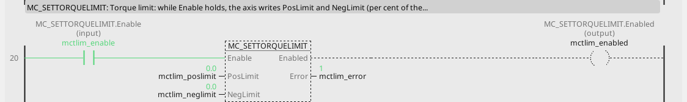
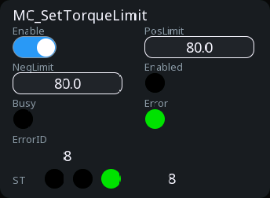

# MC_SetTorqueLimit

Holds the drive's torque limits every bus cycle.

{: .sb-center}

{: .sb-center}

## In Structured Text

```iecst
PROGRAM MC_SetTorqueLimit_ST
VAR mctlim : MC_SetTorqueLimit; END_VAR
  mctlim(AXIS := 0, Enable := mctlim_enable,
         PosLimit := mctlim_poslimit,
         NegLimit := mctlim_neglimit);
  mctlim_enabled_st := mctlim.Enabled;
  mctlim_busy_st := mctlim.Busy;
  mctlim_error_st := mctlim.Error;
  mctlim_errorid_st := mctlim.ErrorID;
END_PROGRAM
```

`AXIS` names the axis at the call - its number on the Motion node, the first axis
is 0; the compiler refuses a motion block without it. The same block sits on a
rung in LD and in a function block diagram with the axis in its properties.

## Where it runs

| Linux runtime | ESP32 boards | STM32 | EtherCAT | CANopen |
|:---:|:---:|:---:|:---:|:---:|
| yes | yes | - | yes | - |

**Needs:** a servo whose cyclic set carries the torque-limit words (objects 0x60E0 / 0x60E1 - the *Torque limits* PDO of a servo family travels beside the cyclic pair when the device is added from its description); without them ErrorID 8.

## Pins

| Pin | Kind | Type | Default | Meaning |
|:---|:---:|:---:|:---:|:---|
| `Enable` | input | bool | - | the block works while TRUE |
| `PosLimit` | input | number | - | the positive torque limit, in per cent of the rated torque |
| `NegLimit` | input | number | - | the negative torque limit, in per cent of the rated torque |
| `Enabled` | output | bool | - | the block holds its setting |
| `Busy` | output | bool | - | the command is taken and not finished |
| `Error` | output | bool | - | the command failed |
| `ErrorID` | output | integer | - | why it failed - the table below |

A project written before this library used the name `MC_SETTORQUELIMIT` for it; the old name
opens and builds as an alias.

## Error codes

`ErrorID` is one table for the whole library ([Motion blocks](blocks-motion.md));
this block answers these of it:

| ErrorID | When |
|:---:|:---|
| 1 | the axis is not bound to a drive |
| 8 | this drive cannot do it |

## Description

Our extension. Writes the positive and the negative torque limit (per cent of the
motor's rated torque) to the drive **every bus cycle** while `Enable` holds - the
classic tension control of a winder (the speed set a little above the line, the
torque limit is the tension), or a gentle approach against a mechanical stop.
Without the block the drive keeps its own limits, and the limits the drive had at
start are written back when `Enable` falls.

---

The library's rules - what every block answers, the axis's states, units and
time, the drives - are on [Motion blocks](blocks-motion.md).
