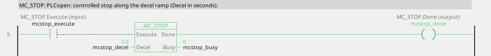
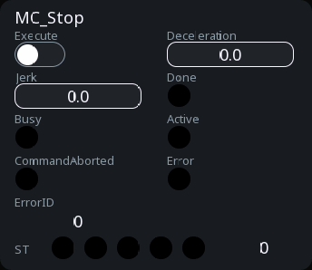

# MC_Stop

A controlled stop that holds the axis while Execute is TRUE.

{: .sb-center}

{: .sb-center}

## In Structured Text

```iecst
PROGRAM MC_Stop_ST
VAR mcstop : MC_Stop; END_VAR
  mcstop(AXIS := 0, Execute := mcstop_execute,
         Deceleration := mcstop_deceleration,
         Jerk := mcstop_jerk);
  mcstop_done_st := mcstop.Done;
  mcstop_busy_st := mcstop.Busy;
  mcstop_active_st := mcstop.Active;
  mcstop_commandaborted_st := mcstop.CommandAborted;
  mcstop_error_st := mcstop.Error;
  mcstop_errorid_st := mcstop.ErrorID;
END_PROGRAM
```

`AXIS` names the axis at the call - its number on the Motion node, the first axis
is 0; the compiler refuses a motion block without it. The same block sits on a
rung in LD and in a function block diagram with the axis in its properties.

## Where it runs

| Linux runtime | ESP32 boards | EtherCAT | CANopen |
|:---:|:---:|:---:|:---:|
| yes | yes | yes | yes |

**Needs:** any drive - a servo, a frequency drive, a stepper chip, the virtual master, the simulation.

## Pins

| Pin | Kind | Type | Default | Meaning |
|:---|:---:|:---:|:---:|:---|
| `Execute` | input | bool | - | starts the command on the rising edge; the outputs hold while it is TRUE and fall when it falls (or stay one cycle when it fell before the command ended) |
| `Deceleration` | parameter | number | 0 | the ramp, in velocity units per second; 0 = the axis's default |
| `Jerk` | parameter | number | 0 | the jerk limit, in acceleration units per second; 0 = none (a trapezoid) |
| `Done` | output | bool | - | the command reached its goal |
| `Busy` | output | bool | - | the command is taken and not finished |
| `Active` | output | bool | - | this command moves the axis now (a buffered one waits with `Busy` alone) |
| `CommandAborted` | output | bool | - | another command took the axis, or the axis was stopped |
| `Error` | output | bool | - | the command failed |
| `ErrorID` | output | integer | - | why it failed - the table below |

A project written before this library used the name `MC_STOP` for it; the old name
opens and builds as an alias.

## Error codes

`ErrorID` is one table for the whole library ([Motion blocks](blocks-motion.md));
this block answers these of it:

| ErrorID | When |
|:---:|:---|
| 1 | the axis is not bound to a drive |
| 2 | the axis is not powered - `MC_Power` first |
| 3 | the axis is in ErrorStop - acknowledge with `MC_Reset` |
| 15 | the command buffer is full |

## Description

Ramps the axis down at `Deceleration` and keeps it in **Stopping** while `Execute`
holds: every motion command is refused with ErrorID 4 until `Execute` falls, then
the axis is in Standstill. It is the controlled stop of a sequence - the end of a
cycle, a door opened - not an emergency stop: stopping over CANopen or EtherCAT is
not a safety function, and neither is this block (see Safety on the Motion page).

---

The library's rules - what every block answers, the axis's states, units and
time, the drives - are on [Motion blocks](blocks-motion.md).
