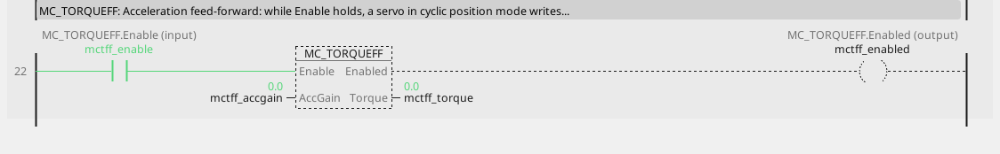
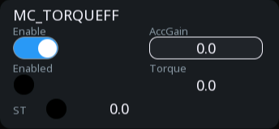

# MC_TorqueFF

The acceleration feed-forward of a servo in position mode.

{: .sb-center}

{: .sb-center}

## In Structured Text

```iecst
PROGRAM MC_TorqueFF_ST
VAR mctff : MC_TorqueFF; END_VAR
  mctff(AXIS := 0, Enable := mctff_enable,
        AccGain := mctff_accgain);
  mctff_enabled_st := mctff.Enabled;
  mctff_busy_st := mctff.Busy;
  mctff_error_st := mctff.Error;
  mctff_errorid_st := mctff.ErrorID;
  mctff_torque_st := mctff.Torque;
END_PROGRAM
```

`AXIS` names the axis at the call - its number on the Motion node, the first axis
is 0; the compiler refuses a motion block without it. The same block sits on a
rung in LD and in a function block diagram with the axis in its properties.

## Where it runs

| Linux runtime | ESP32 boards | EtherCAT | CANopen |
|:---:|:---:|:---:|:---:|
| yes | - | yes | - |

**Needs:** a servo whose cyclic set carries the torque offset word (object 0x60B2); a drive without it answers `Enabled` FALSE and ErrorID 8.

A board (ESP32) refuses the block at the build; a project for a Linux device
carries it. The STM32 runtime has no motion library.

## Pins

| Pin | Kind | Type | Default | Meaning |
|:---|:---:|:---:|:---:|:---|
| `Enable` | input | bool | - | the block works while TRUE |
| `AccGain` | input | number | - | per mille of the rated torque per revolution per second squared - the inertia behind the axis, found on the real axis |
| `Enabled` | output | bool | - | the block holds its setting |
| `Busy` | output | bool | - | the command is taken and not finished |
| `Error` | output | bool | - | the command failed |
| `ErrorID` | output | integer | - | why it failed - the table below |
| `Torque` | output | number | - | the offset in force, in per mille of the rated torque |

A project written before this library used the name `MC_TORQUEFF` for it; the old name
opens and builds as an alias.

## Error codes

`ErrorID` is one table for the whole library ([Motion blocks](blocks-motion.md));
this block answers these of it:

| ErrorID | When |
|:---:|:---|
| 1 | the axis is not bound to a drive |
| 8 | this drive cannot do it |
| 10 | the block is not on this runtime - a Linux block on a board |

## Description

Our extension. A position loop can only produce the torque a ramp needs by falling
behind first; the feed-forward hands the drive that torque up front - `AccGain`
times the acceleration the setpoint asks for - as the drive's torque offset, per
mille of the rated torque. That acceleration is exact where the setpoint is ours:
the axis's own ramp or move, or the master's through the ratio while the axis is
geared; a virtual master that reads an encoder measures it over a short window, so
the offset is quiet at constant speed. `AccGain` is per mille per revolution per
second squared and stands for the inertia behind the axis: found on the real axis
by watching the register through a ramp, never computed - a bare motor needs almost
none, a plate cylinder needs it. `Torque` shows the offset in force.

---

The library's rules - what every block answers, the axis's states, units and
time, the drives - are on [Motion blocks](blocks-motion.md).
