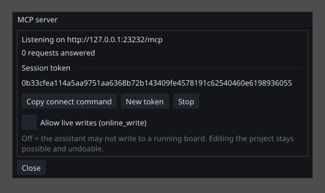

# The AI assistant (MCP server)

An AI assistant running on your computer — any client that speaks
**MCP** (the Model Context Protocol) — can join your
**running editor session**. It does not get a copy of your project or
a private workspace of its own: it works in the same window you are
looking at. It sees the project you have open, reads variables,
screens and program sources, runs the build and reads the same error
messages you do, and can make edits that appear **live in the editor**
— every one of them a single Ctrl+Z away.

That makes it useful for the real work, not just questions:

- *"Why does this project refuse to build?"* — the assistant runs the
  build and reads the refusal verbatim, including the limit numbers.
- *"Add the six variables from this data sheet and a screen to show
  them"* — the edits land in your open project, undoable.
- *"The panel is connected — what is the cycle time, and is anything
  in the diagnostic buffer?"* — it reads the same ONLINE session you
  see.
- *"Rewrite this ST program to use a TON instead of counting cycles"*
  — it reads the source, writes the new one, and builds to check.

## Starting it

*Tools → MCP server → Start*. Nothing listens until you do this.

{: .sb-center}

Then press **Copy connect command** and paste it where your assistant
registers MCP servers - a terminal or its settings. The line carries
the two things every client needs (the port and the token are your
session's own — always use the copied one):

```
transport: http    server: http://127.0.0.1:PORT/mcp
header:    Authorization: Bearer TOKEN
```

From that moment the assistant can reach the session. The dialog shows
a **request counter**, so you can watch it working, and three
controls:

| Control | What it does |
|---|---|
| **New token** | issues a fresh secret and cuts off every connected client at once |
| **Stop** | closes the server; nothing listens any more |
| **Allow live writes** | consent for writing values to a running board — off by default, forgotten when the editor closes |

For scripted use the editor also takes a `--mcp` flag: it starts the
server at launch — the same trust gesture as clicking Start — and
prints the address and token to the console. The token never touches a
file.

## What the assistant sees

The reading tools cover the whole session, and they are read-only:

| Tool | Answers |
|---|---|
| `project_info` | project name, target board, resolutions, and every limit with its current usage |
| `system_info` | the net32 system: devices, the active one, subscription links |
| `list_variables` | every variable — name, type, access, source, unit, comment |
| `list_screens` / `screen_info` | both screen sets (HMIview and WEBview) and each screen's widgets |
| `list_pous` / `pou_source` | the programs and their ST source — LD and FBD come as their ST rendering, because that text *is* what runs |
| `build` | builds exactly as F7 does; errors come back word for word |
| `device_info` | the connected board — link state, firmware version, program, cycle times |
| `online_read` | live values of named variables from the ONLINE session |
| `diag_read` | the board's diagnostic buffer |
| `deploy_status` | the upload's progress while a download runs |

## What the assistant can change

The writing tools are the same operations your own clicks perform —
no back door, no second path:

| Tool | What it does | What protects you |
|---|---|---|
| `edit_variable` | add or rename a variable | live in the editor, one Ctrl+Z away |
| `edit_pou_source` | replace an ST program's source | undoable; the build checks it |
| `online_write` | write ONE value to the running board | needs the *Allow live writes* consent; the program owns the value again next cycle |

Every change answers with what it changed, so the assistant's
transcript reads like the editor's own edit history.

**Forcing is deliberately not available to the assistant.** A force
holds a value against the running program — that is a commissioning
tool for a person standing at the equipment, and it stays that way.

## Safety in plain words

- **Off by default.** Nothing listens until you press Start, and Stop
  ends it.
- **This computer only.** The server binds to 127.0.0.1 and cannot be
  opened to the network — there is deliberately no such option.
- **A fresh secret each start.** Every request must carry the session
  token; *New token* revokes all of them instantly.
- **Writing to a running board needs your consent**, and the consent
  dies with the session.
- **The assistant is a guest.** It never switches the screen you are
  looking at on its own, and everything it edits is in your undo
  history.

## What it is not

- **Not remote control.** There is no network mode and no plan for
  one; an assistant on another computer cannot reach your editor.
- **Not an autonomous operator.** `online_write` exists for
  commissioning assistance next to a person; the consent toggle is
  that person's hand on it.
- **Not a separate AI service on the device.** The runtimes — panels
  and Linux devices alike — carry no AI interface of any kind. The
  editor session is the one place an assistant can connect, and it
  connects to *you*, not to the equipment.

## When something does not work

- **The connect command is refused** — the session token changed
  (every Start makes a new one). Copy the command again.
- **`online_write` answers "consent"** — tick *Allow live writes* in
  the dialog; it is off on purpose.
- **The request counter stays at zero** — the client is talking to a
  stale port. Stop, Start, copy the fresh command.
