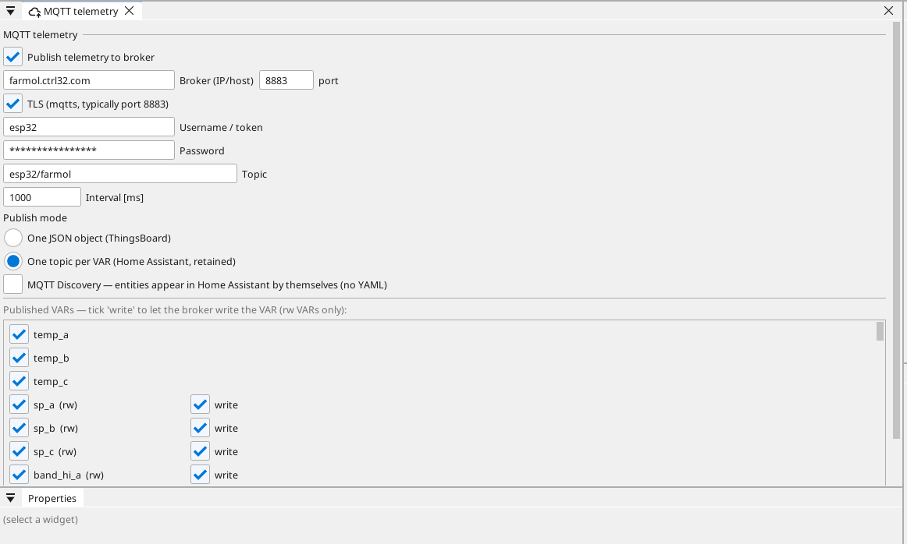

# MQTT telemetry in ctrl32

> **Home Assistant?** There is a page for that: [Home Assistant](home-assistant.md)
> takes you from nothing to working entities. What follows here is the
> mechanics underneath — start with that page unless you want them.
>
> The section on this page: [Home Assistant mode](#home-assistant-mode-one-topic-per-variable)
> — in that mode the board acts as a process data server (an
> [OPC UA](opcua.md) equivalent).

The board can push variable values to an **MQTT broker** — typically into
ThingsBoard or OpenRemote, where the customer builds charts, dashboards
and notifications. The board is a data source (gateway role), not a
historian: it sends the current state, the server keeps the history.

## How to switch it on

1. In the device tree, click the **MQTT** node — the whole
   configuration lives on the page that opens, nothing hides behind a
   dialog.
2. Tick *Publish telemetry to broker* and fill in the broker address
   and credentials.
3. In the variable list, tick the variables that should be sent.
4. *Apply* → *Download to board*. The configuration is part of the pack —
   changing the broker or the variable list **does not require new firmware**.

MQTT is part of every version, the free one included.

| Field | Meaning |
|:---|:---|
| broker | IP address or hostname (e.g. `192.168.0.10`) |
| port | 1883 plain, typically 8883 with TLS |
| TLS | encrypted connection to the broker — S3, P4 and STM32 (see below) |
| username / token | in ThingsBoard this is the **device access token** |
| password | for a generic broker; ThingsBoard does not need it |
| topic | base topic; default `v1/devices/me/telemetry` |
| interval | how often a message may be sent at most (default 5 s, min 1 s) |
| setTag commands | allows writes from the dashboard (see below) |

{: .sb-center}

## What the board sends

A flat JSON containing **only the values that changed** since the last
message goes out on the base topic:

```json
{"voltage_l1": 231.4, "contactor": true, "pieces": 1250}
```

- If nothing changed, **nothing is sent** — no pointless traffic.
- After connecting (including after an outage) the complete state is
  sent once, so the dashboard has everything.
- Decimal places follow the variable settings; `bool` goes out as
  `true`/`false`.
- The variable deadband filters noise — without it a noisy analog input
  would send messages forever.

## Commands from the dashboard (setTag)

If commands are enabled, the board listens on the ThingsBoard RPC topic
and accepts:

```json
{"method":"setTag","params":{"pieces":0}}
```

A write is a **command, not direct memory access** — the board executes
it only if the variable is among the published ones and has **rw** access.
Otherwise it answers with an error and writes nothing. The reply goes to
the topic `.../rpc/response/<id>`.

> Never use remote commands for safety functions. E-stop, limit
> switches and doors must be hard-wired.

## Security and limits

- **TLS is available on ESP32-S3, ESP32-P4 and STM32 boards** — see
  the section below. The classic ESP32 has no RAM for it and the editor refuses
  the option for such a board at your desk. Without TLS the broker
  must live on the **separate equipment network**, not on the
  internet.
- The WEBview pages themselves are always served without TLS — that
  rule is unchanged, whatever the broker connection does.
- The token and password are stored in the project pack in plain text.
- Published variable limit: **64**. The editor will not allow more.
- One broker per board.

## Encrypted connection (TLS)

Tick *TLS* and the board talks `mqtts` to the broker — the server
certificate is verified against a built-in bundle of public
certificate authorities (Let's Encrypt included), so a broker with an
ordinary public certificate works with no extra configuration.

Two things follow from how certificates work:

- **The board needs real time.** Certificate validity is checked
  against the clock, so a TLS project should keep NTP on (*Clock* →
  *NTP*). Until the first time sync lands, the connection simply
  retries — nothing breaks, it connects a few seconds later.
- **S3, P4 and STM32 only.** The classic ESP32 does not have the
  memory for a TLS session next to control and rendering; the editor
  tells you at your desk, not the board at the site.

## Changing the network on the board itself

A board with a display can be re-pointed **without the editor**: a
navigation button with the reserved target `sys_settings` (place it
on a protected screen) opens the system *Network settings* page —
WiFi network and password, broker address, port, TLS, credentials —
with an on-screen keyboard. *Save + restart* stores the values on the
board and reboots; the board then joins the new network and broker
while the project itself stays untouched. *Pack defaults* returns to
what the project says.

What is published — the variable list and the topics — always comes
from the project. The board decides *where* it runs, never *what* it
says.

## Watching the traffic on the board

A navigation button with the reserved target `sys_terminal` opens a
console straight on the display: every published message, everything
received, and the connection events, each with a timestamp. When a
dashboard shows nothing, this screen answers the first question — is
anything actually leaving the board? — without a laptop.

| Situation | Behaviour |
|:---|:---|
| Broker unreachable at startup | the board runs normally and connects in the background |
| Broker outage | one diagnostic event, repeated reconnection, the complete state is sent once it is back |
| Slow network | telemetry never extends the control cycle (it runs on the other core) |
| Pack without MQTT | the client never starts, no memory overhead |

## ThingsBoard step by step

1. *Devices* → *Add device*, copy the **Access token**.
2. In the editor: broker = the IP of the ThingsBoard server, username =
   the token, leave the topic at its default.
3. After the upload the values appear under *Latest telemetry* of the
   device.
4. A *Switch* or *Knob* widget in the dashboard → RPC method `setTag`,
   parameters `{"tag_name": value}`.

For OpenRemote or any other broker only the topic and the credentials
change — the message format is the same.

## ctrl32 telemetry (telemetry.digital)

[ctrl32 telemetry](https://telemetry.digital) is the free data platform
from the same author: measurements from devices, PLCs and gateways,
stored as verifiable records, with alarms, reports and a remote device
console. A ctrl32 device talks to it in its own *Publish mode*:

1. In ctrl32 telemetry: *Devices → New device*, an external id (say
   `panel-1`), *Issue token* — the token `c32d_…` shows once. Under the
   asset create a **datastream for every variable you will publish**,
   with the **same key as the variable name**, and assign the keys to
   the device (device page → *Datastreams*). A value whose key the
   device does not have is kept as a raw message and never reaches a
   chart.
2. In the editor: *Publish mode* → **ctrl32 telemetry**. Picked on an
   empty form it fills the platform's address (`telemetry.digital`,
   port 8883, TLS on); username = the external id, password = the
   token, leave the topic at its default. Tick the variables.
3. After the upload the device shows **connected** on the Devices page
   and the values arrive on the datastreams — every change at most
   once per interval, everything once after a reconnect.

What travels is one object per message, `{"ts": <UNIX seconds>, "v":
{"temp": 21.5, "run": true}}`; the time is sent only while the
device's clock is set (NTP or an RTC), otherwise the server stamps the
arrival. Commands from the platform are not supported in this version
— the *Allow setVar commands* switch has no effect here.

Two rules the platform imposes, both checked at your desk: a variable
name used as a key is lowercase letters, digits and `_` (a letter
first, 32 at most) — the build refuses a `Voltage_L1` and says so; and
TLS needs a board that has it (see *Encrypted connection*). A classic
ESP32 reaches a **local instance** of the platform on port 1883
without TLS (the platform's *intranet* profile), which is also the
road for a board with no internet access.

## Home Assistant mode (one topic per variable)

The MQTT settings let you switch the publish mode to **one topic per
variable**. The board then behaves as a process data server — the equivalent of
an [OPC UA server](opcua.md):

| What | Topic | Note |
|:---|:---:|:---|
| variable value | `<base>/<variable>` | **retained** — a new client gets the state immediately |
| write to a variable | `<base>/<variable>/set` | only variables with writing enabled |
| availability | `<base>/status` | `online` / `offline` (last will) |

For example, with the base topic `ctrl32/boilerroom` the temperature
goes to `ctrl32/boilerroom/temperature` and the setpoint is changed by
writing to `ctrl32/boilerroom/setpoint/set`.

### Why retained and last will

- **Retained**: after a restart, Home Assistant immediately receives the
  last value of every variable from the broker. Without it the entities would
  stay empty until a value on the equipment happened to change.
- **Last will (LWT)**: when the board drops out (network or power
  failure), the broker itself publishes `offline` and the entities in HA
  grey out. Without it HA would keep showing the last known value as if
  it were current — which is worse than no value at all.

### Enabling writes — per variable

Every published variable has its own **write** checkbox. It can only be
ticked for a variable that is `rw` in the project. Without it the board
**ignores** a write from the broker, even if somebody sends one. So the
project decides what the supervisory system may touch — not the
other way round.

### The fastest route: MQTT Discovery

In one-topic-per-variable mode the **MQTT Discovery** option is enabled. On
connect the board sends the broker a configuration for every entity and
Home Assistant creates them **by itself** — you write no YAML. All you
need is the MQTT integration set up in HA.

The entities are grouped under a single device, so you see the board in
HA as a whole with all its values underneath. The entity type follows
the variable:

| Variable | Entity in HA |
|:---|:---:|
| numeric, read-only | sensor with a unit |
| boolean, read-only | binary sensor |
| numeric, writable | number (`number`) |
| boolean, writable | switch (`switch`) |

The configuration is published as retained, so it survives a restart of
both HA and the broker. After a project change the entities update
themselves.

### Exporting the configuration (when you want YAML)

If you would rather keep the configuration under your own control
(version control, manual edits), turn Discovery off and use the export:

The *Export YAML for Home Assistant* button produces a file with one
entity per variable:

- numeric read-only variable → `sensor` (with a unit)
- boolean read-only variable → `binary_sensor`
- numeric writable variable → `number`
- boolean writable variable → `switch`

Paste the file into `configuration.yaml` (or pull it in with
`!include`) and restart HA. The ranges on `number` are deliberately
wide — narrow them down in HA to suit the equipment.

### Control stays on the board

The logic, the timers and the local buttons keep running **even when
Home Assistant is switched off, the network is dead and the broker is
unreachable**. MQTT is only a window to the outside. Verified by
measurement: with an unreachable broker the cycle runs at 24 µs with
zero overruns. That is why nothing on it stops while HA is
being updated.

The price of MQTT is roughly **12 kB of RAM** — and only when it is
enabled in the project.

### Ghosts after a project change

Retained messages stay on the broker even after a variable is renamed. Clear
the old topic with an empty retained message:

```
mosquitto_pub -h <broker> -t ctrl32/boilerroom/old_tag -r -n
```

## Typical pitfalls

| Pitfall | Fix |
|:---|:---|
| Nothing shows up in the dashboard | check the token (in ThingsBoard it goes into *username*, not the password) and whether the variable is ticked |
| Values arrive rarely | that is by design — only changes are sent; check the variable deadband |
| A command from the dashboard does nothing | the variable must be published **and** have rw access |
| Broker behind NAT or on the internet | not supported without TLS — the broker belongs on the equipment network |
