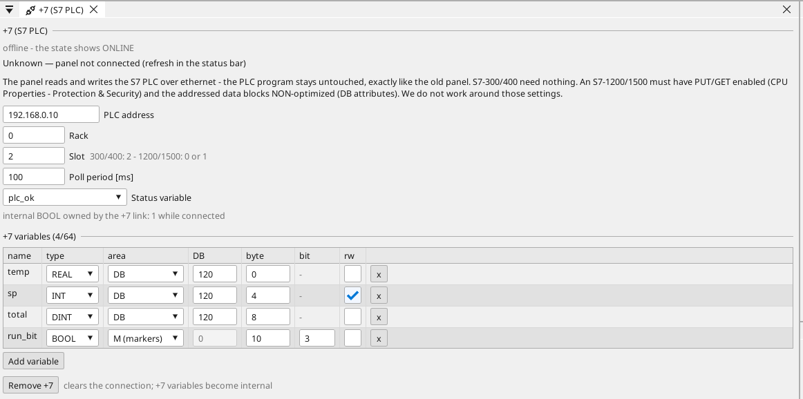

# +7 — connecting an S7 PLC

**+7** lets a ctrl32 panel replace the operator panel on an existing
S7 installation. The panel reads and writes the PLC's data over
ethernet — **the PLC program is not touched**, nothing is added to it,
no GSD files and no TIA project are needed. To the PLC the panel looks
exactly like the HMI it replaces: a client that asks for data blocks
and flag bytes.

The PLC keeps running the line; the panel only reads values and writes
setpoints and commands. The panel is always the subordinate side —
it never acts as an S7 server.

## Which PLCs

| PLC | What to set up |
|:---|:---|
| S7-300, S7-400 | nothing — it answers as delivered |
| S7-1200, S7-1500 | **PUT/GET** must be enabled (CPU Properties → Protection & Security) and the addressed data blocks must be **non-optimized** (DB attributes) |
| compatible CPUs (VIPA and similar) | same as the S7 family they mirror |

ctrl32 does not work around the S7-1200/1500 protection settings —
if PUT/GET is off, the connection is refused by the PLC and the +7
status shows it.

Older CPUs without an ethernet port (Profibus or MPI only) need an
ethernet gateway of the NetLink class; the panel then talks to the
gateway's IP.

## Which ctrl32 hardware

+7 needs a real ethernet interface: **ESP32-P4 boards, STM32 F7
boards and Linux devices**. Boards without one are refused when the
project is built, with the reason spelled out — the same rule you know
from MQTT TLS.

## How to switch it on

1. In the device tree, right-click the **Ethernet** interface and pick
   **Add +7 (S7 PLC)…** — the +7 page opens.
2. Fill in the PLC address, rack and slot:

    | CPU | rack | slot |
    |:---|:---|:---|
    | S7-300, S7-400 | 0 | 2 |
    | S7-1200, S7-1500 | 0 | 0 or 1 |

3. Pick the poll period (default 100 ms) and, if you want the link
   state on a screen, a **status variable** — an internal `bool` the
   link owns: 1 while connected.
4. Add the variables (below) and *Download to board*. The connection
   is part of the pack — changing the PLC address or the variable
   list **does not require new firmware**.

One PLC connection per project; up to **64** +7 variables.

{: .sb-center}

## Variables

A +7 variable is a normal project variable whose source is the PLC.
One thing to know up front: **variable names never travel over the
wire** — S7 communication carries addresses and bytes, the names live
in the TIA project. You name the panel's variables yourself (usually
the same names) and point each one at its address, exactly as the
original panel did. Each entry names the area, the byte offset and
the type:

| In the PLC | In the +7 table |
|:---|:---|
| `DB120.DBD0` as REAL | area **DB**, DB 120, byte 0, type REAL |
| `DB120.DBW4` as INT | area **DB**, DB 120, byte 4, type INT |
| `M10.3` | area **M**, byte 10, bit 3, type BOOL |

Types: **BOOL, INT, WORD, DINT, DWORD, REAL** — mapped onto the
matching ctrl32 variable types. A BOOL always addresses one bit
(0–7) of its byte; the other types never carry a bit.

- Analog values keep the usual **deadband** rule — without it a noisy
  value repaints the screen and floods WEBview forever.
- A variable marked **rw** is written back to the PLC when an operator
  changes it — a setpoint field or a command button works exactly as
  it did on the old panel.
- Everything else about the variable (unit, decimals, alarms, use in
  logic and on screens) works like any other variable.

## When the link drops

+7 is honest about its health:

- the **status variable** falls to 0 the moment the connection is
  lost, and every state change lands in the diagnostic buffer
  (`+7: connected`, `+7: link lost`);
- the panel reconnects on its own, backing off from 1 s up to 8 s
  between attempts — no traffic storm against a PLC that is off;
- after a reconnect the panel **reads before it writes**: an operator
  value entered during the outage is never pushed over the PLC's
  state, and a stale boot default can never overwrite a live setpoint;
- a data block that does not exist (wrong DB number, DB too short)
  flags only the variables that point into it — the rest keep
  polling, and the diagnostic buffer names the DB once.

## Good to know

- Writes from the panel are ordinary data writes — the PLC program
  remains the authority and can overwrite them on its next cycle,
  exactly as with the original panel.
- Stopping equipment over +7 is **not a safety function**. E-stop
  stays hard-wired; the S7's own protection concepts stay in place.
- The poll period is shared by all +7 variables; reads are grouped
  into as few requests as the PLC's answer size allows, so 64
  variables typically cost a handful of requests per period.

---

The short overview — what connects, what you need and where it does not
belong — lives at [ctrl32.com/siemens-s7](https://ctrl32.com/siemens-s7/).
