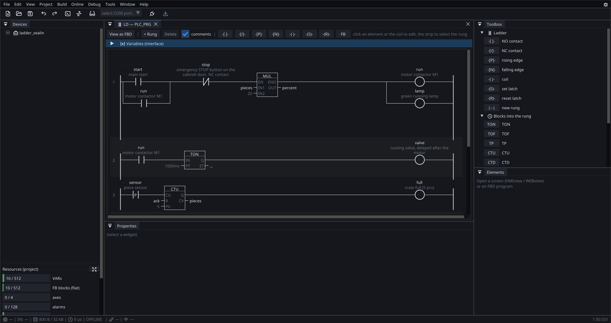
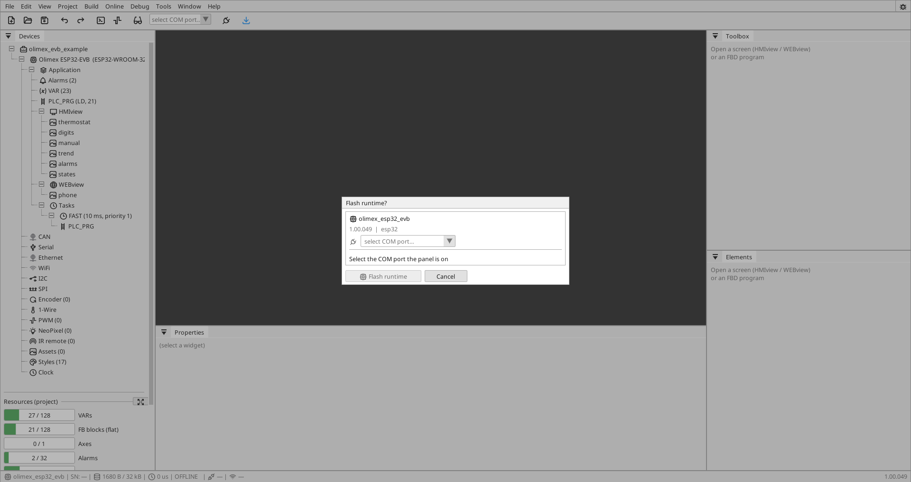

# Quick start

The goal of this chapter: **from an installed editor to a program running in
the board.** It takes a few minutes and needs nothing but the board, a USB
cable and a PC.

## 1. Installation

Run the installer `ctrl32-setup-<version>.exe`. It installs:

| File | What it is for |
|:---|:---|
| `visu_editor.exe` | the editor itself |
| `ctrl32.dat` | the catalog of boards and chips |
| `runtimes\` | prebuilt firmware for every supported board |
| `examples\` | sample projects to open |

!!! note "Why there is only one program"
    The ST compiler, the pack builder and the flasher are **compiled into
    the editor** — there is no helper process to be missing, moved or a
    version behind. The pack format has a single author, so the pack the
    editor builds is byte for byte the one our own release tools build.

## 2. Open a sample project

*File → Open* and pick something. There are two folders, and the
difference is size: `tutorials\` holds one idea per project, `examples\`
holds whole working projects. Good places to start:

- `tutorials\ladder_sealin.yaml` — the classic seal-in circuit: a start
  button that latches through the contact it energised,
- `tutorials\time_setpoint.yaml` — a TIME setpoint the operator types on
  the screen, driving a timer's PT,
- `examples\tm8_6_proofer.yaml` — a three-zone proofing cabinet: PT100
  probes, SSR heaters, hysteresis instead of on/off chatter, and the
  whole operator interface in WEBview,
- `examples\tubex_panel.yaml` — a real board with Ethernet, a Modbus
  slave and NeoPixel LEDs.

## 3. Pick the board

Click the board node in the project tree. The board decides the pins, the
memory and which runtime is flashed into it — a project cannot be deployed
without one.

## 4. Flash the runtime (the first time)

If the board is new or carries old firmware, the board page has *Flash
runtime*. The editor writes it over USB itself, reads the flash back to
verify it, and refuses a chip that does not match the board — a wrong
COM port cannot be written. It takes tens of seconds.

!!! warning "An old runtime means the program will not load"
    The pack format evolves. If the runtime is older than the pack, the board
    refuses it and the editor shows an error. The fix is always the same:
    **flash the runtime**.

## 5. Download the program

Pick the COM port in the toolbar and click the blue :ti-download: icon (*Download to
board*). The editor builds the project and uploads it. What happens
underneath:

1. the project is built into a binary pack,
2. the pack goes into the **inactive slot** in the board,
3. the board verifies the CRC, the format and the target board,
4. **only then** does it switch the active slot and restart.

That is why downloading cannot brick the board: when anything is wrong, the
old pack stays and keeps running.

!!! note "No port is preselected"
    The port selector starts empty, and both transfer dialogs ask for it at
    the moment bytes are about to move. A port nobody chose reads as
    "configured", and the first sign that it was not would be a download
    going nowhere.

## 6. Watch what it is doing

Next to the port there is a plug icon — *ONLINE*. Switched on, the editor
shows **live values straight from the board**: in the ladder rungs, on block
pins, in the variable list and in the screen preview.

There is one condition: **the editor and the board must run the same
program**. If they do not, the editor says so and offers to download it —
more in [Online monitoring](online.md).

## What next

- [Editor](editor.md) — how it is laid out and what is where
- [Variables](variables.md) — variables, types, deadband and where values come from
- [Ladder](ladder.md) — drawing rungs
- [Download to the board](deploy.md) — dual slot, runtime, what is verified when
