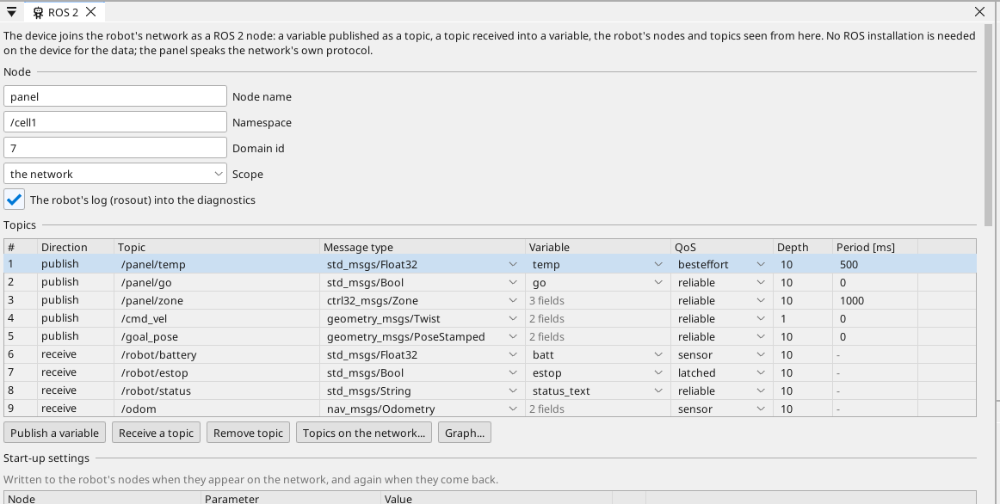
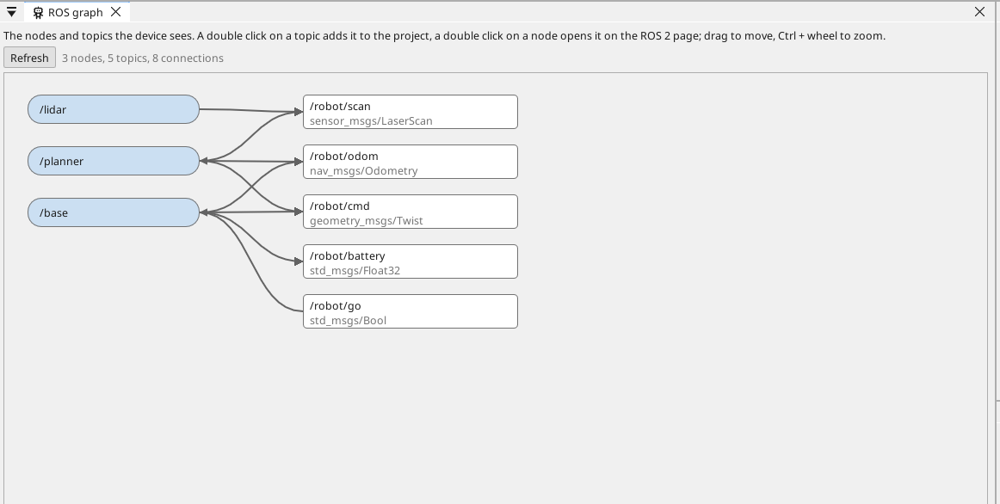

# ROS 2

A Linux device joins the robot's network as a ROS 2 node. A variable of
the project is published as a topic, a topic of the robot is received
into a variable, and the nodes and topics on the network are seen from
the editor. Nothing of ROS has to be installed on the device for this:
the device speaks the network's own protocol.

What it is for: a robot cell where the planning and the perception run on
ROS and the operator panel, the I/O, the drives and the logic run on
ctrl32; a mobile robot whose navigation runs on ROS and whose display,
diagnostics and drives run here; a camera and a detector on the robot's
side and the result on your screen. Every element of a screen works on a
topic the moment the topic is a variable - a button publishes, a value
shows, a trend draws, an alarm fires.

{: .sb-center}

## Joining the network

In the tree of a Linux device, open the context menu of **ROS 2** and pick
**Add ROS 2...**; the page opens. The page's first section is the node:

| Field | Meaning |
|:---|:---|
| **Node name** | The device's name on the network - letters, digits and `_` |
| **Namespace** | Optional. A topic written without a leading `/` is resolved under it |
| **Domain id** | The network's domain, 0 to 232. Every node of one robot shares one |
| **Scope** | **the network** - every device of the LAN; **this device only** - the nodes on this device |
| **The robot's log** | Warnings and errors of the robot's nodes land in the diagnostic buffer |

## Topics

| Column | Meaning |
|:---|:---|
| **Direction** | **publish** - the device sends; **receive** - the device takes |
| **Topic** | The topic's name, `/panel/temp` |
| **Message type** | The message the topic carries, `std_msgs/Float32`, `geometry_msgs/Twist`, ... - the standard types are in the list |
| **Variable** | For a scalar message (`std_msgs/Bool`, `Int32`, `Float32`, `String`, ...): the one variable that is the message |
| **QoS** | `reliable` (every sample arrives), `besteffort` (the latest matters), `sensor` (a stream of readings), `latched` (a late joiner gets the last sample) |
| **Depth** | How many samples the network keeps for a slow reader |
| **Period [ms]** | A published topic: 0 sends on every change of the variable, a number sends on that period |

**Publish a variable** and **Receive a topic** add a row; **Remove topic**
takes the selected one out. A project carries up to 256 topics.

### Fields of a composite message

A message with more than one value - a `Twist`, an `Odometry`, a
`JointState` - maps its scalars to variables one by one. Select the topic
and its fields show under it:

```
linear.x
angular.z
pose.pose.position.x
name[0]
```

A field names a path into the message - a dot between the parts, an
element of a list by its index in brackets, counted from 0 - and the
variable it goes to. A published message carries the type's zeros in the
fields the project does not name; a received message fills the variables
the project names and leaves the rest. A path that is not a scalar of the
type is said under the field.

### Topics on the network

**Topics on the network...** asks the connected device what it sees: every
topic, its type and how many publish and receive it. A click on one makes
the row - a topic somebody publishes becomes one to receive, a topic
nobody publishes becomes one to publish.

## Start-up settings

The robot's nodes are set from the project. The section lists the
**parameters** the device writes to a node when the node appears on the
network - a node, a parameter name and its value - and the **lifecycle
target** of a node: `unconfigured`, `inactive`, `active` or `finalized`.
The device walks a node to its target one transition at a time. Both are
done again whenever the node comes back; a refused parameter or transition
lands in the diagnostic buffer with the node's own reason.

A value is written in the parameter's own type: `0.5`, `20`, `true`,
`hello`, a list as `[1, 2, 3]`. A text with spaces is one value.

## Nodes on the network

**Read nodes...** asks the connected device for the nodes it sees. Pick
one and its card opens:

- **Read parameters** lists the node's parameters with their types and
  values. Enter in a value writes it to the node at once; **At start-up**
  keeps the value in the project, so the node gets it on every start.
- **Read state** shows a lifecycle node's state; **Configure**,
  **Activate**, **Deactivate**, **Clean up** and **Shut down** send the
  transition and show the state after it. A node without a lifecycle says
  so. **Target at start-up** puts the state into the project.

## The graph

**Graph...** opens the network as a picture: the nodes the device sees as
pills, the topics between them as boxes with their types, a line from a
node into every topic it publishes and from a topic into every node that
receives it. **Refresh** asks the device again. A double click on a topic
adds it to the project the way **Topics on the network** does; a double
click on a node opens it on the ROS 2 page with its parameters and its
lifecycle. Drag a block to move it, Ctrl and the wheel to zoom, the wheel
to pan, Home to see everything.

{: .sb-center}

## Launch

Where ROS is installed on the device itself, the device starts the
project's **launch** entries - a package, a launch file and its arguments
(`use_sim_time:=false`) - when it starts, and starts an entry again five
seconds after it ends. Online, the row shows **running**, **stopped** or
how many times it ended; **Start** and **Stop** act on the device; **Output
to Messages** brings the entries' output into the Messages pane. A device
without ROS skips the entries and says so once.

## Images and diagnostics

A camera of the project can be **published** as a JPEG image topic
(`sensor_msgs/CompressedImage`) at a frame rate of its own - the robot's
tools show the panel's camera. The other way, a camera whose device is
**ROS 2 image topic** on the Cameras page shows an image topic of the
robot: its camera element on the screen and in the browser draws the
robot's pictures, and a vision program can run on them. The
**Diagnostics topic** publishes the panel's alarms the way ROS tools read
them: one status for the device and one for every active alarm, its
level from the alarm's priority, its name from the variable, its message
the alarm's text.

The **map** element of the Toolbox (the Display group) shows the robot's
map: the occupancy grid of its **Map topic** (`nav_msgs/OccupancyGrid`)
fills the element with the aspect kept - free cells light, occupied dark,
unknown grey - and the planned path of its **Path topic** (`nav_msgs/Path`)
is drawn over it. Its variables are listed by **role**: `x`, `y` and `yaw`
place the robot on the map (the pose received from `/odom` or
`/amcl_pose` by fields), `goal_x`, `goal_y` and `goal` take a goal - a tap
on the map marks the point, a second tap on it writes the point's world
coordinates into `goal_x` and `goal_y` and flips `goal`; published as a
`geometry_msgs/PoseStamped` by fields it is the robot's goal. The element
works on the device's glass and in the browser alike; a project on a
device without the ROS 2 node shows the map's topic name in its place.

## Actions

A robot's longer tasks - drive to a pose, spin, dock - are ROS 2
**actions**: a goal is sent, feedback comes while it runs, a result ends
it, and it can be canceled. The **Actions** section lists the actions the
device sends as a client: the action's name (`/navigate_to_pose`), its
type (the navigation stack's `NavigateToPose`, `Spin`, `FollowPath`,
`DockRobot` and the others are in the type list) and its **status
variable** - a number that is the command and the state in one:

| Value | Meaning |
|---|---|
| 1 | send the goal (a button or the program writes it) |
| 2 | the robot is executing it |
| 3 | cancel it (written while 1 or 2); the robot is canceling |
| 4 / 5 / 6 | the result: succeeded / canceled / aborted |
| 7 | the robot's server rejected the goal |
| 8 | no action server on the network |

The selected action's **fields** map its parts to variables the way a
topic's fields do: `goal.<field>` is sent FROM a variable (the map's
`goal_x` into `goal.pose.pose.position.x`), `feedback.<field>` and
`result.<field>` are written INTO one (`feedback.distance_remaining`
into a value on the screen). A goal's time stamp and frame (`map`) are
filled in by the device unless a field sets them.

A **button** in mode `ros_action` (its *ROS 2 action* field in the
Properties names the action) binds the status variable: a press sends
the goal, a press while it runs cancels it, and the face shows the status
word under the caption - filled with the accent colour while the goal is
on its way, with *text when ON* as the caption ("Cancel"). The program
may write the same variable, so a goal can start from logic too; an alarm
on the variable's value 6 says when the robot gave up.

## Your own messages

A robot usually has messages of its own beside the standard ones. The
**Own message types** section lists them: **Import** reads a `.msg`,
`.srv` or `.action` file as the robot's workspace has it (the package is
the folder two above the file, `my_robot_msgs/msg/Zone.msg`) - a service
file makes its request and response, an action file the eight types an
action is made of; or a type is written by hand as `name:type` pairs. A
field's type is a ROS primitive (`float32`, `string`, `string<=16` ...),
a standard type (`geometry_msgs/Point`) or an own type listed above it,
each with an optional `[]` (a sequence), `[N]` (a fixed array) or `[<=N]`
(a bounded sequence). Constants and default values of a file are read
past - the layout is its fields, and an own type's fields start at zero.

An own type is then published, received or sent as an action like a
standard one: it appears in the type list of the Topics and Actions
sections, its fields take variables, and the device announces it on the
network under its name (`my_robot_msgs/msg/Zone`), so the robot's nodes
built from the same file read it. The layout travels in the project; the
device needs no installation of the package.

## What the device shows

The device's INFO line carries `ros=<ok>,<pubs>,<subs>,<nodes>`: whether
the node is on the network, how many topics it publishes and receives,
and how many ROS nodes it sees (itself included); `ros_distro=<name>`
names the ROS installation on the device when there is one. The
diagnostic buffer notes a sample the device could not read, a topic whose
type is not in the table, every start-up parameter written or refused, a
lifecycle target reached or refused, and a launch entry that started or
ended.

From a computer with ROS 2 the device is an ordinary node:

```
ros2 node list
ros2 topic list
ros2 topic echo /panel/temp
ros2 topic pub /robot/estop std_msgs/msg/Bool "{data: true}"
ros2 param get /talker greeting
ros2 action list
```

## Limits

- The bridge runs on the Linux runtime. A project on another device is
  refused at the desk by name; such a device reaches the robot through
  net32 and a Linux device.
- A received value is a command, like a button's: a variable the program
  also writes is the program's again next cycle.
- QoS is matched by the network, not by the device: a topic published as
  **besteffort** or **sensor** is never received by a subscriber that asks
  for reliable delivery - and the robot's own tools subscribe reliably by
  default. Publish **reliable** what the robot must see; keep best effort
  for a fast stream a late sample of which is worthless.
- A device on WiFi may see the robot late - discovery travels as
  multicast. Where the robot and the device share one computer, the scope
  **this device only** needs no network at all.
- Parameters and lifecycle travel as services. The device speaks to a
  node whatever middleware the node runs; one request is in flight at a
  time, so a node that answers slowly is read in turn.
