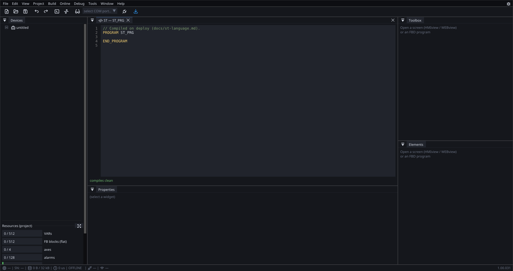

# Structured Text on ctrl32

The board executes logic written in IEC 61131-3 Structured Text. The
editor compiles the source at your desk; the pack carries the
compiled program and the board runs it in the PLC cycle —
**uploading a new program never reflashes the firmware**, exactly like
uploading new screens.

{: .sb-center}

The FBD blocks and the ST program run in the same task, in this order:
FBD first, then ST. A variable the FBD wrote in this cycle is already
visible to the ST body (and the other way round next cycle) — the same
"written this cycle reads live" rule PLC programmers expect.

## The subset

**POUs**: `PROGRAM` (one per project), `FUNCTION_BLOCK` (your own
blocks with instance state), `FUNCTION` (stateless, returns through
its own name).

**Sections**: `VAR`, `VAR_INPUT`, `VAR_OUTPUT`, `VAR_TEMP` … `END_VAR`.
A name that is not declared in the POU resolves against the project's
variable lists (VAR/RVAR) — variables behave as globals, case-insensitively.

**Types**: `BOOL`, `INT`/`DINT` (32-bit), `REAL` (float), `TIME`
(milliseconds), `STRING(N)` (bounded text, 1..250 bytes, default 32).
`INT` widens to `REAL` silently; `REAL` never narrows silently —
write `TRUNC(x)` or `REAL_TO_INT(x)`. `INT` and `TIME` convert freely
(a `TIME` is milliseconds).

**Statements**: assignment `:=`, `IF/ELSIF/ELSE`, `CASE` (values,
lists, ranges `4..6`), `FOR/TO/BY`, `WHILE`, `REPEAT/UNTIL`, `EXIT`,
`RETURN`. FB invocation with named parameters:

```iecst
t1(IN := start, PT := T#500ms);
lamp := t1.Q;
```

**Literals**: `TRUE/FALSE`, `123`, `16#FF`, `2#1010`, `1.5`,
`T#1m30s500ms`, typed `INT#5`. Comments `(* ... *)` and `// to eol`.

**Bits**: a constant bit of an integer variable or local is addressable
directly — `IF status.5 THEN`, `mask.0 := ready;`. Read as a `BOOL`,
written atomically (a concurrent writer of another bit or of the
whole word never loses its update). The index must fit the declared
width (0–15 on a 16-bit variable, 0–31 on 32-bit); `REAL`, `TIME` and
bools have no bits and are refused at build time.

**Bitwise**: on integers, `AND`/`OR`/`XOR`/`NOT` are bitwise (on
`BOOL`s they stay logic, and mixing the two is refused); `SHL(x, n)`
and `SHR(x, n)` shift logically — a count of 32 or more yields 0.
The same six exist as functions: `r := OR(SHL(1, 2), SHL(1, 5));`
lights bits 2 and 5.

**Time**: `NOW()` returns the cycle's monotonic milliseconds. All four
comparisons work on `TIME` (`IF t1.ET > T#500ms THEN ...`), and they are
**unsigned** — a setup that is never switched off passes 2^31 ms
(24.8 days), where a signed compare would call its uptime negative.
Never count cycles: the cycle period may jitter, milliseconds do not.

A duration is written `T#…` or `TIME#…` with segments in `d h m s ms`,
most significant first, and underscores as separators — `T#1s500ms`,
`TIME#1h_30m`, `T#25h` (the leading segment may overflow its unit).

A `TIME` **variable** is the same value with a face: the board shows and the
keypad edits it in the variable's unit (`s`, `ms`, `min`), so an operator can
set the equipment's delay on the screen and the program takes it straight as
`t1(PT := delay)`. See [Variables](variables.md).

**Standard functions**: `ABS MIN MAX LIMIT SEL TRUNC`, the
conversions above, and the string set below.

## Your own function block

The classic on-delay written from scratch — if you can read this, you
can write ctrl32 blocks:

```iecst
FUNCTION_BLOCK MY_TON
VAR_INPUT  IN : BOOL; PT : TIME; END_VAR
VAR_OUTPUT Q  : BOOL; ET : TIME; END_VAR
VAR  running : BOOL; t0 : TIME; END_VAR
  IF IN AND NOT running THEN t0 := NOW(); running := TRUE; END_IF
  IF NOT IN THEN running := FALSE; Q := FALSE; ET := T#0s; END_IF
  IF running THEN
    ET := NOW() - t0;
    IF ET >= PT THEN Q := TRUE; ET := PT; END_IF
  END_IF
END_FUNCTION_BLOCK
```

Instances are allocated at compile time — the editor knows the RAM
consumption before the upload and rejects a program over the limits
(32 kB compiled program, 8 kB instance data) at your desk, not on the
equipment.

## What the compiler refuses (on purpose)

- recursion and call chains deeper than 8 — checked at compile time
- two declarations differing only in case — identifiers are
  case-insensitive per the norm
- `REAL` into an integer without `TRUNC`/`REAL_TO_INT`
- pointers, OOP, 64-bit types, `WSTRING` — not in this version; the
  message names the reason, never a cryptic parse error

## Runtime safety

A broken program (division by zero, an endless loop) FAULTS: it stops
with a diagnostic entry and the board keeps running — HMI, WEBview,
communication and the other logic are untouched. The fault stays until
a new pack or a restart.

## Strings — bounded STRING(N)

A string variable declares its capacity: `s : STRING(32);`. The
buffer lives in the statically proven instance area — no heap, ever.
Assignments and `CONCAT` **clamp** to the destination capacity instead
of overflowing; comparing with `=` / `<>` compares content. The parser
toolkit of the norm is in:

```iecst
cmd := CONCAT('SET:', INT_TO_STRING(setp));
at  := FIND(cmd, ':');            (* 1-based, 0 = not found *)
verb := LEFT(cmd, at - 1);
num  := MID(cmd, LEN(cmd) - at, at + 1);   (* MID(IN, L, P) *)
val  := STRING_TO_INT(num);
```

`LEN LEFT RIGHT MID FIND CONCAT STRING_TO_INT INT_TO_STRING` — plus
literals with the norm's `$` escapes (`$$`, `$'`, `$L`, `$N`, `$R`,
`$T`, `$P`). This is the barcode-reader / SMS-command motif; the
ingress blocks that feed real reader and modem text into these
buffers arrive with the modem service.

A `FUNCTION` may take `STRING(N)` parameters and return a `STRING`
(the return capacity is the norm default, 32).

## Messages (string literals in SMS_SEND)

The literal in `SMS_SEND('text', n)` is stored once in the pack
(localizable) and the running cycle handles only its number — same
queue and hook as the FBD block.

## Receiving SMS commands (SMS_RECV)

`SMS_RECV(from, text)` pops one received SMS into two `STRING`
variables and returns `BOOL` — call it each cycle and parse:

```iecst
IF SMS_RECV(from, txt) THEN
  IF LEFT(txt, 4) = 'SET:' THEN
    setp := STRING_TO_INT(RIGHT(txt, LEN(txt) - 4));
  END_IF
END_IF
```

Only texts from the project's configured numbers ever reach the
program — everything else is dropped (and counted in diagnostics)
before the logic sees it. An SMS is a **command**: the program
decides what it may change. Without a modem (PC simulation) the call
simply returns FALSE.

## The serial line port (SERIAL_RECV / SERIAL_SEND)

A project may claim one spare UART as a **universal line port**
(`serial:` — pins, baud, terminator, max line length). Barcode
readers, scales, label printers — anything that talks in
terminator-ended ASCII lines:

```iecst
IF SERIAL_RECV(line) THEN          (* one framed line per call *)
  pieces := STRING_TO_INT(line);
  SERIAL_SEND(CONCAT('ACK ', line)); (* terminator appended *)
END_IF
```

`SERIAL_RECV` wants a `STRING` variable; `SERIAL_SEND` takes any
`STRING` expression and returns FALSE while the previous line is
still leaving (one line in flight — the cycle never blocks on the
UART). Overlong lines and queue overflows are dropped and counted,
never truncated into plausible-looking garbage.

One budget note: the board has three UART controllers — console,
RS485 and the modem/GPS already claim them all. The line port runs
where one is free; a project combining RS485, a modem AND a line
port does not fit on the S3 generation (the diagnostics say so
plainly).

## Notes the norm-lawyers will want

- `REPEAT body UNTIL condition END_REPEAT` — no semicolon after the
  condition (the norm's syntax; a stray semicolon gets a hint)
- comments do not nest in this version
- `AND`/`OR` evaluate both sides (no short-circuit) — keep side
  effects out of conditions
