# Hot tank

A complete, working control system for a **hot tank in cosmetics
production** — a three-zone heated bath of the kind that keeps
creams, emulsions and oils at their working temperature. One board
sits at the tank: it measures three PT100 probes, one per heating
zone, and switches three SSR heater outputs. A touch panel operates
it, a phone mirrors it, and an MQTT uplink reports the whole tank to
a SCADA anywhere in the world. The two boards find each other over
their own WiFi — no router, no plant infrastructure required — and
everything an operator or an integrator needs to know is on this
page: every screen, every state, every mode, every setting, every
protection and the measured cost of all of it.

The projects are installed with the editor in `examples\wifi_pair`:

| | inoCORE32-TM8.6 — at the tank | stepHMI32.4 — at the operator |
|:---|:---|:---|
| Role | measures, regulates, owns the heaters, raises the WiFi, reports to SCADA | displays, commands, holds the settings pages |
| Processor | ESP32-PICO-V3-02, 2× 240 MHz | ESP32-S3, 2× 240 MHz |
| Memory | 8 MB flash, 2 MB PSRAM | 16 MB flash, 8 MB PSRAM |
| Display | none — WEBview to a phone | 4,3" 480×272, SSD1963, capacitive touch |
| Process I/O | 3× MAX31865 (PT100), 3× SSR 240 V/16 A | — |
| Buses | WiFi (AP + uplink), CAN, RS485, SPI | WiFi, CAN, RS485 |
| Project file | `tm8_6_wifi_zones.prj32` | `stephmi_wifi_panel.prj32` |

!!! note "The design rule underneath everything"
    The zone board **owns its outputs**. The panel asks — a setpoint,
    a manual command, a mode — and the zone board decides, with its
    own interlocks, its own thermostat and its own link watchdog. If
    the panel disappears, the process side fails to a safe state on
    its own. Every behaviour described below follows from this split.

---

## How the two boards talk

The zone board raises its own access point (`ctrl32-zones`), and the
panel joins it as a station. The AP side of an ESP32 network is
always **192.168.4.1**, which is why the process board hosts: the
address the panel polls can never go stale. Over that link runs
Modbus TCP — the panel reads the temperatures and states ten times a
second and writes settings and commands the moment they change.

The zone board's radio wears two hats at once (`mode: apsta`): the
same chip that hosts the pair's private network also joins the plant
WiFi as a station. That uplink carries the [MQTT reporting](#scada-over-mqtt)
— and nothing else depends on it: unplug the plant network and the
tank, the panel and every protection keep running exactly as before.

Two heartbeats ride along:

- the zone board blinks `beat` twice a second — the panel's **Link
  lamp** shows it directly. A blinking lamp *is* the proof that data
  is flowing; a frozen lamp says it is not. No extra logic is
  involved, staleness shows itself.
- the panel blinks `panel_beat` back. On the zone board every edge
  of that blink retriggers a 3-second watchdog — **three seconds of
  silence and every heater drops**, whatever the last command said.
  Commands, mode and settings survive the outage, so normal
  operation resumes by itself when the panel returns.

---

## The five thermostat variables

One zone's thermostat is five whole-degree variables (the logic is
[ladder](ladder.md)). Everything except the setpoint is an **offset
from it** — change the setpoint and the whole ladder of lines moves
with it:

| Variable | Meaning | Default |
|:---|:---|:---:|
| **Setpoint** | the temperature the zone should hold | 20 °C |
| **Band +** | heat switches OFF at *setpoint + Band+* | 5 |
| **Band −** | heat switches ON at *setpoint − Band−* | 5 |
| **Alarm +** | high alarm at *setpoint + Alarm+* | 20 |
| **Alarm −** | low alarm at *setpoint − Alarm−* | 10 |

With the defaults and a setpoint of 20 °C, the ladder for a zone
reads:

| Line | Where | What happens there |
|:---:|:---:|:---|
| 40 °C | setpoint + 20 | **high alarm** — the control has failed upward |
| 25 °C | setpoint + 5 | heat OFF — top of the control band |
| **20 °C** | setpoint | the set temperature |
| 15 °C | setpoint − 5 | heat ON — bottom of the control band |
| 10 °C | setpoint − 10 | **low alarm** — the control has failed downward |

The temperature therefore cycles between 15 and 25 °C in normal
automatic operation, and the alarm lines sit deliberately **outside**
that band: an alarm never fires because the control is cycling, only
because it has genuinely lost the zone.

All fifteen variables (five per zone) are set on the panel's
protected Settings page; the setpoint alone is also editable right on
the Home page, because it is the everyday knob. The zone board
**persists all of them** — a power cut changes nothing.

---

## Operating modes

The system has one global mode, switched on the protected Settings
page and remembered across power cuts.

### AUTO

Each zone runs an independent on/off thermostat across its band:
the heater switches ON when the temperature falls under
*setpoint − Band−* and OFF when it rises over *setpoint + Band+*.
One comparator with hysteresis per zone is the whole controller —
there is nothing to tune, the band *is* the behaviour. The Home
cards show **AUTO** where the manual switches would be.

### MANUAL

The operator drives the heaters directly: toggle switches appear on
the Home cards and each one commands its zone's output. This mode
exists for commissioning and service, and that is exactly why the
switches are **invisible in AUTO** — nobody can flip a heater in
passing, because the control that would do it is not on the glass at
all. Entering manual requires the access code (the mode switch lives
behind it).

### What no mode can override

Three gates sit between *any* request and a physical heater, in both
modes:

1. **The probe interlock** — a zone whose sensor reads like a broken
   PT100 (below 2 °C, the signature of a loose or shorted probe)
   refuses to heat, whatever asks.
2. **The link watchdog** — if the panel stops blinking for 3
   seconds, every heater drops. Manual commands included: a manual
   heater with a dead display is nobody's definition of supervised.
3. **The alarm engine** never switches anything — it reports. The
   heaters are governed only by the gates above.

---

## The screens

Four pages, reached by the bar at the bottom — the same four buttons
everywhere, in a fixed order: **Home, Trend, Alarms, Setup**. The
Setup button always leads through the access-code page.

The right-hand end of the title row on every page is reserved for
the **connection banner**: invisible while the link lives, and a red
strip with a yellow **!** and *TM8.6 not connected* the moment the
watchdog declares it dead.

### Home

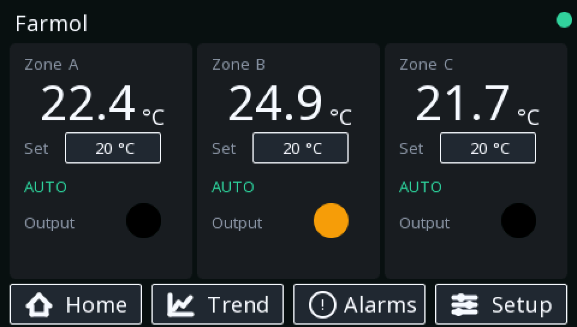{: .sb-center}

One card per zone:

| Element | Meaning |
|:---|:---|
| large number | the **current** temperature, one decimal |
| **Set** field | the setpoint — touch it and a keypad opens; the new value is on the zone board within a poll cycle and persists there |
| **AUTO** badge / switch | in AUTO the badge; in MANUAL the command switch (below) |
| **Output** lamp | the REAL state of the SSR output, read back from the zone board — not the wish, the fact |
| link dot (top right, after the banner strip) | blinks with the zone board's heartbeat; frozen = link down |

In MANUAL the badge gives way to the command switch:

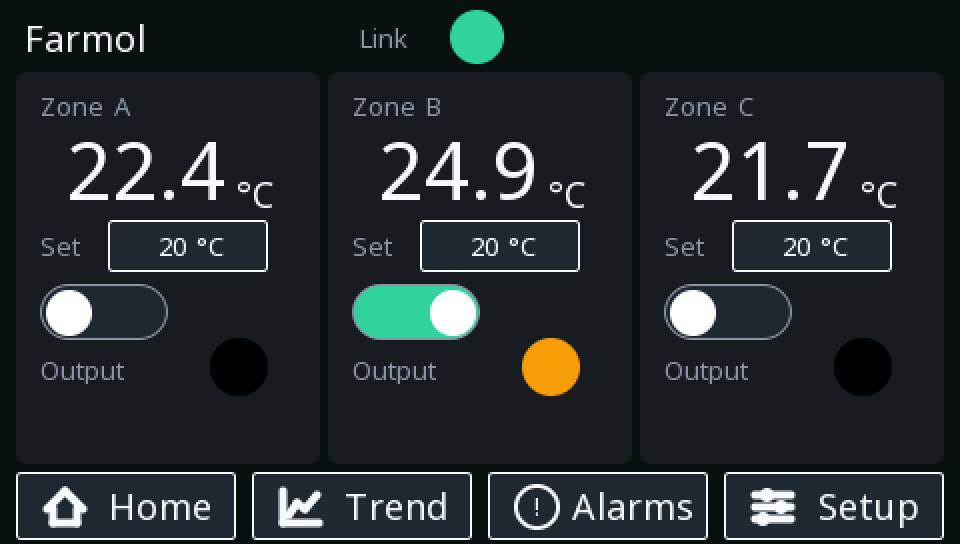{: .sb-center}

The switch *requests*; the Output lamp *reports*. When they disagree
— switch on, lamp dark — one of the gates said no, and the Alarms
page says which.

When the link dies, the banner takes the title row and the values
freeze at their last known state:

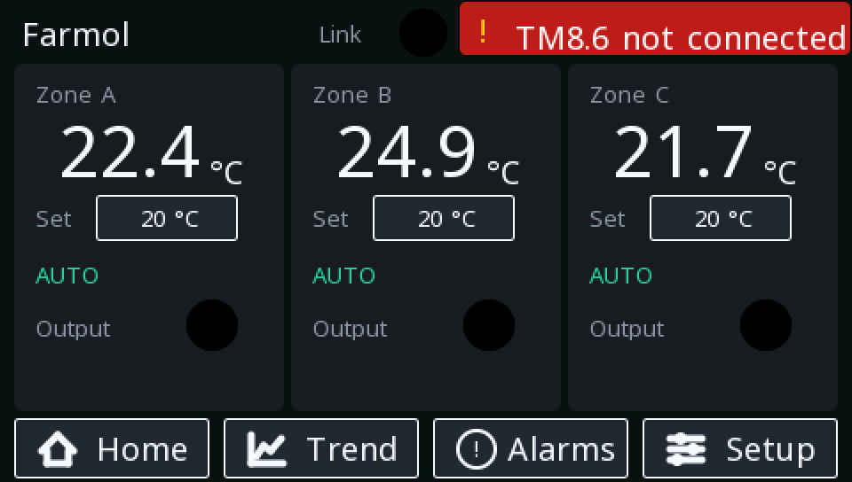{: .sb-center}

At that same moment the zone board has already dropped its heaters —
the banner and the protection are two views of the same watchdog.

### Trend

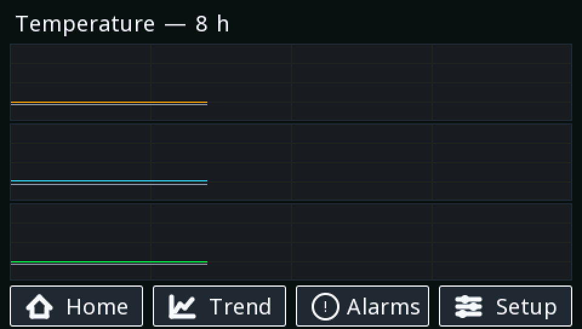{: .sb-center}

Three charts, one per zone, each with **two curves: the current
temperature and the setpoint**, so a setpoint change is visible in
the history exactly when it happened. The window is **8 hours, one
sample per minute** (480 samples per curve). The rings live in the
panel's RAM: a panel restart starts the history afresh.

### Alarms

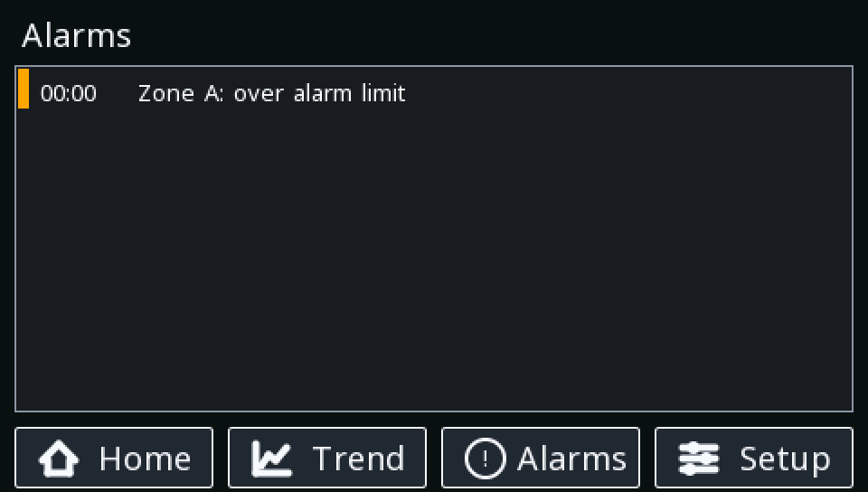{: .sb-center}

The complete alarm list of the system:

| Alarm text | Priority | Cause | Delay |
|:---|:---:|:---|:---:|
| *Zone X: over alarm limit* | warning | temperature above *setpoint + Alarm+* | 2 s |
| *Zone X: under alarm limit* | warning | temperature below *setpoint − Alarm−* | 2 s |
| *Zone X: sensor fault* | fault | the probe reads below 2 °C — loose, shorted or broken PT100 | 3 s |
| *Display link lost — heating off* | fault | (on the zone board) the panel stopped blinking; heaters dropped | 1 s |
| *Link to zones lost — heating is off* | fault | (on the panel) the zone board stopped blinking | 1 s |

The zone board evaluates its zone alarms and the panel mirrors them,
so the history and the acknowledgement live where the operator is —
and the zone board's own WEBview shows its half to a phone even with
the panel gone.

The delays filter waves: a splash of cold air across a probe should
not page anybody. A limit alarm clears itself when the temperature
returns inside its line; a sensor fault clears when the probe reads
sanely again.

### The access code

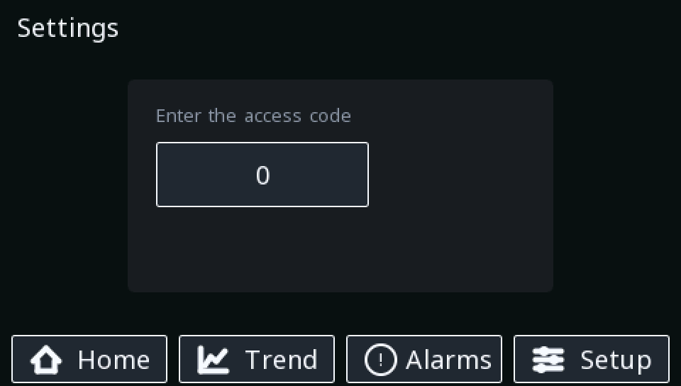{: .sb-center}

The Setup button leads here, never straight to the settings — and
the page doubles as the **connection notice**: the *Phone access*
card spells out the pair's WiFi name and password, both `.local`
names and both raw addresses, because the person standing at the
panel is exactly the one who wants to join with a phone.

The operator types the access code — the keypad opens on touch —
and **only the right code makes the way in appear**:

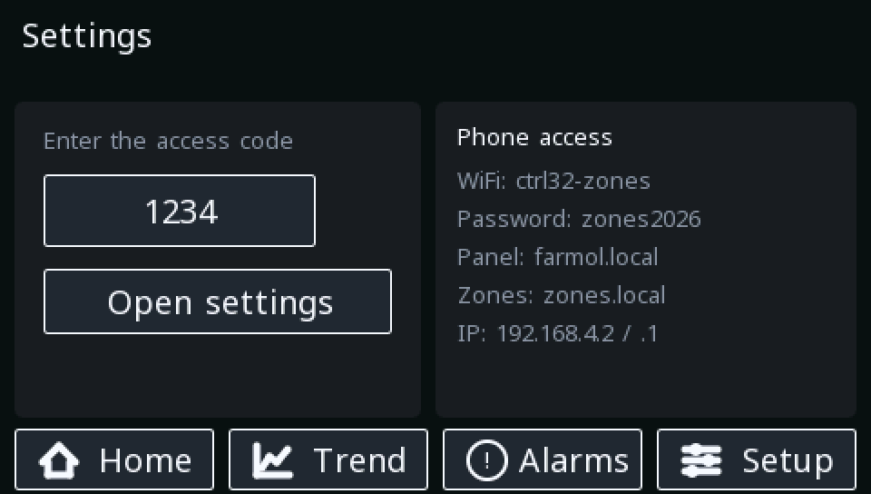{: .sb-center}

- The code is **fixed in the program** (as delivered: `1234`). It is
  compiled into the panel's logic; changing it means editing one
  value in the project and downloading — it is not a setting, on
  purpose, so it cannot be changed from the glass.
- **Five minutes after unlocking** the program clears the entry and
  the way in disappears again. Walking away from an unlocked panel
  is therefore a five-minute exposure, not a permanent one.
- A wrong entry simply does nothing — there is nothing to guess
  against except the keypad itself.

### Settings

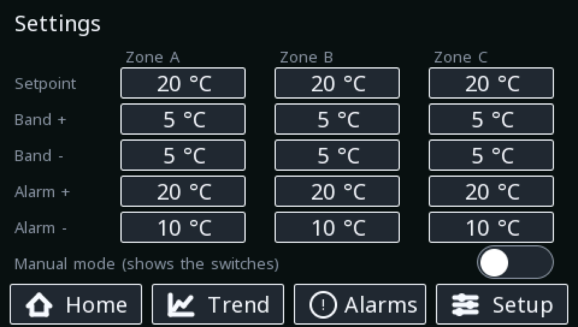{: .sb-center}

The protected page. All fifteen thermostat variables as a grid —
rows are the variables, columns the zones — plus the mode:

| Row | Range | Effect |
|:---|:---:|:---|
| **Setpoint** | 0–90 | the zone's set temperature (also editable on Home) |
| **Band +** | 1–30 | heat OFF line, degrees above the setpoint |
| **Band -** | 1–30 | heat ON line, degrees below the setpoint |
| **Alarm +** | 1–40 | high alarm line, degrees above the setpoint |
| **Alarm -** | 1–40 | low alarm line, degrees below the setpoint |
| **Manual mode** | on/off | ON shows the command switches on Home and hands the heaters to the operator |

Every field validates its range at the keypad — a value outside it
is not accepted. Every change lands on the zone board within a poll
cycle and is persisted there immediately (throttled, so the storage
is not worn out by a spinning knob).

---

## The phone view

Both boards serve a WEBview over the pair's own network. Join the
WiFi **`ctrl32-zones`** (password as delivered: **`zones2026`** —
both are printed on the panel's access-code page, and both change in
the project files) and open:

- **http://zones.local** (= 192.168.4.1) — the zone board: the three
  temperatures, the real output states and the alarm table, with a
  Link lamp blinking with the *panel's* heartbeat. This view works
  even when the panel is down — which is precisely when it is most
  useful.
- **http://farmol.local** (= 192.168.4.2 — as the network's first
  client the panel takes the first lease): the panel's **full
  visualization, laid out for a phone**. This is not a summary of
  the glass; it is the same five pages, described below.

Both boards announce their names over mDNS, so the `.local`
addresses work with no IP known; the raw addresses stay as the
fallback for a phone whose browser does not resolve them. All four
are printed on the panel's access-code page.

The pair's network is its own island. Nothing here reaches the
internet, and per the product's [network stance](security.md) it
should stay that way.

### The mobile pages

The panel's phone view carries the identical page set, states and
protections as the glass — the browser evaluates the same records,
so a switch hidden in AUTO on the glass is hidden on the phone too,
and the red banner appears in both places in the same moment. The
page bar is a two-by-two grid of thumb-sized buttons; the banner has
its own reserved strip under the title.

**Home** — the three zones stacked, each with the large current
temperature, the editable setpoint and the real output state. In
AUTO the cards carry the badge; in MANUAL the command switches
appear, exactly as on the glass:

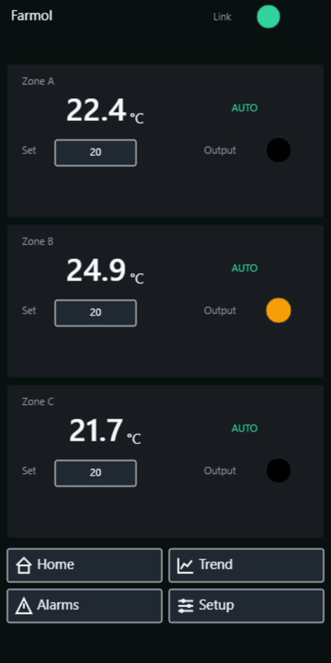{: .sb-center}

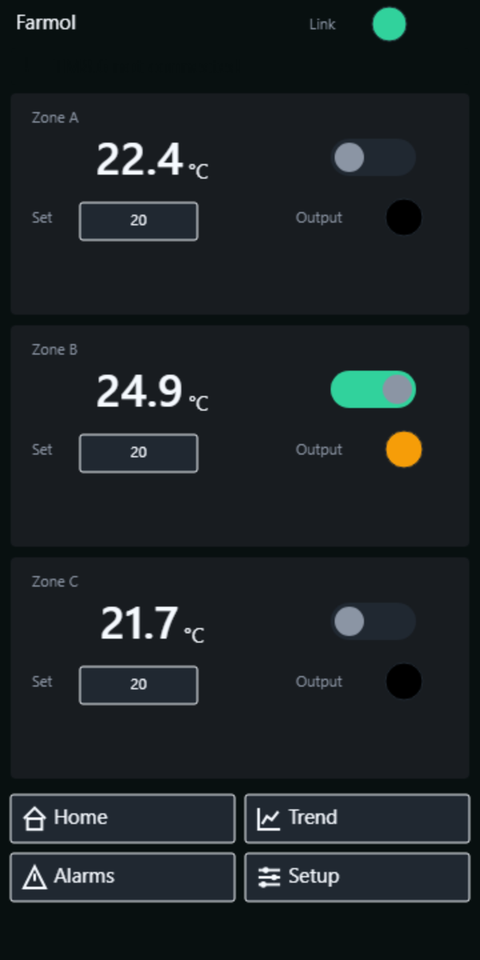{: .sb-center}

**Trend** — the same three eight-hour charts, current and set
temperature per zone:

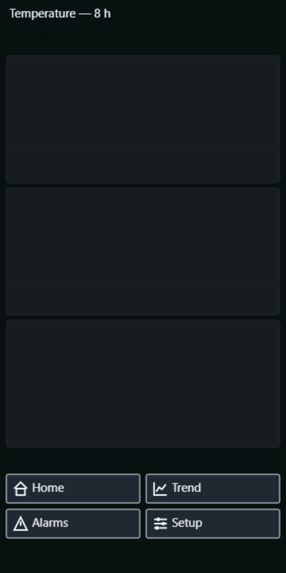{: .sb-center}

**Alarms** — the alarm table, sized for a phone:

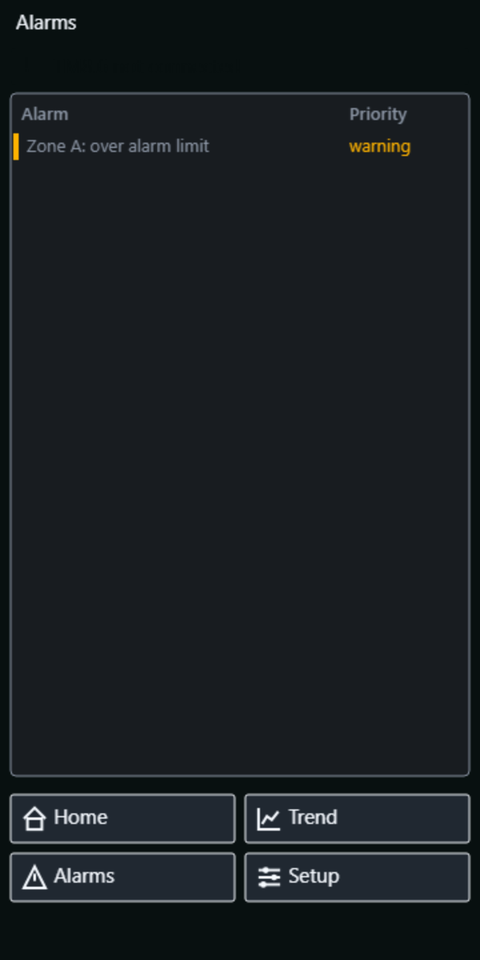{: .sb-center}

**Setup** — the same access code guards the same settings. The way
in appears only on the right code, and the five-minute auto-lock
applies to the phone exactly as to the glass (it is the panel's
logic that locks, not the page):

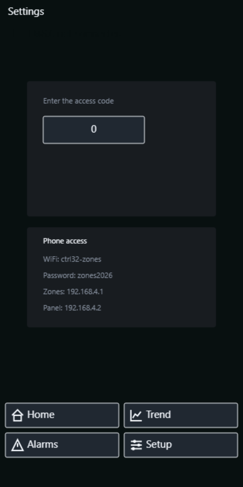{: .sb-center}

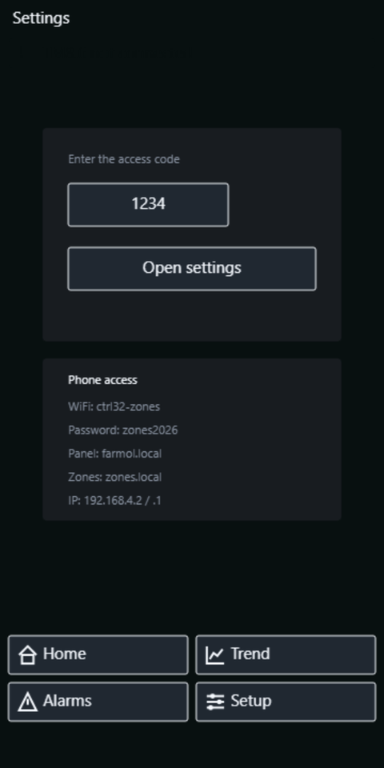{: .sb-center}

**Settings** — all fifteen thermostat variables and the mode, one
zone card under another:

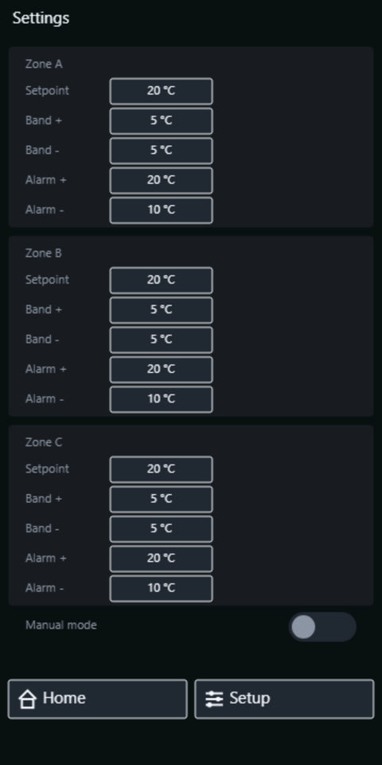{: .sb-center}

Writes from the phone follow the same rule as everything else: the
page *requests*, the boards decide. A setpoint typed on a phone
lands on the zone board through the panel and persists there — and
if two people edit at once, the last write wins and both pages show
it within a second.

---

## SCADA over MQTT

The tank reports itself to the outside world over MQTT — the uplink
half of the zone board's radio carries it. Twenty variables publish
under `ctrl32/hottank/` as plain per-variable topics, at most once a
second and **only when a value changed**:

| Topics | Content |
|:---|:---|
| `temp_a/b/c` | the three zone temperatures |
| `sp_a/b/c` | the setpoints (writable) |
| `mode_man`, `cmd_a/b/c` | the mode and the manual commands (writable) |
| `heat_a/b/c` | the REAL heater states |
| `trip_hi_*`, `trip_lo_*` | the alarm trips |
| `link_ok` | the panel link |
| `status` | `online`, and a broker-kept last will when the board drops |

A SCADA writes by publishing to `<topic>/set` — for example `20` to
`ctrl32/hottank/sp_a/set`. The same rule as everywhere else in this
system: **the write flag in the project is the permission**, a
command on anything not marked writable is refused, and the board
republishes the accepted value so the SCADA sees what actually
happened, not what it asked for.

!!! warning "The bench ran a public broker on purpose"
    This page's measurements were taken against a public internet
    broker, precisely to see the behaviour with a SCADA "half a
    world away". A production site keeps the broker on its own
    network — the MQTT credentials travel in plain text and the
    board does not belong on the open internet.
    See [MQTT telemetry](mqtt.md).

### The measured cost

Every number below is the board's own diagnostic line (`cycle` =
the 10 ms control cycle: current / min / max in µs), captured on the
running tank:

| State | Cycle (µs) | Overruns | Heap low mark |
|:---|:---:|:---:|:---:|
| pair only — no uplink, no MQTT | 93 / 77 / 164 | 0 | 2 120 kB |
| + WiFi uplink + MQTT connected, quiet | 109 / 77 / 449 | 0 | 2 102 kB |
| + SCADA load: 4 writes/s + full echo, 60 s (240 commands, 341 messages) | 108 / 77 / 449 | 0 | 2 102 kB |

Reading it: the uplink and the broker connection cost ~16 µs of an
average cycle (0.16 % of the period) and ~18 kB of memory, once. The
SCADA hammering the tank with commands cost **nothing measurable**
— the communication runs beside the control, never inside it, and
the cycle never overran. The panel's numbers did not move at all
(38 / 19 / 60 µs throughout). This is the degradation rule
(*logic > communication > graphics*) holding under a deliberate
stress, measured rather than promised.

## Power loss and restarts

| What | Survives a zone-board power cut? |
|:---|:---:|
| Setpoints, bands, alarm offsets | **yes** — persisted on the zone board |
| AUTO/MANUAL mode | **yes** — persisted (a power cut must not hand a manual cabinet back to the automatics) |
| Manual commands (`cmd_*`) | no — a restart begins with every command off |
| Alarm history on the panel | no — the history lives in panel RAM |
| Trend history | no — the rings live in panel RAM |

A panel restart alone changes nothing at the process: the zone board
drops its heaters for the few seconds the heartbeat is missing and
resumes when the panel is back. The panel never pushes a value at
the zone board on boot — it reads first, so the zone board's
persisted state is the truth after any restart, on either side.

---

## The register map

For an integrator who wants to sit beside the panel — a SCADA, a
logger — the zone board answers Modbus TCP on `192.168.4.1:502`,
unit 1, word order big. The full map (0-based protocol addresses,
manual numbers in brackets — see [What Modbus is](modbus-basics.md)):

| Address | Variable | Access |
|:---|:---|:---:|
| holding 0–1 (40001) | temp_a, f32 | read |
| holding 2–3 (40003) | temp_b, f32 | read |
| holding 4–5 (40005) | temp_c, f32 | read |
| holding 6/7/8 (40007…) | sp_a/b/c | read/write |
| holding 9/10/11 | band_hi_a/b/c | read/write |
| holding 12/13/14 | band_lo_a/b/c | read/write |
| holding 15/16/17 | alarm_hi_a/b/c | read/write |
| holding 18/19/20 | alarm_lo_a/b/c | read/write |
| coil 0/1/2 | cmd_a/b/c — manual commands | read/write |
| coil 3/4/5 | heat_a/b/c — the REAL outputs | read |
| coil 6 | beat — the zone board's heartbeat | read |
| coil 7 | panel_beat — the panel writes its blink here | read/write |
| coil 8/9/10 | trip_hi_a/b/c — over the alarm line | read |
| coil 11/12/13 | trip_lo_a/b/c — under the alarm line | read |
| coil 14 | link_ok — the panel is alive | read |
| coil 15 | mode_man — 1 = manual | read/write |

Writes to anything not marked writable are refused with a Modbus
exception. The settings registers are whole degrees in one register
each; the temperatures are f32 across two registers, big word first.

---

## Commissioning

1. **Zone board first, over USB** — the first download carries the
   AP configuration. After the restart the `ctrl32-zones` network is
   on the air.
2. **Panel second** — download its project; it joins the network and
   the temperatures appear within seconds. Both halves can also be
   found and addressed later with the
   [device scanner](find-devices.md).
3. **Check the ladder** — with everything at defaults each zone
   holds 15–25 °C. Set the real setpoints from Home, the bands and
   alarm offsets from Settings (code `1234`).
4. **Prove the protections** — pull a probe: its zone drops out and
   *sensor fault* appears. Power the panel off: the heaters drop
   within 3 seconds and return with the panel. Neither test can hurt
   anything, and both are worth seeing once before trusting the
   cabinet to them.

To change the access code, edit the one comparison in
`stephmi_wifi_panel.prj32` (the block named `gate`) and download the
panel again.

---

## Troubleshooting

| Symptom | Look at |
|:---|:---|
| Red banner, values frozen | the pair's WiFi: is the zone board powered? Within range? The zone board side has already secured the heaters |
| A `.local` address does not open | not every phone resolves mDNS — use the raw address from the access-code page |
| A switch is on but the Output lamp is dark | one of the gates said no — the Alarms page names it (sensor fault, or the link) |
| Temperatures read plainly wrong on all zones | the probe wiring and the reference-resistor setting belong together — see the project file's peripheral section |
| A zone cycles wider than expected | the band offsets on Settings — the cycle *is* setpoint − Band− to setpoint + Band+ |
| Limit alarms fire during normal cycling | the alarm offsets are inside the band — Alarm+ must be greater than Band+, Alarm− greater than Band− |
| The Set field will not take a value | it is outside the field's range — the keypad refuses rather than clamps |
| Setup opens but the way in vanished | the five-minute auto-lock — enter the code again |

---

## Where next

| | |
|:---|:---|
| [Two boards over Modbus](tutorial-modbus-pair.md) | the same pair's simpler ancestor, over the plant network |
| [MQTT telemetry](mqtt.md) | the mechanics behind the SCADA chapter |
| [What Modbus is](modbus-basics.md) | the protocol behind the register map |
| [States and motion](states-motion.md) | the mechanism behind the banner and the mode-dependent switches |
| [Finding your boards](find-devices.md) | locating both halves from the editor |
