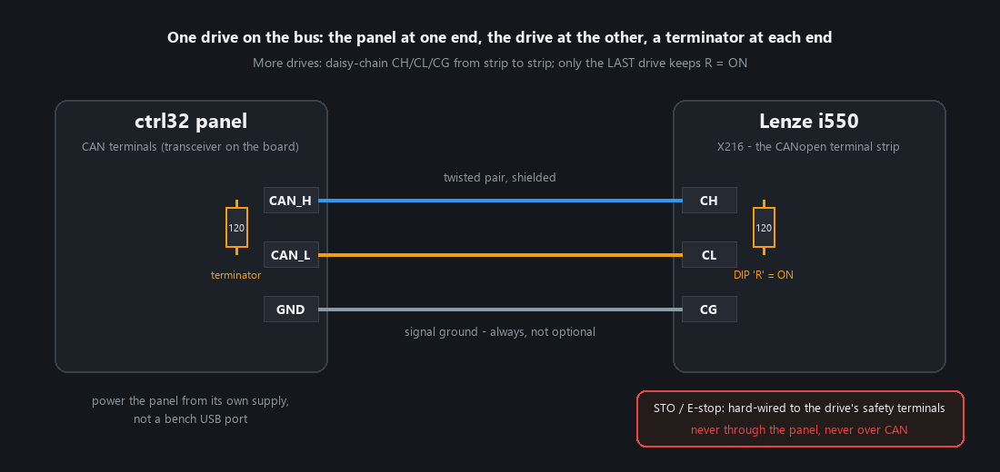
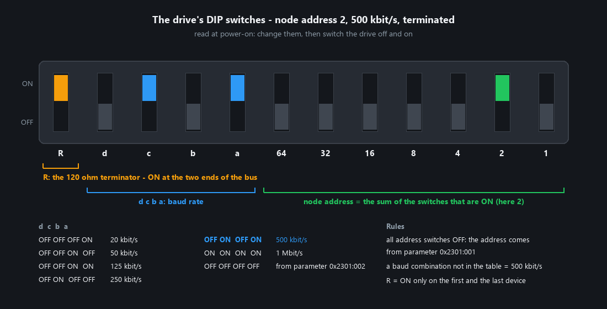
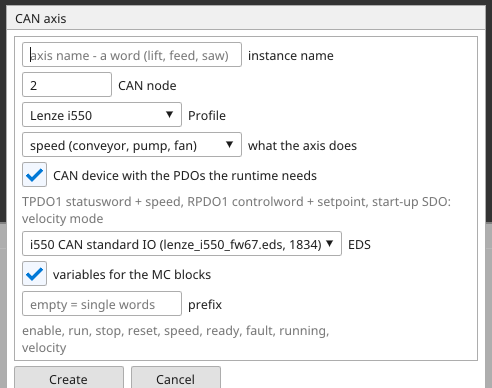
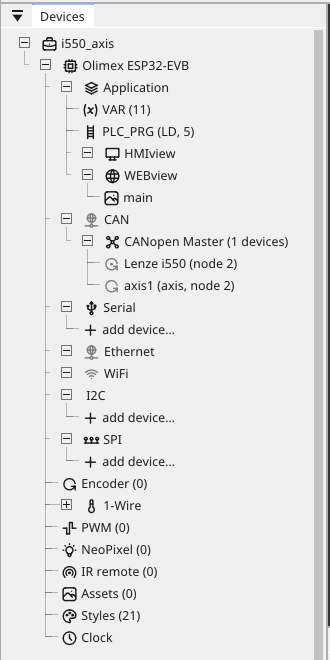
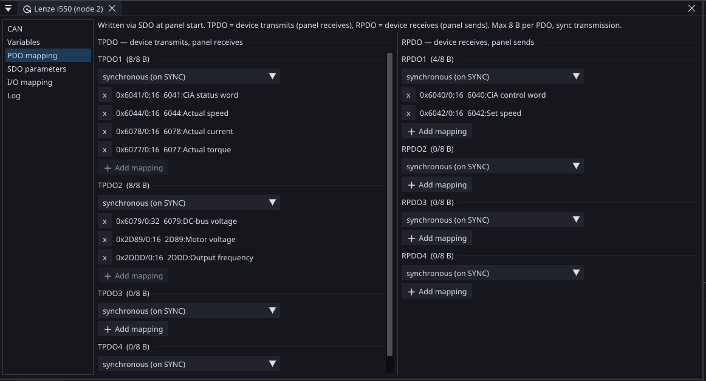
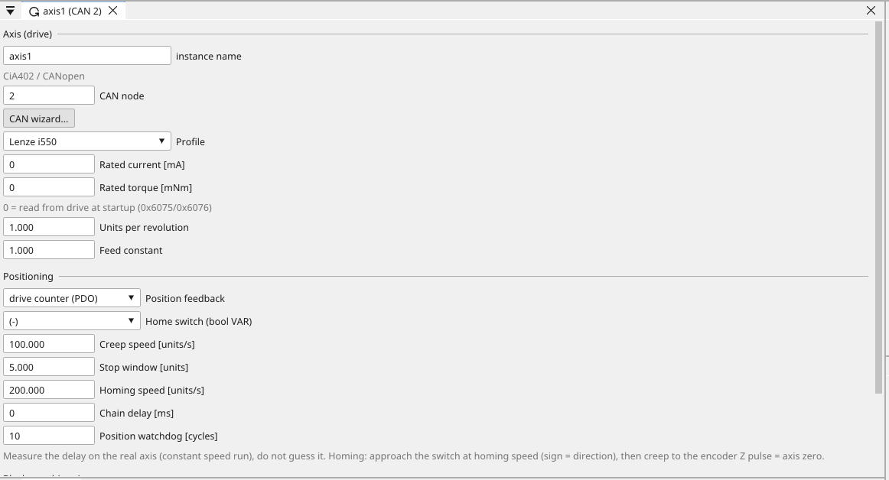
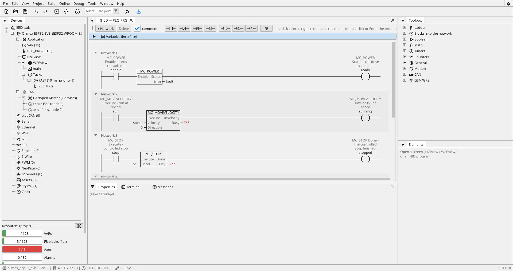
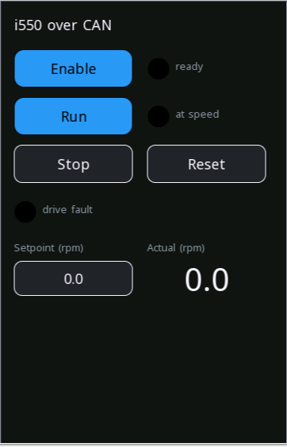

# A drive over CAN, step by step

A frequency inverter on the CAN bus, controlled from the panel: enable,
run at a setpoint, stop, reset a fault, read the actual speed. The drive
is a **Lenze i550** with its CANopen control unit; the panel is any board
that carries CAN. This page uses an Olimex ESP32-EVB, because it has the
CAN transceiver on the board and no display — the operator side is a
browser page.

The finished project is `tutorials\i550_axis.prj32`. Every step below is
what the project contains, in the order you would do it at the bench.

**What you need**

- a panel with CAN (a catalog board that lists `CAN` among its buses, or
  your own module with a transceiver on the CAN pins)
- the i550 with the CANopen control unit, its motor, and mains
- a twisted pair for the bus, two 120 Ω terminators (the drive has one on
  its DIP switch), and the STO wiring
- the editor, and a way to reach the panel: USB for the first download,
  or the network after that

---

## 1. Wire the bus

{: .sb-center}

| Panel | Drive (X216) | Note |
|:---|:---|:---|
| `CAN_H` | `CH` | one wire of the twisted pair |
| `CAN_L` | `CL` | the other wire |
| `GND` | `CG` | the signal ground — **always**, it is not optional |

- **Terminate both ends.** A 120 Ω resistor between `CAN_H` and `CAN_L`
  at the panel, and the drive's `R` switch ON at the other end. A bus
  without terminators works on the bench and fails in the cabinet.
- **Shield** the pair in a cabinet with drives; connect the shield at one
  end.
- **More drives** are daisy-chained from strip to strip. Only the last
  one keeps `R` ON; the ones in the middle have it OFF.
- **Power the panel from its own supply**, not a bench USB port — a USB
  port does not carry a radio burst and a bus at once, and the resets
  look like a bus problem.

!!! danger "STO is wired, not programmed"
    The emergency stop goes to the drive's **STO** terminals by wire. The
    panel can command a stop over CAN and it does; that is not a safety
    function and it must never be the only one. See [Safety](intended-use.md).

---

## 2. Set the drive's switches

The i550 reads its node address, its bit rate and its terminator from a
DIP bank on the control unit. This project uses **node 2 at 500 kbit/s**:

{: .sb-center}

- **`R`** — the terminator. ON at the last drive on the bus.
- **`64 32 16 8 4 2 1`** — the node address is the sum of the switches
  that are ON. For node 2, only `2` is ON. With all seven OFF the drive
  takes the address from its parameter 0x2301:001 instead.
- **`d c b a`** — the bit rate, by the table in the picture. `OFF ON OFF
  ON` is 500 kbit/s. All four OFF takes the rate from parameter
  0x2301:002; a combination not in the table falls back to 500 kbit/s.

The switches are read **at power-on**. Set them, then switch the drive
off and on again — a change while it runs does nothing until the next
start.

Write the address and the rate on the drawing. Nothing in software can
tell you the switch is wrong; the bus is simply silent.

---

## 3. The project

*New project* in the editor (the Welcome tab, the toolbar, or `Ctrl+N`):

{: .sb-center}

- **Name** `i550_axis`, the location as offered.
- **Hardware** — the board. The EVB is under *Boards*; type `EVB` in the
  search box to find it. Your own hardware is a module under *Modules*,
  with the CAN pins assigned on the board tab afterwards.
- **What the project does** — tick **CAN / CANopen master** and **First
  program in LD**. The EVB has no display, so *Visualization on the
  display* stays off and **WEBview (browser screens)** is on. On a board
  with a glass tick the display instead, or both.

*Create project*. The tree opens with `CAN → CANopen Master` already
there, empty.

---

## 4. The axis wizard

Right-click **CANopen Master** in the tree and choose *Add Axis (drive)*.
The CAN axis wizard opens:

{: .sb-center}

| Field | For this project |
|:---|:---|
| **instance name** | `axis1` — one word; the motion blocks name the axis by it |
| **CAN node** | `2` — the address on the DIP bank |
| **Profile** | `Lenze i550` |
| **what the axis does** | `speed` — a conveyor, a pump, a fan. `positioning` adds the blocks and variables for going to a position |
| **CAN device with the PDOs the runtime needs** | leave it ticked |
| **EDS** | the drive's own file from the device library; the wizard preselects the i550 file with the most objects |
| **variables for the MC blocks** | leave it ticked; the **prefix** stays empty for the first axis |

*Create* makes three things in one step, and the tree shows them:

{: .sb-center}

**The CAN device** at node 2, with the two process-data objects the
runtime exchanges on every cycle. Open it (a click) and look at *PDO
mapping*:

{: .sb-center}

- **TPDO1** — what the drive transmits: the statusword (0x6041) and the
  actual speed (0x6044), followed by the actual current and torque. The
  first two are what the motion blocks read.
- **RPDO1** — what the drive receives: the controlword (0x6040) and the
  speed setpoint (0x6042). That is what the motion blocks write.
- both **synchronous**: sent after the SYNC the panel produces, so the
  values arrive at a known moment in the cycle.
- *SDO parameters* holds the start-up writes: velocity mode, and on the
  i550 the two entries that hand control to the network. Without them the
  drive ignores every controlword — see [the trap](canopen.md#drives-the-trap-that-costs-a-day).

**The axis** `axis1`, opened in its window:

{: .sb-center}

Leave the rated current and torque at 0 — the runtime reads them from the
drive at start. *Units per revolution* and *Feed constant* matter for
positioning; a speed axis runs in the drive's own units.

**Nine variables** in `VAR`, named for the blocks they belong to:
`enable`, `run`, `stop`, `reset`, `speed`, `ready`, `fault`, `running`,
`velocity`. Each carries a comment saying which block pin it is for.

!!! note "The wizard is a starting point, not a cage"
    What it made is an ordinary project. Add a mapping, rename a
    variable, change the node — everything is editable afterwards. The
    node-ID in the device window moves the variables and the axis with it.

---

## 5. The program

Open **PLC_PRG**. One rung per motion block, each driven by one of the
wizard's variables:

{: .sb-center}

```
1  |--[ enable ]--[ MC_POWER ]------------------( ready )--|      Error -> fault
2  |--[ run ]--[ MC_MOVEVELOCITY  Velocity=speed ]--( running )--|
3  |--[ stop ]--[ MC_STOP ]--------------------( stopped )--|
4  |--[ reset ]--[ MC_RESET ]------------------( cleared )--|
5  |----[ MC_READACTVEL ]---->                                    Velocity -> velocity
```

For each rung: *+ Rung*, a contact bound to the variable, then the block
from the Toolbox's **Motion** group (or the **FB** button). The block's
first input is the rung; its first output continues into the coil. The
other pins are bound in the block's sheet or in **Properties**:

| Block | Pins to bind | What it does |
|:---|:---|:---|
| `MC_POWER` | `Error` → `fault` | enables the drive while `enable` is TRUE; `ready` = the drive reports it is enabled |
| `MC_MOVEVELOCITY` | `Velocity` ← `speed`; `Direction` stays `0` | runs at the setpoint while `run` is TRUE; `running` = the drive is at speed |
| `MC_STOP` | — | a controlled stop along the drive's deceleration ramp |
| `MC_RESET` | — | acknowledges a drive fault |
| `MC_READACTVEL` | `Velocity` → `velocity` | the measured speed, every cycle |

Two variables are not from the wizard: `stopped` and `cleared`, the
`Done` outputs of `MC_STOP` and `MC_RESET`. A rung wants a result; add
them in `VAR` as `BOOL` before drawing rungs 3 and 4.

Every motion block names its axis. With one axis in the project it is
assigned by itself; with more, the block's sheet asks which.

---

## 6. A screen

The EVB has no display, so the operator page is a WEBview screen. Under
**WEBview**, open `main` and place:

{: .sb-center}

| Widget | Variable | Mode |
|:---|:---|:---|
| button *Enable* | `enable` | `toggle` |
| led | `ready` | |
| button *Run* | `run` | `toggle` |
| led | `running` | |
| button *Stop* | `stop` | `momentary` |
| button *Reset* | `reset` | `momentary` |
| led | `fault` | |
| input | `speed` | 0 … 1500 |
| value | `velocity` | |

On a board with a display the same widgets go on an HMIview screen.

---

## 7. Download and start

1. Connect the panel over USB and pick its port in the toolbar.
2. The first time only: *Flash runtime* on the board tab (the board's
   firmware). See [A board from zero](first-run.md).
3. Press :ti-download: (F5). The project builds and goes into the panel.
   A CAN project without a PDO mapping is refused here, at the desk —
   that is the wizard's device doing its job.

Then, with the drive powered:

1. Open the panel's page in a browser (its address, or through the
   captive portal on its own WiFi).
2. Press **Enable**. The *ready* lamp lights within a second: the drive
   is enabled and the panel talks to it.
3. Set a speed, press **Run**. The motor turns; *at speed* lights when
   the drive reports it reached the setpoint; *Actual* shows the measured
   speed.
4. **Stop**, and the motor ramps down along the drive's deceleration.

In the editor, **ONLINE** shows the same rungs live: the contacts, the
block pins and the coils with their values.

---

## 8. When it does not move

| You see | The cause, in the order to check |
|:---|:---|
| *ready* never lights, the panel's `INFO` says the node is **OFFLINE** | the bus: the DIP address is not 2, the bit rate is not 500 kbit/s, a terminator is missing, `CG` is not connected, `CH`/`CL` swapped. The switches were changed without a power cycle. |
| the console says **`CAN: NO CYCLE`** | the project has an axis but no device with a PDO mapping — the cyclic exchange never starts. The wizard's device provides it; if you built the device by hand, map TPDO1 and RPDO1 as in step 4. |
| *ready* lights, **Run** does nothing, no fault | the drive is not under network control. On the i550 that is the start-up SDO the wizard writes (the network-control entries under *SDO parameters*); a drive commissioned by hand may have them reset. |
| the motor starts and **oscillates** or overshoots | the drive's own ramps are slower than the profile the panel sends. Set the drive's acceleration and deceleration ramps to their minimum; the panel makes the profile. |
| the *fault* lamp is on | read the fault on the drive's display, remove its cause, press **Reset**. A fault that comes back at once is in the drive's parameters or the wiring, not in the project. |
| *Actual* stays at 0 while the motor turns | TPDO1 does not carry 0x6044 — compare the mapping with step 4 |
| the whole panel restarts every few seconds | a CAN transmit into a bus nobody acknowledges: a drive that is off, a transceiver that is missing, a shorted pair |

---

## Where to go from here

| You want to | Read |
|:---|:---|
| understand what the blocks do, and positioning | [Motion](blocks-motion.md) |
| what CANopen is and why not Modbus here | [CANopen](canopen.md) |
| read the drive's own objects — current, torque, DC bus | [Drive control (Lenze i550)](example-i550.md), the complete example |
| talk to a drive without the motion blocks | [CANopen blocks](blocks-can.md) |
| put it on your own hardware | [Hardware catalog](modules.md) — a module with the CAN pins assigned |
