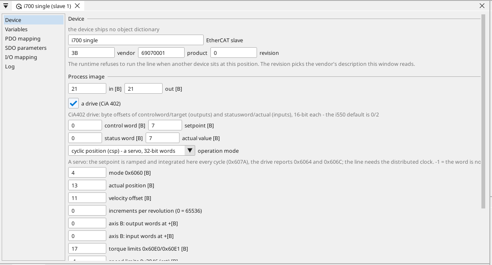
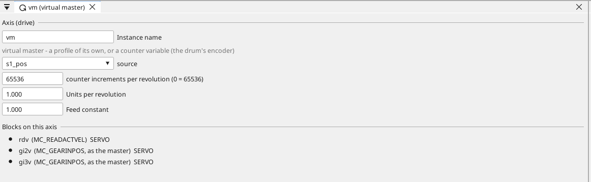
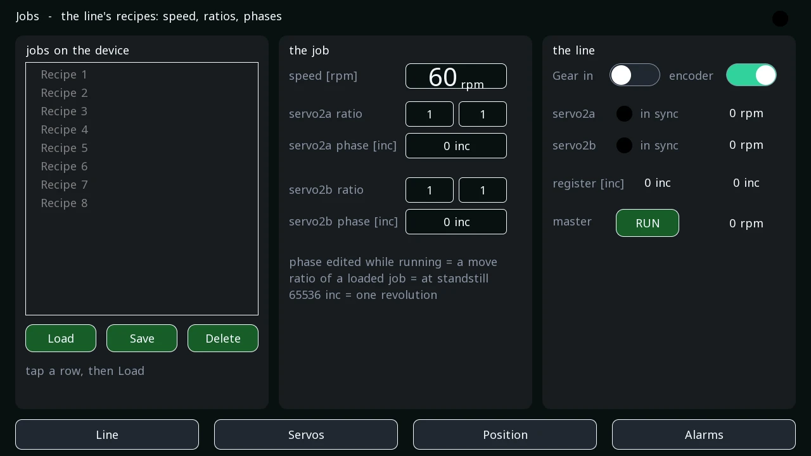

# The line shaft, step by step

A drum that runs on its own velocity, cylinders that follow it in
position at a ratio and a phase, a register that says how well they
do, and a job that carries the numbers. This page goes from a running
EtherCAT axis to a line shaft with jobs, one step at a time.

[EtherCAT, step by step](tutorial-ethercat.md) is the walk before this
one; [Motion blocks](blocks-motion.md) is the reference of the blocks
used here.

**What is used here**

- A Linux device with a spare network port as the EtherCAT master —
  the reTerminal with its E10-1 expansion.
- Servo inverters in cyclic position mode: a Lenze i700 single and an
  i700 double on the bench. Any CiA 402 servo with a cyclic position
  set works the same way; its own description file is what differs.
- The project is `examples\reterminal_ecat_example.prj32`.

---

## 1. The drives as servos

*Add from library* on the EtherCAT line lays a servo out from its
description: the cyclic position pair of process data objects is
assigned, the torque limits object travels beside it, and the slave's
window shows the mode *cyclic position (csp)* with the byte offsets of
the words the runtime reads and writes every cycle — the target
position, the actual position, the actual velocity, the velocity
offset, the torque offset, the torque limits and the actual torque.
The two numbers that describe the drive's units are there too: the
increments of one revolution and the velocity units per rpm, both read
from the description.

{: .sb-center}

A double inverter carries two axes in one slave: the window names
where axis B's words start, and an axis on that slave picks A or B.

---

## 2. The axes

Three axes sit on the two slaves: `servo1` on the single, `servo2a`
and `servo2b` on the double's A and B. Each is a plain CiA 402 axis;
what makes one a master and the others followers is the program, not
the axis. Every axis keeps its start-up writes on its slave — the
motor's data and its loops, which an i700 forgets at power-off — so a
spare drive swapped into the line gets its set at the next start.

---

## 3. The master lives its own life

The drum of a press is a drive that gets a velocity and a ramp and
nothing more. `servo1` plays the drum: `MC_Power`, `CO_RAMPTIME` for
its ramp and `MC_MoveVelocity` with the operator's setpoint.

What the followers gear to is not the drum's setpoint but its
**measured position** — on a press the encoder on the drum, here
`servo1`'s actual position signal. That measurement is the counter a
**virtual master** follows: an axis with no drive behind it, added on
the EtherCAT line, whose window names the counter variable and the
counts of one revolution. Everything else derives from it.

{: .sb-center}

The same axis can instead run a profile of its own (no source named)
for a line where the drum too is geared in position.

---

## 4. The followers in gear

Each follower gears to the virtual master with `MC_GearInPos`: a
rational ratio (`RatioNumerator`/`RatioDenominator`, whole numbers) and
a defined relation of the two positions — when the master stands at
`MasterSyncPosition` the follower stands at `SlaveSyncPosition`, in the
axes' units. In the example's program (the ratio comes from REAL
setpoints on a screen, so it is named as a whole number):

```st
gi2v(AXIS := 2, Execute := line_on AND line_src, Delay := line_tau2 / 1000.0,
     MasterSyncPosition := 0.0, SlaveSyncPosition := ph2,
     Master := 4, RatioNumerator := REAL_TO_INT(r2_num),
     RatioDenominator := REAL_TO_INT(r2_den), Velocity := 18.0);
s2_insync := gi2v.InSync;
s2_reg    := gi2v.Register;
```

The example's servo axes count increments (`units_per_rev` 65536) and
speak rpm (`velocity_per: rpm`), so the phases are plain increments and
every velocity on a screen is rpm - the way a servo's own tools show them.
At gear-in the follower moves the shortest way into the relation at
`Velocity` (18 rpm here), then follows the master's
measured position every bus cycle with the velocity feed-forward. While
`Execute` holds, a changed `SlaveSyncPosition` is a further move — the
operator's register trim — and a changed ratio is applied the moment
the line stands still. `InSync` is in gear and in the relation;
`Register` is the follower's actual position against the master's
through the ratio and the phase, in the follower's increments: 0 is
in register.

---

## 5. Measure the chain delay

A follower made from a measured position lags it: the drive samples,
the bus carries, the runtime computes, the drive applies. That delay
is not a tuning matter and no bus cycle removes it — it is
compensated. `Delay` (seconds) is that number, and it is **measured,
not estimated**:

1. Set the delay to 0, gear in, run the master at a constant speed.
2. Read the register in the hold — it is negative, the follower behind.
3. The delay is that register divided by the velocity in increments
   per second (300 rpm = 327 680 increments per second at 65 536 per
   revolution): 1 000 increments behind at 300 rpm is 3 ms.
4. Enter it. The register in the hold goes to a few increments.

The line screen has the field beside the two registers, live and at
their peaks, with a trend of both. The delay moves a little with the
drives' loop settings, so it is re-measured after any loop change.

{: .sb-center}

---

## 6. Jobs

A job is a speed, a ratio per cylinder and a phase per cylinder. The
example keeps them as a **recipe** named `job` — the master's setpoint,
each follower's ratio as numerator and denominator, and its phase in
increments — and the followers gear in with the job's numbers. The
*Jobs* screen shows the sets on the device, the job's fields and the
followers' sync lamps; *Load*, *Save* and *Delete* act on the row
selected in the table.

{: .sb-center}

Three things follow from the numbers being plain recipe members:

- A job loaded **at standstill** re-gears the line: the ratios take
  effect and each follower moves into its phase without a new gear-in.
- A phase edited **while the line runs** is a smooth move to the new
  relation — the register trim.
- The values are persisted, so after a restart the same numbers are in
  the variables and the next gear-in finds the same relation. The
  drives' positions are absolute; nothing has to be homed.

On the bench: job A at 300 rpm, both followers 1:1, phases 0; job B at
200 rpm, one follower 1:2, the other 3:2, phases 20 000 and 40 000.
Loading B at standstill moved the followers into their phases and the
next run held 101 and 305 rpm in sync; a restart of the runtime brought
the numbers back and the gear-in was in sync at once, with no movement.

---

## 7. The feed-forward

A position loop produces the torque a ramp needs by falling behind
first. `MC_TorqueFF` hands the drive that torque up front: a gain times
the acceleration the setpoint asks for, written as the drive's torque
offset every cycle. The line screen has one gain for both followers.
On a bare motor the inertia torque is under a per cent even at a hard
ramp, so the field stays at 0 on the bench; on a press the plate
cylinder is the inertia, and the gain is found there: raise it until
the register stops dipping at the start of a ramp, and stop before it
overshoots.

---

## 8. What to watch

- **The register**, live and at its peak, and its trend — the one
  number the print sees. A peak at the start of a ramp is the drive's
  loop taking up the breakaway; the position controller gain of the
  drive is the lever for it.
- **The sync lamps** on the Jobs screen: off while a follower moves
  into its phase, off when it is out of gear.
- **The device page**: `ecat=` with the master up and every slave
  operational, and the bus counters — a line shaft asks nothing of the
  bus it did not ask before, but a working-counter error is a slave
  gone.

---

## Where to go next

- [EtherCAT](ethercat.md) — the reference: the device window tab by
  tab, the cyclic position mode, the virtual master.
- [Motion blocks](blocks-motion.md) — `MC_GearIn`, `MC_GearInPos`,
  `MC_PhasingAbsolute`, the torque blocks and the feed-forward.
- [Recipes](recipes.md) — where the sets live and what a load does.
- [reTerminal, the drive on EtherCAT](example-reterminal-ecat.md) —
  the project this page walks, with the bench's measurements.

---

*EtherCAT® is a registered trademark and patented technology, licensed by Beckhoff Automation GmbH, Germany.*
