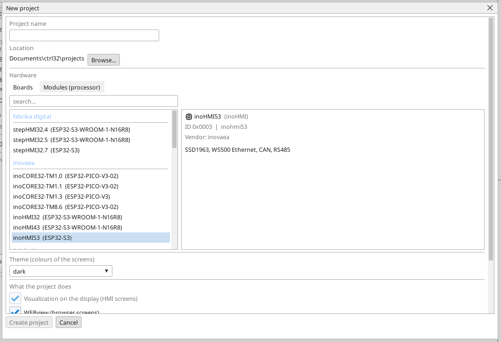
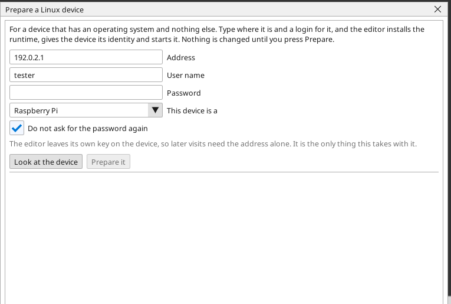
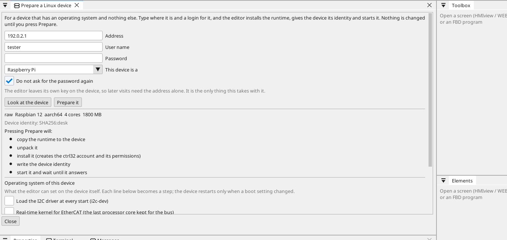
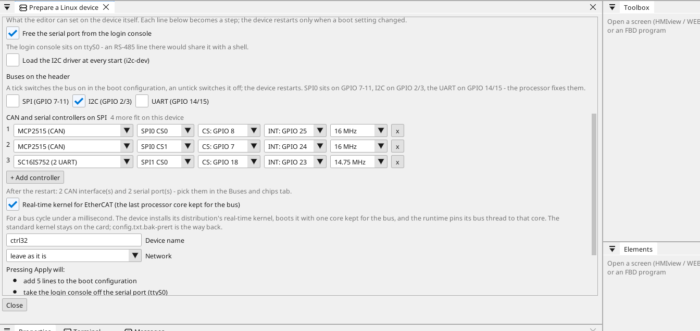
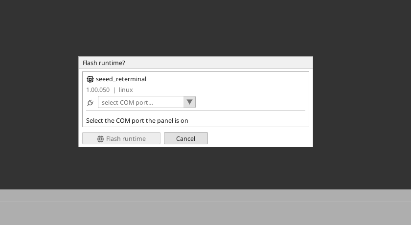
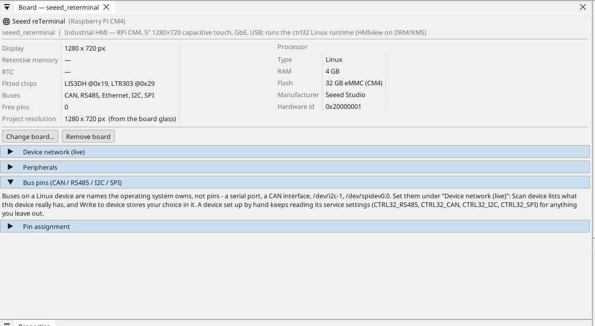

# From a blank device to a running one

A Raspberry Pi with nothing on it but an operating system, and half an
hour. At the end it boots into your visualisation, serves it to a
browser, answers OPC UA and appears in the editor like any other
device — and you will not have typed a single Linux command.

Everything here is done from the editor. The reference for every
device the catalogue knows, and for the parts this page does not
need, is [Setting up a Linux device](linux-setup.md).

**What you need**

- A 64-bit Raspberry Pi (Pi 4, Pi 5, CM4, CM5, Zero 2 W) or a Seeed
  reTerminal, on the same network as your PC.
- A fresh **Raspberry Pi OS** on its card, with SSH enabled and a user
  you know the password of. The Raspberry Pi Imager asks for both
  while it writes the card.

---

## 1. Make the project

Start the editor and choose **New project**. Give it a name, then pick
the device under *Linux*: the reTerminal, or **Raspberry Pi** for
anything else.

{: .sb-center}

Tick what the project will do — Visualization for a screen, WEBview
for the browser, and whichever buses the device will talk on. Nothing
here is final; every one of them can be added later from the tree.

---

## 2. Tell the editor where the device is

Open **Tools › Prepare a Linux device**. Type the device's address,
the user name and the password you set when you wrote the card, and
say which device it is.

{: .sb-center}

Leave **Do not ask for the password again** ticked. The editor puts
its own key on the device the first time, and later visits need the
address alone — the password is used once and never stored.

---

## 3. Look at it before you change it

Press **Look at the device**. Nothing is changed by looking: the
editor logs in, reads what the device is, and says what it found and
what it intends to do.

{: .sb-center}

The list is the whole plan — the runtime copied over, unpacked,
installed with its own account and permissions, given the device's
identity, started, and waited for until it answers. A device that
already runs ctrl32 is told so, and the network road takes over from
there.

---

## 4. The operating system, if the device needs it

Under the plan sits **Operating system of this device** — the settings
a project cannot carry because they belong to the machine, not to the
program.

{: .sb-center}

- **Expansion board** — pick it and the boot lines it needs are added
  for you. The reTerminal E10-1 brings its CAN interface, its RS-485
  port and its second gigabit port this way.
- **Free the serial port from the login console** — a login shell sits
  on the serial port of a fresh Raspberry Pi OS and would fight your
  RS-485 line for it.
- **Load the I2C driver at every start** — needed when the project
  reads chips over I2C.
- **Device name** and **Network** — a fixed address instead of
  whatever DHCP offers, which is what a machine on a shop floor wants.

Each ticked line becomes one step. The device restarts only when a
boot setting changed, and the window says so before you press
anything.

---

## 5. Prepare it

Press **Prepare it**. The editor works through the list and reports
each step as it lands. When it is done the device runs the ctrl32
runtime, under its own account, started by the system at every boot.

From here the device needs no password: it answers the editor over the
network, and every later update takes that road.

---

## 6. Send it your project

Build and deploy as you would to any board — the project goes to the
device, the runtime loads it and the screen comes up.

The runtime itself travels the same way when a new version of the
editor brings one:

{: .sb-center}

---

## 7. Check it

- The **board card** in the tree shows what the device told the editor
  about itself — its buses, its interfaces, its screen.

{: .sb-center}

- **WEBview**: open `http://<address>:8080` in a browser on the same
  network and the visualisation is there.
- **OPC UA**: the device serves every variable on port 4840; see
  [OPC UA](opcua.md).
- The editor's [device scanner](find-devices.md) finds it from then on
  without being told where it is.

---

## What to do next

- [Setting up a Linux device](linux-setup.md) — every device in the
  catalogue, the settings file, and the road for a device that is not
  a Raspberry Pi.
- [The Linux runtime](linux-runtime.md) — what it can do once it runs.
- [Modbus](modbus.md), [EtherCAT](ethercat.md), [CANopen](canopen.md) —
  the buses to give it next.
