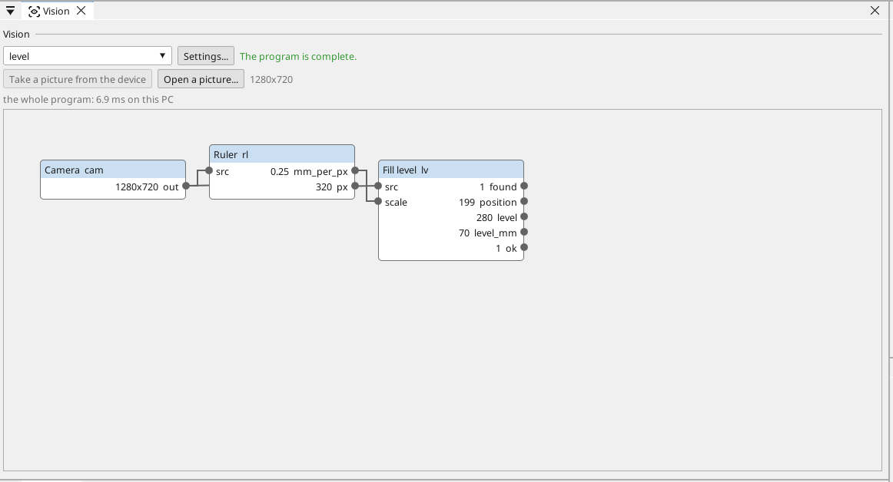
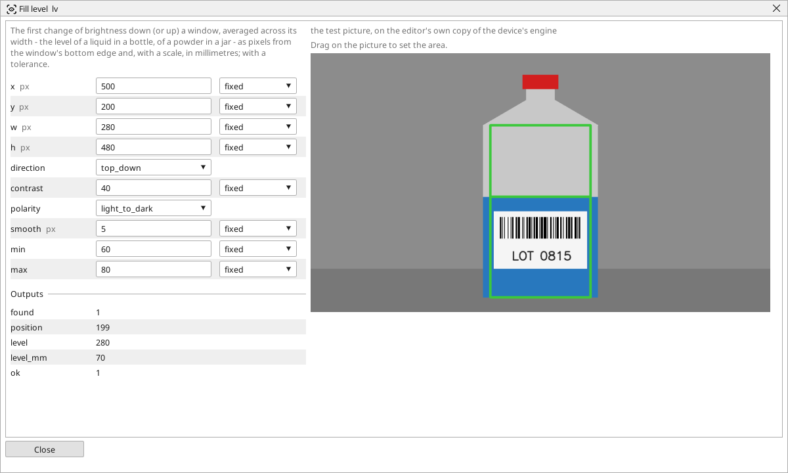
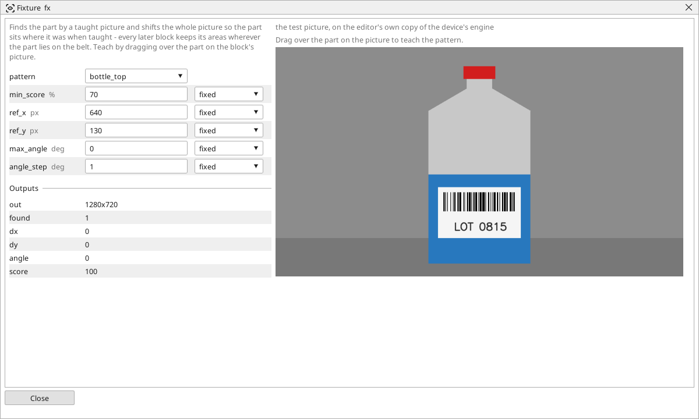
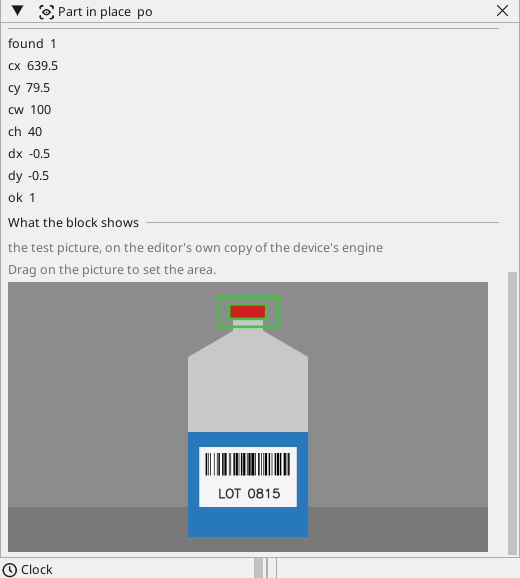
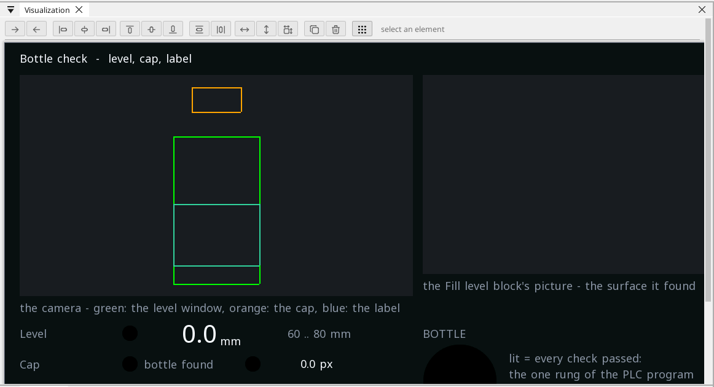

# Measuring, step by step: a bottle

A filling line asks three things of every bottle: is it filled to the
mark, is the cap on, is the label on and readable. This tutorial builds
the three checks as three vision programs on one camera, every answer a
variable, and one rung that says OK. The finished project is the
[Bottle check](example-bottle-check.md) example; here it is built from
the first block.

What you need: a 64-bit Linux device with a camera (the reTerminal of the
examples), or no device at all — every step below works on the desk with
the drawn bottle the editor ships for its own tests, and the numbers it
measures are the numbers the drawing was made with.

## 1. The picture and the plane

Open the project (or make a new one on the reTerminal, tick
*Visualization* and *Vision*), add a camera under **Cameras**, and under
**Vision** add a program named `level`. Its first block is the camera.
Press **Open picture** on the Vision page and pick a picture of a bottle
in front of the camera — or `bottle.png` from the editor's test pictures:
a bottle 320 px wide standing on a belt, its liquid up to row 400.

Pixels mean nothing to a tolerance. Add a **Ruler** from the Toolbox,
connect it to the camera and drag across the bottle's body on its
picture: 320 px. Type what that really is — 80 mm — and the Ruler's
*mm per px* output is 0.25. Every measuring block takes that number on
its *scale* input and answers in millimetres.

## 2. The fill level

Add a **Fill level** block, connect the camera to *src* and the Ruler's
*mm per px* to *scale*. Open its window and drag its area over the body
of the bottle, from the shoulder to the bottom: the block walks the area
from the top (*direction* top down), averages every row across the
area's width, and stops at the first jump of brightness darker than the
one before — the surface. Set *polarity* to *light to dark* so a label's
edge further down cannot be taken for it, and *contrast* to the size of
the jump (40 is right for most liquids).

The outputs: *position* is where the surface sits from the area's top,
*level* how far above the area's bottom edge, *level_mm* the same in
millimetres: 70 mm on the drawn bottle. Type the tolerance — *min* 60,
*max* 80 — and *ok* lights. Hand *level_mm*, *found* and *ok* to
variables in the program's **Results**; the screen and the PLC program
read them from there.

## 3. The cap, wherever the bottle stopped

A bottle never stops at the same place twice, and a window drawn on the
cap today sits beside the cap tomorrow. The second program, `cap`,
begins with a **Fixture**: connect the camera, open the block's window
and drag over the bottle's top — the neck, the shoulder, the cap. The
block remembers that picture and where its centre was. On every later
picture it finds the top again and shifts the whole picture so the top
sits where it was taught; a turned bottle is turned back too when *max
angle* allows it.

Now add a **Part in place** block and connect it to the Fixture's *out*
— not to the camera. Drag its window over the cap, set *polarity* dark
(a red cap on a light bottle) and the *threshold* between the two, and
the block finds the largest dark blob in the window and judges where it
sits: *ex* / *ey* say where the cap's centre should be, *pos tol* how far
off it may be. A missing cap leaves *found* dark; a cap askew leaves *ok*
dark while *found* lights and *dx* / *dy* say which way it slid.

## 4. The label and its code

The third program, `label`: a **Crop** to the label's place feeds a
**Read code** block (*kind* barcode — the drawn label carries a Code 128,
`BTL-0815`; a real label may carry a QR code or a DataMatrix, and
*any* reads whatever is there). A second **Part in place** on the
camera's picture, *polarity* light, checks that the white label sits
where it belongs. The code's *text* goes to a text variable, *found* and
the place check's *ok* to two more.

## 5. One rung

The PLC program is one rung: `level_ok AND cap_ok AND label_ok` into
`ok`. A lamp on the screen shows it, a conveyor stop or a reject flap
reads it. The screen of the example draws the three windows over the
camera's picture, shows the Fill level block's own picture beside it,
and the three results with their lamps.

## What to try next

- Move the tolerance: *min* 75 on the Fill level turns *ok* off for the
  70 mm bottle — the screen's lamp follows within half a second.
- A **Plane from a board** in place of the Ruler, when the camera looks
  at the belt from an angle: one chessboard teaches a top view in
  millimetres, and every block after it measures on that.
- Bind a tolerance to a variable (the *@* beside the setting) and a
  recipe sets it per product.
