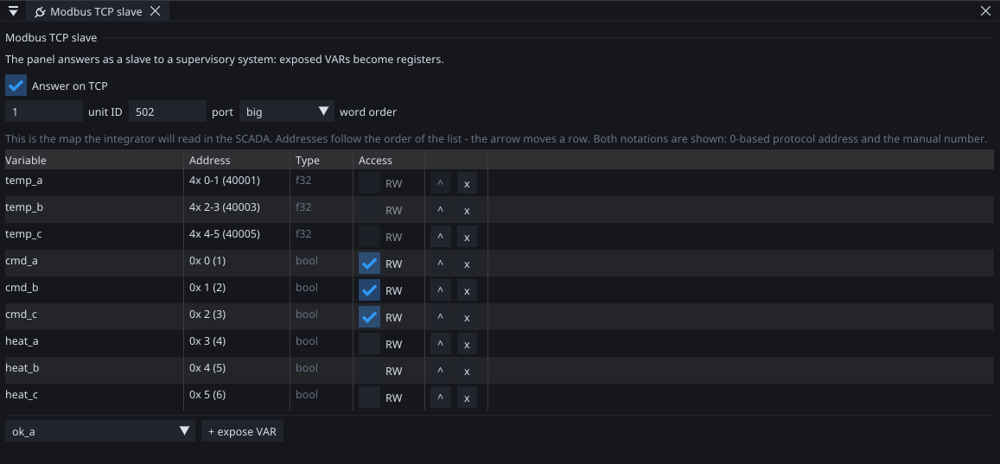
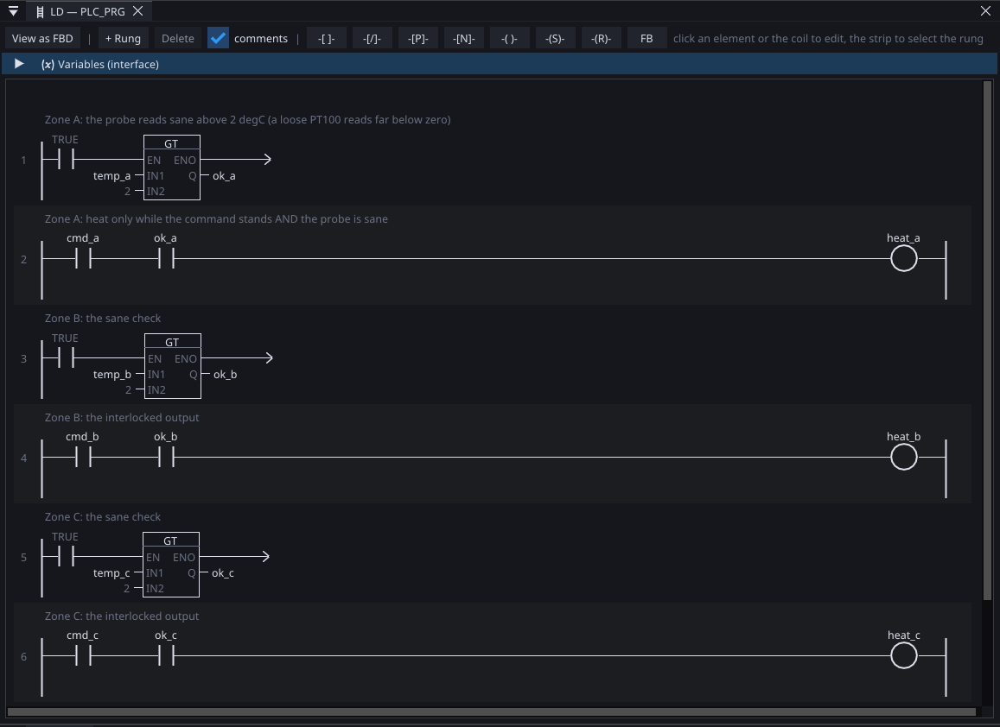
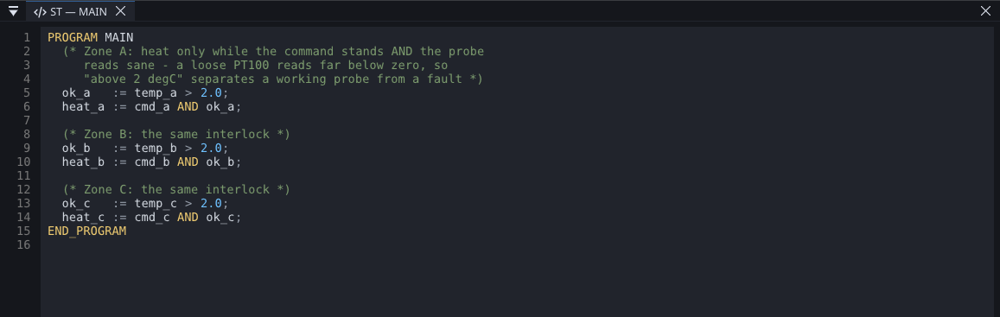
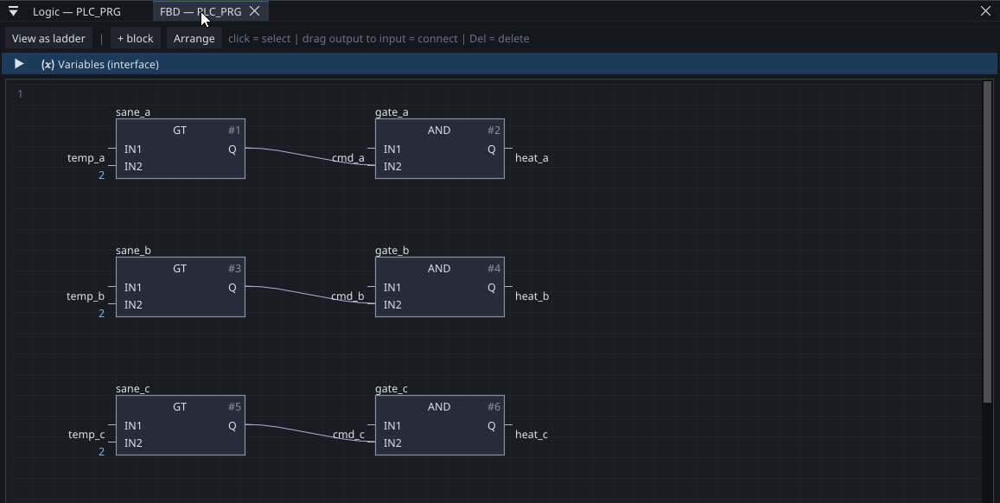
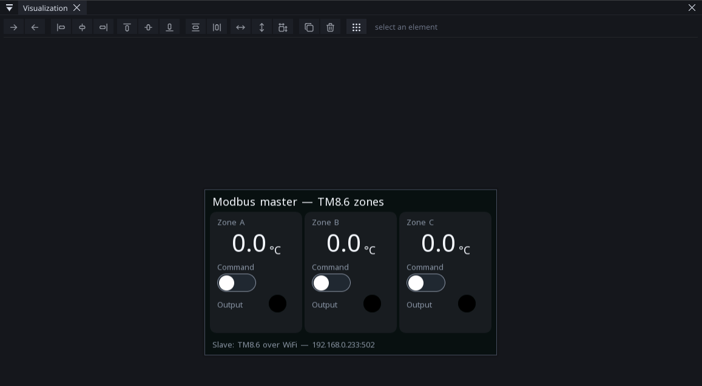
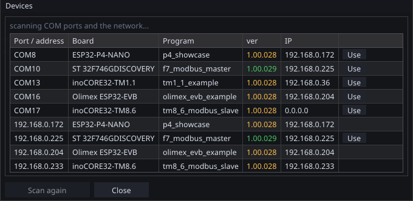

# Two boards over Modbus

A complete, working pair of projects — the kind of job Modbus exists
for. One board sits at the process: it measures three PT100
temperatures and switches three heater outputs. The other is the
operator's panel: it shows the temperatures and takes the commands.
Between them, nothing but Modbus TCP.

| | Board | Transport | Role | Project file |
|:---|:---|:---|:---|:---|
| **At the process** | inoCORE32-TM8.6 | WiFi | Modbus **slave** — measures, owns the outputs | `tm8_6_modbus_slave.prj32` |
| **At the operator** | STM32F746-DISCO | Ethernet | Modbus **master** — displays, commands | `f7_modbus_master.prj32` |

Both files are installed with the editor in `examples\modbus_pair` —
open them side by side while reading. Everything below is the real
bench pair; the screenshots are of these exact files.

New to Modbus itself — registers, addresses, word order? Read
[What Modbus is](modbus-basics.md) first; this page uses those terms
freely.

---

## The design decision worth copying

The master does **not** drive the heaters. It writes a *command*
coil, and the slave's own logic decides whether the output actually
closes — a zone whose sensor reads like a broken probe refuses to
heat no matter what the master asks. The master then reads back what
the output *really* does and shows that.

This split — **the board at the process owns its outputs, the panel
only requests and displays** — is the difference between a system
that survives a WiFi dropout and one that does not. If the link
dies, the slave keeps its interlocks; the master keeps showing the
last known state and its own connection diagnostics.

---

## The slave — TM8.6

### Variables and the map

Twelve variables, three groups:

```yaml
tags:
  # measured temperatures - the MAX31865 drivers write degrees in
  - { name: temp_a, datatype: f32, unit: "°C", decimals: 1, deadband: 0.1,
      source: { periph: { chip: rtd_a, pin: 0 } } }
  # ... temp_b, temp_c the same

  # the master's COMMANDS (written over Modbus as coils)
  - { name: cmd_a, datatype: bool, access: rw }
  # ... cmd_b, cmd_c

  # sensor-ok interlocks, computed by the program
  - { name: ok_a, datatype: bool }
  # ... ok_b, ok_c

  # THE OUTPUTS: SSR relays on real pins
  - { name: heat_a, datatype: bool, access: rw, source: { gpio: { pin: 7 } } }
  # ... heat_b (pin 8), heat_c (pin 19)
```

The Modbus side exposes nine of them. Addresses are assigned in list
order — `bool` becomes a coil, everything else a holding register,
an `f32` taking two (see [Modbus](modbus.md) for the rules):

```yaml
modbus_slave:
  tcp: true
  port: 502
  unit: 1
  word_order: big
  tags:
    - { tag: temp_a }                    # holding 0-1  (40001)
    - { tag: temp_b }                    # holding 2-3  (40003)
    - { tag: temp_c }                    # holding 4-5  (40005)
    - { tag: cmd_a, writable: true }     # coil 0
    - { tag: cmd_b, writable: true }     # coil 1
    - { tag: cmd_c, writable: true }     # coil 2
    - { tag: heat_a }                    # coil 3 - the REAL output state
    - { tag: heat_b }                    # coil 4
    - { tag: heat_c }                    # coil 5
```

Two deliberate choices in that map:

- Only the **commands** are `writable`. A master writing anywhere
  else gets exception 03 — the map itself enforces who owns what.
- The **real outputs** are exposed read-only right after the
  commands. The master can always compare "what I asked" with "what
  is happening" — that gap is the interlock speaking.

The editor's *Modbus TCP slave* page shows this map exactly as the
integrator on the other side will read it, in both address
notations:

{: .sb-center}

### The program

One interlock per zone: the output follows the command **only while
the probe reads sane**. A loose or broken PT100 reads far below
zero, so *above 2 °C* separates a working probe from a fault:

{: .sb-center}

Six rungs, two per zone — the compare writing `ok_x`, then the
classic series pair `cmd_x AND ok_x` into the `heat_x` coil. Three
alarms with a 3-second delay report a failed probe to both screens.

### The three languages

The same program, written three ways — the three files
`slave_logic_ld.prj32`, `slave_logic_st.prj32` and
`slave_logic_fbd.prj32` sit next to the pair in
`examples\modbus_pair` with identical variables, one language each.
They compile to the same behaviour; pick whichever reads best to
you. In ST the whole interlock is six lines:

{: .sb-center}

And as a function block diagram, the dataflow view — the GT feeding
the AND through the `ok_x` variable:

{: .sb-center}

There is no better-or-worse here: ladder shows an electrician the
interlock at a glance, ST says it in the fewest characters, FBD
draws the dataflow. The runtime cannot tell them apart — ladder and
FBD compile through the same path as ST, into the same bytecode.

### Network

The TM8.6 joins the plant WiFi as a station:

```yaml
network:
  mode: sta
  ssid: your_network
  password: your_password
```

It gets its address from DHCP. **Give it a DHCP reservation** on the
router — the master will address it by IP, and a lease change would
silently break the pair. On the bench below it lives at
`192.168.0.233`.

The slave also carries a small WEBview screen showing the three
temperatures, the output LEDs and the alarm table. The board has no
display of its own — but any phone on the network can see exactly
what the master sees, which turns "is it the slave or the link?"
into a thirty-second question.

---

## The master — F7

### Variables: a Modbus source per tag

The master has **no program at all** — it is pure HMI. Every
variable points at the slave:

```yaml
tags:
  # the slave's temperatures - f32 = TWO holding registers each,
  # and word_order must match the slave (big on both ends here)
  - { name: temp_a, datatype: f32, unit: "°C", decimals: 1, deadband: 0.1,
      source: { modbus: { transport: tcp, ip: 192.168.0.233, unit: 1,
                          fc: holding, address: 0, word_order: big } } }
  # temp_b at address 2, temp_c at address 4

  # commands - rw + a coil source = written TO the slave on change
  - { name: cmd_a, datatype: bool, access: rw,
      source: { modbus: { transport: tcp, ip: 192.168.0.233, unit: 1,
                          fc: coil, address: 0 } } }
  # cmd_b, cmd_c at coils 1, 2

  # what the outputs really do (the slave may say no)
  - { name: heat_a, datatype: bool,
      source: { modbus: { transport: tcp, ip: 192.168.0.233, unit: 1,
                          fc: coil, address: 3 } } }
  # heat_b, heat_c at coils 4, 5
```

The rule that makes the switches work: a variable that is both
**`access: rw`** and has a **Modbus source** is a *write-through*
variable. Toggle it on a screen and the board pushes the new value
to the slave the moment it changes — a coil write for a `bool`. The
cyclic read then keeps it honest: if the slave rejects or overrides
the value, the read brings the truth back.

Note what maps where: the master's `heat_a` has **no** `access: rw`
— it is a display of coil 3, nothing more. Only the `cmd_*` trio
writes.

### The screen

One HMI screen, three identical cards — temperature, a *Command*
switch, an *Output* LED:

{: .sb-center}

The switch binds to `cmd_x`, the LED to `heat_x`. That pairing puts
the interlock on display: flip the switch with a healthy probe and
the LED follows; disconnect the probe and the switch stays on while
the LED goes dark — the slave refusing, visibly. A WEBview copy of
the same screen serves phones from the master too.

---

## Bringing the pair up

1. **The slave first, over USB.** The first download carries the
   WiFi credentials, so it has to travel over the cable:
   compile `tm8_6_modbus_slave.prj32` and download. After the
   restart the board joins the network.
2. **Find it.** Open the device scanner (the :ti-eyeglass: button).
   The board answers twice — on its COM port and, a few seconds
   later, from its WiFi address:

    {: .sb-center}

    The *Program* column is the point: `tm8_6_modbus_slave` at
    `192.168.0.233` — the address the master's variables must name.

3. **Fix the address.** Reserve that IP on the router, and make sure
   the master's `ip:` fields say it.
4. **The master.** Compile `f7_modbus_master.prj32`, download over
   ethernet or USB. From its restart on, the temperatures appear on
   the glass within a second or two.
5. **Prove the interlock.** Flip a Command switch — the Output LED
   follows and the SSR on the TM8.6 clicks. Then pull that zone's
   PT100 out of its terminal: the alarm fires after three seconds,
   the output drops, and the switch stays where the operator left it
   — with a dark LED beside it telling the truth.

While both run, [online monitoring](online.md) on either board shows
the pair live: watch `cmd_a` arrive on the slave a poll cycle after
the master's switch flips.

---

## When it does not work

| Symptom | Look at |
|:---|:---|
| No temperatures on the master | is the slave on the network? The scanner must show it. Then the IP in the master's variables — a changed DHCP lease is the classic |
| Temperatures are nonsense values | `word_order` differs between the two ends — see [What Modbus is](modbus-basics.md) |
| Values shifted by one register | an address written from a 1-based manual — the map is 0-based protocol addresses |
| Switch flips but nothing happens | the zone's probe: `ok_x` false means the slave is refusing on purpose — check the alarm table |
| Everything works, then stops after a router restart | the DHCP reservation from step 3 was skipped |

---

## Where next

| | |
|:---|:---|
| [What Modbus is](modbus-basics.md) | the protocol behind this page |
| [Modbus](modbus.md) | the full configuration reference — catalog, limits, RTU |
| [Hot tank](three-zone-thermostat.md) | where this pair grows into a complete regulated system |
| [Finding your boards](find-devices.md) | the scanner used in step 2 |
| [States and motion](states-motion.md) | making those zone cards move |
