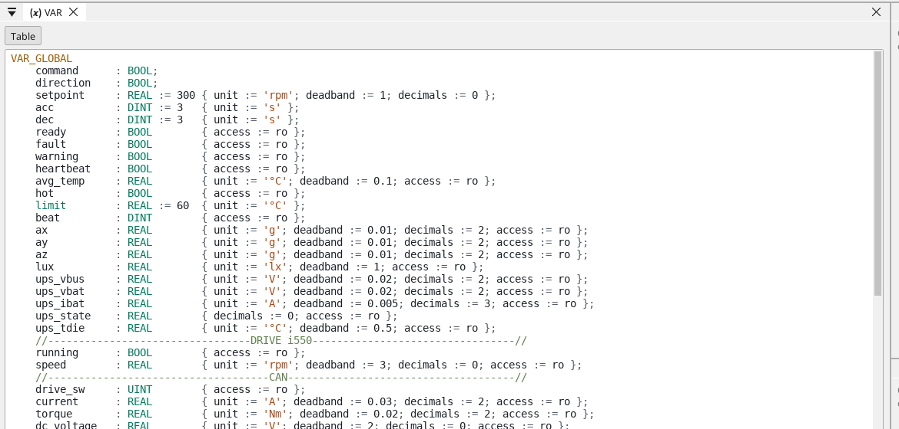
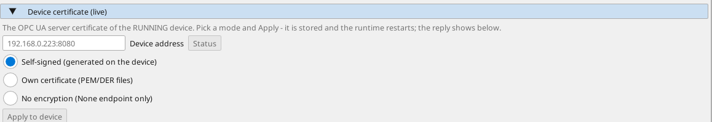

# OPC UA, step by step

A Linux device serves every variable of its project over OPC UA, and
it does so without a single line in the project. This page turns that
on, connects to it, reads a value, writes one back, and says what the
security options mean when the device leaves your desk.

[OPC UA](opcua.md) is the reference; this is the walk.

**What is used here**

- A Linux device running a project — the reTerminal of
  [the walk-through](tutorial-linux-device.md) does nicely.
- Any OPC UA client for the checking. A free browser client is enough.

---

## 1. Turn the server on

In the tree, under the device's **Ethernet**, add **OPC UA**. That is
the whole of it: the device serves its variables on port **4840** from
the next deploy onwards.

{: .sb-center}

---

## 2. What the device serves

Every variable of the project, under one folder named `ctrl32`. A
variable's **node id** is its own name:

```
opc.tcp://<address>:4840        the endpoint
ns=1;s=z_temp_a                 the node id of the variable z_temp_a
```

There is nothing to map and nothing to name twice. A variable that
exists in the project is on the server; a variable renamed in the
project is renamed on the server.

{: .sb-center}

On our own bench the reTerminal serves 46 variables that way — the
zone temperatures, the drive's values, the device's own sensors and
the system variables, all of them.

---

## 3. Read one

Point a client at `opc.tcp://<address>:4840`, open **Objects ›
ctrl32**, and the variables are there with their live values. Reading
one is a click.

A client that prefers to be told the id can take it straight:
`ns=1;s=<variable name>`.

---

## 4. Write one

A variable the project marks **read/write** can be written from a
client, and the write goes the same road a screen's button takes: the
program owns the variable again on its next cycle, so a value a
program computes cannot be held down from outside.

That is worth saying plainly, because it is the difference between a
setpoint and a measurement. A setpoint is yours to write. An actual
value is the program's, and a client writing it is overwritten
immediately.

---

## 5. Security, before the device leaves the desk

The OPC UA page has a **Device certificate** section that works on the
**running device**, not on the project: type its address, pick a mode
and press *Apply to device*. The runtime stores it and restarts, and
the page shows what it answered.

{: .sb-center}

- **Self-signed (generated on the device)** — the device makes its own
  certificate on first start. The client trusts it once. This is the
  normal choice.
- **Own certificate (PEM/DER files)** — when a site issues its
  certificates centrally.
- **No encryption** — the plain endpoint only, for a machine's own
  network behind a panel and a switch nobody else reaches.

The certificate lives with the device, not in the project, so
deploying one project to two devices does not give them the same
identity.

The same page has the other direction: **Import variables from a
server** browses another OPC UA server and brings its variables into
the project, which is how a ctrl32 device reads someone else's PLC.

---

## 6. Check it from the wall

Our own test wall does exactly what this page describes, on every
release: it connects to the reTerminal and the DK2 over OPC UA, reads
a temperature, writes a setpoint, reads it back and restores it. When
that check is green, the road you just set up is the road that was
tested.

---

## When it does not answer

1. **Deploy first.** The server starts with the project that declares
   it; a device running an older project does not have it.
2. **Port 4840** must be reachable — on the device's own network, not
   through a firewall that only forwards the web port.
3. **The device's name.** A client that connects by host name needs
   the name the device answers to; the address always works.
4. **One project, one device.** A device serves the variables of the
   project it runs, not of the one open in the editor.

---

## Where to go next

- [OPC UA](opcua.md) — the reference, including the editor as a
  client reading another server's variables.
- [The Linux runtime](linux-runtime.md) — what else the device does
  while it serves.
- [net32](net32.md) — how ctrl32 devices share variables with each
  other, which is a different job from serving a SCADA.
