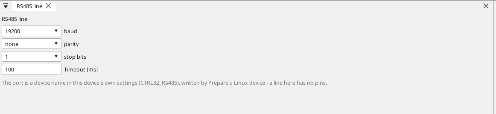
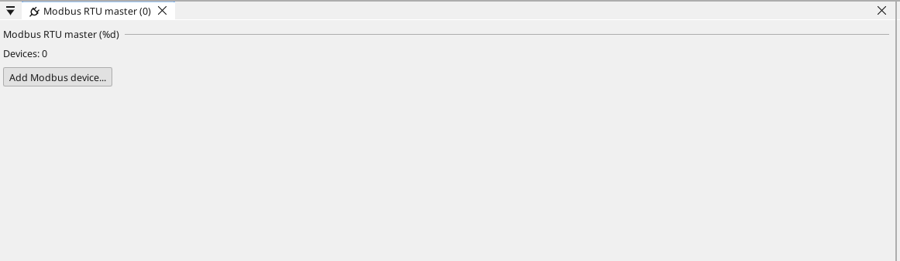
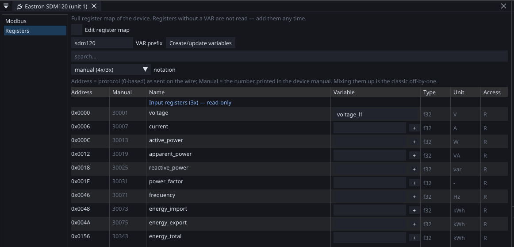

# RS-485, step by step

Two wires, a handful of devices, and the oldest industrial protocol
still worth using. This page goes from a bare pair of wires to a
number on the screen, one step at a time, on a Linux device that
masters two slaves.

[Modbus in ctrl32](modbus.md) is the reference; this is the walk.

**What is used here**

- A Linux device with an RS-485 port — the reTerminal with its E10-1
  expansion, or any device with a USB adapter.
- Two slaves on the same pair: an inoCORE32-TM8.6 with three
  temperature zones and an inoCORE32-TM1.1 panel. Any Modbus RTU
  device does; the addresses and registers change, nothing else.
- The project is `examples\rs485_system.prj32`.

---

## 1. The wires

**A and B, and a common reference.** Every device on the pair is
wired A to A and B to B. A third wire — ground or the cable's shield
at one end — keeps the two ends of a long cable at the same potential;
without it a pair works on a bench and fails in a plant.

**Termination at the two ends, nowhere else.** 120 ohms across A and B
at the first and last device. Termination in the middle of a line is
the most common cause of a bus that works at 9600 and fails at 115200.

**One master.** Modbus RTU has exactly one device that asks; everyone
else answers when spoken to.

---

## 2. Give the device its port

On a Linux device the port is not a pin of a board — it is a name in
the device's own settings. *Online › Prepare a Linux device* writes it;
pick the expansion board and the port comes with it. On the
reTerminal E10-1 that is `ttyS0`, and the same window frees it from
the login console, which would otherwise share the line with your
devices.

{: .sb-center}

In the project, click the **RS485** node in the tree and set what the
slaves use: baud rate, parity, stop bits. Every device on one pair
must agree on all three. The timeout is how long the master waits for
an answer before it calls the device silent.

---

## 3. Say who asks

A device that reads other devices is the **master**. Right-click
**RS485** in the tree and add *Modbus RTU master*; the tree grows a
node for it, and every device you add hangs under it.

{: .sb-center}

---

## 4. Add a device

Add one device per slave and give it the **unit address** the slave
answers to — the address set on the slave itself, by a switch or in
its own configuration. Two devices on one pair must never share it.

The device's registers can come from the catalogue of Modbus devices,
or you name them yourself. Either way you end up with the thing that
matters: a variable with a Modbus source.

{: .sb-center}

---

## 5. A variable is the whole of it

A variable with a Modbus source carries its unit, its register and its
type, and the runtime polls it. Nothing in the program knows that a
value came over a pair of wires:

- **Register** — the address as the slave's manual writes it.
- **Function** — holding register, input register, coil, discrete
  input. A slave's manual says which.
- **Type** — a 16-bit value is one register; an `i32`, `u32` or a
  `TIME` is two, and the pair travels in one request.
- **Word order** matters for 32-bit values and differs between
  vendors. Wrong order gives numbers that are wildly wrong rather than
  slightly wrong, which is how you recognise it.
- **Deadband** on an analog value keeps a noisy input from repainting
  the screen forever.

A **writable** variable is written back to the slave when the program
or a screen changes it. The master reads before it writes, so a
setpoint kept in the slave is not overwritten by the master's boot
value the moment it starts.

---

## 6. Bring it up

Deploy the project. On the device's console — or in the diagnostic
buffer — the master says what it found and what it did not. A unit
that never answers is named there, with its address.

**What to check, in this order**

1. **A and B swapped.** The commonest fault; symptoms are silence, not
   errors.
2. **The address.** Two slaves with the same unit answer together and
   the master sees noise.
3. **Baud, parity, stop bits.** All three, on every device.
4. **Termination.** Two ends, 120 ohms, nowhere else.
5. **The console on the port** — on a Linux device, a login shell on
   the same serial port takes the line. Free it in Prepare.

---

## 7. What it looks like when it works

On our own bench the reTerminal masters both slaves: a TM8.6 with
three temperature zones and a TM1.1 panel. The zone temperature the
master reads matches the slave's own reading to the digit, and the
setpoint written from the master's screen lands in the slave and stays
there. That pair runs in the test wall with every release.

The project is [RS-485 system](example-rs485.md) — one project, three
devices, deployed as one.

---

## The timing, and why it is worth knowing

Modbus RTU has no start or end character. A frame ends when the line
goes quiet for the time of **3.5 characters** at the line's baud rate.
Every ctrl32 device waits that silence before it speaks and uses it to
close a frame it receives.

It matters when a master polls several slaves: every device on the
pair hears every answer, and a request sent too soon after one is
glued to it. If you mix ctrl32 devices with older ones on the same
pair, keep them all on a current version — the timing rule is what
makes a busy pair reliable.

---

## Where to go next

- [Modbus in ctrl32](modbus.md) — the reference: sources, the device
  catalogue, the slave role, the pitfalls.
- [RS-485 system](example-rs485.md) — the example this page walks.
- [Two boards over Modbus](tutorial-modbus-pair.md) — the same idea
  with two boards and a program on each.
