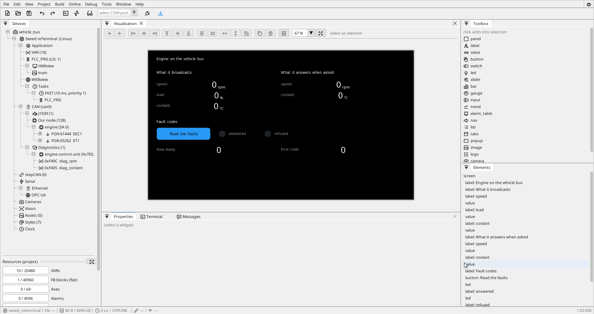
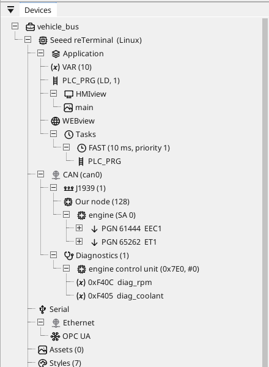
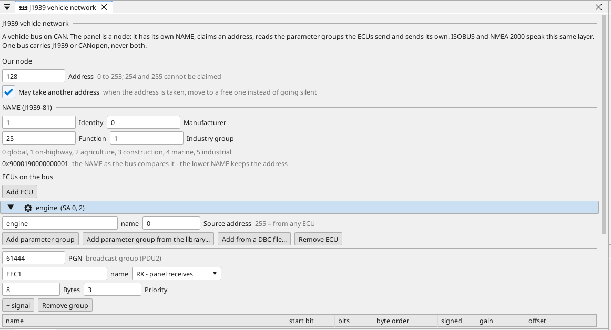
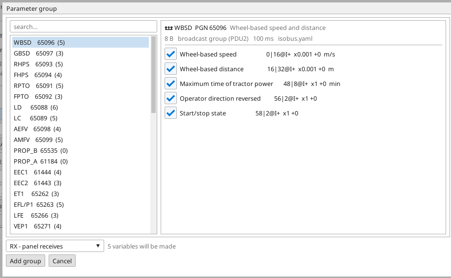
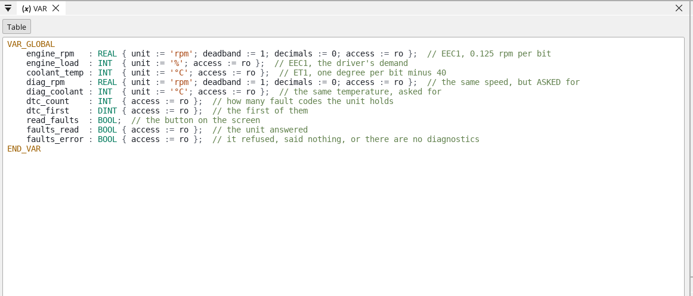
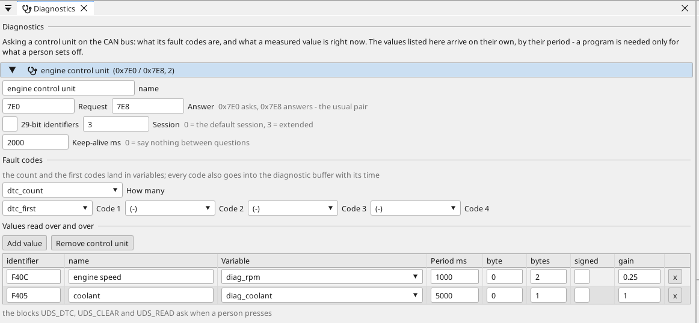
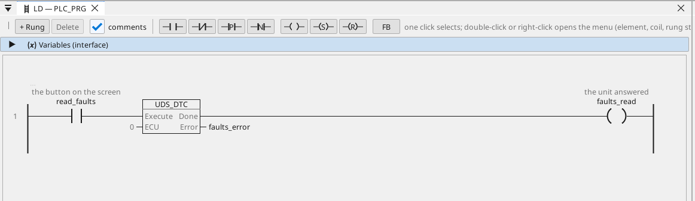

# A vehicle bus, step by step

An engine on a CAN bus broadcasts what it is doing, over and over,
for anyone who cares to listen — and answers questions from anyone
who knows how to ask. This page goes from a cable to both halves
working: the speed and the temperature on a screen, and a button that
reads the control unit's fault codes.

[Vehicle buses](vehicle-buses.md) and
[Vehicle diagnostics](vehicle-diagnostics.md) are the reference; this
is the walk.

{: .sb-center}

**What is used here**

- A **Linux device with a CAN interface** — the reTerminal with its
  E10-1 expansion is the one in the pictures. The listening half works
  on any board with CAN; the asking half needs the Linux runtime.
- An engine control unit on the bus. Any J1939 unit behaves the same
  way; the numbers below are the standard's, not one vendor's.
- The project is `tutorials\vehicle_bus.prj32`. Open it and read
  along, or build it from nothing — every step says which door to use.

---

## 1. The cable, and what the bus runs at

A vehicle bus is ordinary CAN: two wires, terminated at both ends,
every node at the same bit rate. **250 kbit/s** is what J1939 uses on
a truck; marine and agricultural equipment does too, and 500 kbit/s
appears on newer designs. Get it wrong and nothing arrives at all —
there is no negotiation.

Set the interface and its rate in *Online › Prepare a Linux device*
(the buses of the device). The project's CAN node says which interface
it uses, and the runtime brings it up itself.

!!! warning "Listen first"
    On somebody else's vehicle, start in **listen-only**: the device
    reads everything and puts not one bit on the wire. A node that
    claims an address on a live vehicle is a participant, and a
    participant can collide with the unit whose address it took.

---

## 2. Add the vehicle network

In the devices tree, right-click the **CAN** bus and choose **Add
J1939**. That is all it takes — the node appears with a sensible
address and the tree grows the shape you will work in.

{: .sb-center}

The shape reads top to bottom:

| Node | What it is |
|:---|:---|
| **J1939** | the network on this bus |
| **Our node** | the panel itself: its address and its NAME |
| **engine (SA 0)** | a control unit we listen to, at its address |
| **PGN 61444 EEC1** | one parameter group that unit broadcasts |
| **Diagnostics** | the same units, asked instead of overheard |

!!! note "One bus, one higher layer"
    A bus that carries J1939 cannot also carry CANopen. The editor
    will not offer both on one interface, and the build refuses a
    project that tries. A Linux device has four CAN interfaces — the
    drive can have its own.

---

## 3. Say who the panel is

Click **Our node**. Two things live on that page, and both matter on
a real vehicle.

{: .sb-center}

**The address** is how the rest of the bus refers to us. 128 to 247 is
the range for equipment like ours. Leave **May take another address**
ticked: if a unit with a lower NAME wants the same number, the panel
moves to a free one instead of going quiet.

**The NAME** is the sixty-four bits that say what this device is. Two
fields decide how the bus treats it:

- **Function** — 25 is a display. The list is in the standard; pick
  what the device really is.
- **Industry group** — 1 on-highway, 2 agriculture (this is what makes
  a device ISOBUS), 4 marine. It is part of the NAME, so it also
  decides who wins an address contest.

The line under the fields shows the NAME as the bus compares it. The
**lower NAME keeps the address** — that is the whole rule.

---

## 4. Take the parameter groups from the library

Press **Add parameter group from the library…** on the control unit.

{: .sb-center}

Pick **EEC1** (61444) — the engine's own status message, sent every
few dozen milliseconds. Its signals are already there with their bit
positions and their scaling: engine speed at 0.125 rpm per bit, the
driver's demand in percent. Untick what you do not need; each ticked
signal becomes one variable.

Do the same for **ET1** (65262) and its coolant temperature, which is
one degree per bit minus forty. Nobody types an offset.

!!! tip "When the library has not got it"
    A vendor who sends their own data has a **DBC file** for it — the
    same button one row down reads it and offers its messages the same
    way. Proprietary groups (61184 and 65280 upward) are exactly where
    that happens.

The variables land in the project with their units and their scaling,
ready for a screen, a trend or an alarm:

{: .sb-center}

---

## 5. Look at the bus before you trust it

Deploy and watch. The values should move within a second or two of
the engine running.

If nothing arrives, the fault is almost always one of four things, in
this order:

| What you see | What it usually is |
|:---|:---|
| Nothing at all, on any group | the bit rate, or a missing terminator |
| Nothing from one unit | that unit's address is not the one in the project (`SA`) |
| A value that never changes | the group arrives but the signal's bits are wrong — check start bit and width against the vendor's sheet |
| Numbers that look scaled wrong | gain and offset, in the units the sheet uses |

---

## 6. Ask the unit, do not only overhear it

Broadcasts are what a unit chooses to say. The fault codes, and
readings behind a warning lamp, have to be **asked for**.

Right-click the **CAN** bus again and choose **Add diagnostics**, then
open the control unit it made.

{: .sb-center}

**The pair of identifiers** is how a tester and a unit talk: we ask on
`0x7E0`, it answers on `0x7E8`. That pair is the usual one for an
engine; a unit's own document names its own.

**The session** decides what it will answer at all. `0` is the default
session, `3` the extended one, where most readings live. Set the
**keep-alive** to a couple of seconds and the panel keeps that session
open between questions.

**The values** are rows: the identifier the unit's document gives,
which part of the answer to take, how wide it is, its scaling, and the
variable it lands in. A row with a period arrives **on its own** — no
program, exactly like a signal off the bus.

!!! note "Why read the same value twice"
    The project reads engine speed twice on purpose: once from the
    broadcast group, once by asking. Two numbers that disagree tell
    you something a single number never could — one of them is stale,
    or the unit means something different by it.

---

## 7. Put the fault codes on a button

Reading faults is not something to do every second; it is something a
person asks for. One rung does it:

{: .sb-center}

- **`read_faults`** is the screen's button.
- **`UDS_DTC`** asks on the rising edge. `ECU` is which control unit —
  `0` is the first one on the Diagnostics node, the number the tree
  shows beside it.
- **`Done`** means the unit answered; **`Error`** means it refused,
  said nothing, or this device has no diagnostics at all.

What came back is in the variables named on the Diagnostics page: how
many codes, and the first of them. **Every** code also goes into the
diagnostic buffer with the time it was read — that is the record a
service engineer reads afterwards, and it needs no screen at all.

!!! tip "A refusal is an answer"
    A unit may refuse to clear its faults while the engine runs, or
    refuse a reading in the session it is in. `Error` then means
    exactly that; say so on the screen rather than asking again in a
    loop. The answer will not change while the conditions do not.

---

## 8. The screen

Two columns and a button is enough to make the point: what the unit
says by itself on the left, what it says when asked on the right, and
the faults underneath.

{: .sb-center}

The lamps beside the button are the block's `Done` and `Error`. A
person who presses and sees neither light knows the request never got
away — which is a different fault from a unit that answered "no".

---

## What to check when it will not work

| Symptom | Where to look |
|:---|:---|
| No value moves, ever | bit rate, termination, and whether the interface is up |
| The node never takes an address | another unit holds it and has the lower NAME — tick *May take another address* |
| The broadcast works, the asking does not | the diagnostics need a device with a **Linux runtime**; on anything else the blocks report `Error` |
| Every question answers `Error` | the identifiers (`0x7E0` / `0x7E8`), then the session — some units answer nothing outside the extended one |
| One row stays empty, the others fill | that identifier, its byte offset and its width — a unit answers only what it knows |
| The CAN bus also has a drive on it | one bus, one higher layer: move one of them to another interface |

---

## Where to go from here

- [Vehicle buses](vehicle-buses.md) — the reference: the three worlds,
  the transports, the limits.
- [Vehicle diagnostics](vehicle-diagnostics.md) — the reference for
  the asking half.
- [Service blocks](blocks-services.md) — the pin tables and the ST
  examples for `UDS_DTC`, `UDS_CLEAR` and `UDS_READ`.
