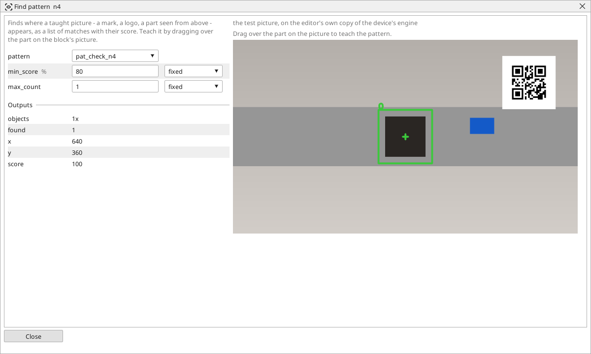
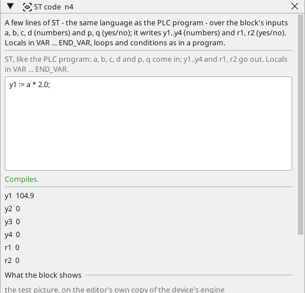

# Vision, step by step

A camera on a Linux device looks at a part on a belt and answers three
questions for the PLC program: **is the part there**, **what does its
code say**, and **where exactly does it lie**. Nothing is programmed -
the check is drawn from blocks, every block has its own window, and the
device computes exactly what the editor showed you.

You need a 64-bit Linux device (the reTerminal, a Raspberry Pi 4 / 5) with a USB camera plugged in (see
[Cameras](cameras.md)). The device's own picture is best; to follow
along without a camera, the editor takes any picture from a file.

## 1. The camera

1. Scan the device on its board page, so the editor knows which cameras
   it has.
2. Right-click **Cameras** under the device → **Add camera**, pick the
   one you plugged in. Leave MJPG on - the camera's own pictures pass
   through the device untouched.
3. Draw a **camera** element on a screen and set its text to the
   camera's name. Deploy, and the live picture is on the device's
   screen and in the browser.

{: .sb-center}

## 2. A vision program

Right-click **Vision** under the device → **Add vision program**. The
new program opens with its camera block already there.

{: .sb-center}

Give the program a test picture first: **Take a picture from the
device** (the camera you just added), or **Open a picture...** from a
file. From now on every block shows what it does with it, and every
value on the page is real.

## 3. Is the part there?

1. Click **Presence** in the Toolbox on the right (the *Ready tools*
   group) - it lands on the graph.
2. Drag from the camera's `out` (the dot on its right) to the presence
   block's `src`. The program is complete: the page says so.
3. Double-click the block. Its window shows the picture; **drag over
   the place where the part sits** to set the area, and set the two
   brightness limits so that the part - darker than the belt - is
   *present* between them.

{: .sb-center}

The frame is green when the answer is *yes*, red when it is *no*.
Change a limit and the answer follows at once.

## 4. What does the code say?

1. Add **Read code**, connect the camera's `out` to its `src`.
2. In its window pick *qr* (or *barcode*), and type the text the code
   must carry in *expect* - or leave it empty to accept any code.

The window shows the code's text on the picture; *found*, *match* and
the code as a *number* are the block's answers, and its *text* can go
into a STRING variable.

## 5. Where does it lie?

A part that is never in the same place needs a block that finds it:

1. Add **Find pattern**, connect the camera to it, and in its window
   **drag over the part** - the cut-out becomes the taught picture
   (a picture of the project, you will see it under Assets).
2. The block now answers *found*, *x*, *y* and the *score* wherever
   the part appears; a place must be at least *min score* alike.

{: .sb-center}

For a calculation the blocks do not have - the distance of two parts,
a tolerance that depends on a variable - add an **ST code** block: a
few lines of ST over its inputs, compiled the moment you leave the
box.

{: .sb-center}

## 6. Into the program

1. Right-click the presence block → **Result present into** → a BOOL
   variable of the project (say `part_ok`); the same for the code's
   *match* and the pattern's *x* and *y*.
2. At the top of the page choose **on a rising edge** and pick the BOOL
   the PLC program sets when the part is in position; pick a BOOL for
   **DONE**. A rung waits on DONE and reads the results.
3. Deploy. The program runs on the device below the PLC; every run
   writes its results, a run that could not look (no picture) writes
   nothing and says why on the device's console.

Online, the block windows show the device's own pictures and values -
the same ones the editor computed at the desk.

## What to check when it does not work

- **The page says "Not complete"** and names the block and the pin -
  an input nothing feeds is drawn red. Connect it.
- **Find pattern says the taught picture has no detail** - the drag
  covered one flat shade. Drag over the part *with its edges*.
- **The device's picture is dark** - the camera's exposure settles over
  its first frames; **Take a picture** waits for that. A lamp helps a
  camera more than any block does.
- **The check is slow** on a small device - put a **Crop** in front of
  the heavy blocks (Find pattern, Read code) so they look only where
  the part can be.
