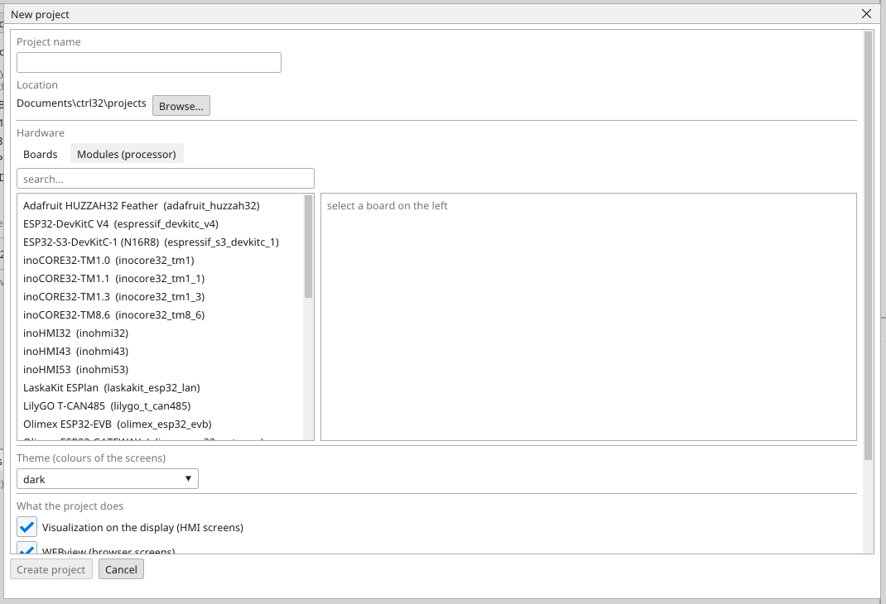
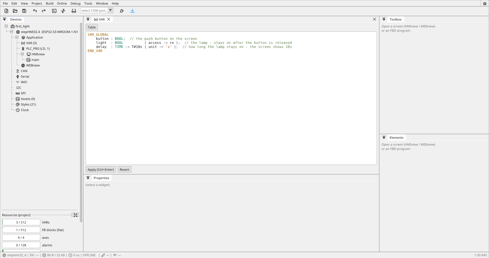
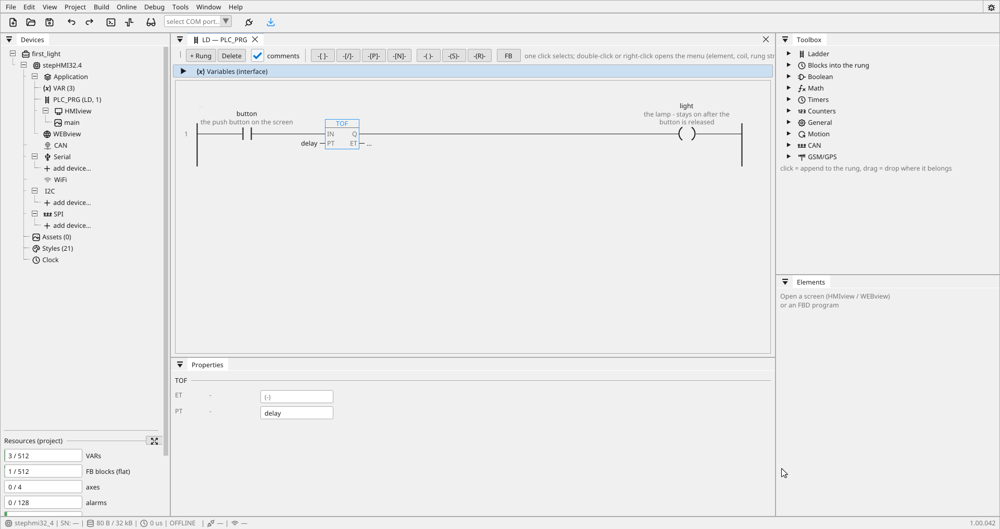
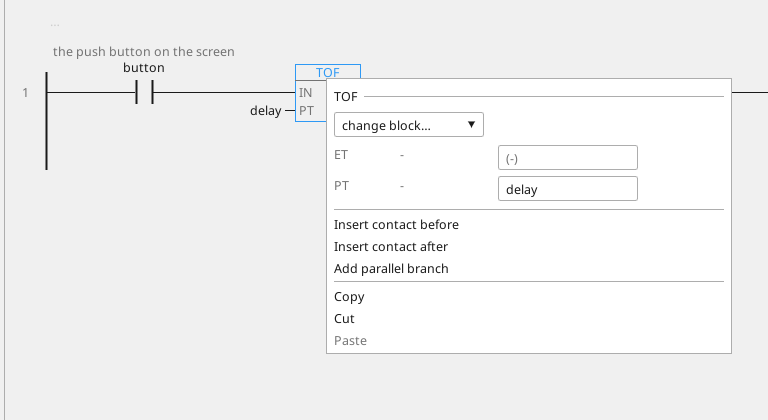
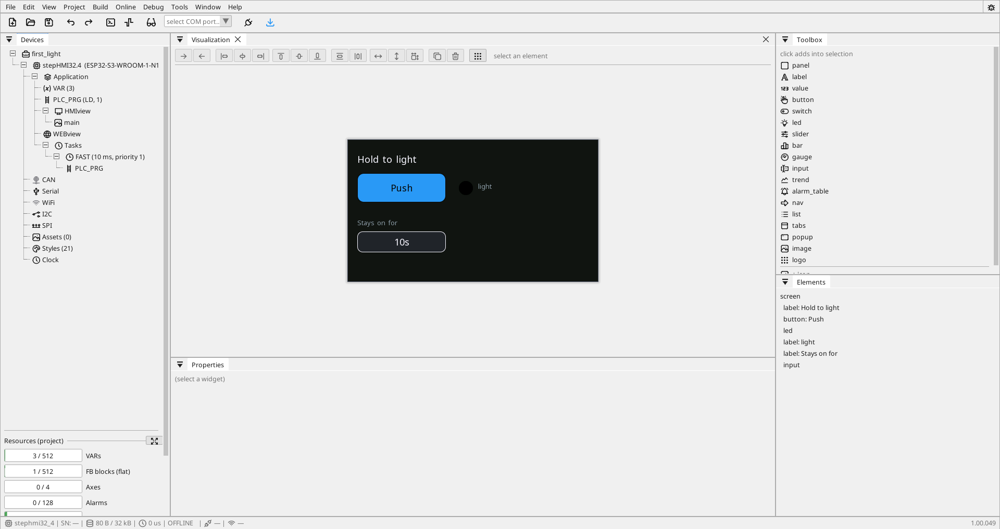

# Your first project

Half an hour, from an empty editor to something running: a project, three
variables, one rung of ladder, a screen, and a download. No hardware
needed until the last step — everything before it runs in simulation on
your PC.

If you would rather start by *looking* at something finished, open one of
the [examples](examples.md) instead. This page is for building one
yourself, which teaches more. The finished result is
`tutorials\first_light.prj32`, so you can compare at any step.

**What we are building:** a light that switches on when a button is
pressed and stays on for ten seconds after it is released. Small, but it
has everything — an input, a timer, an output, and a screen to watch it
on.

---

## 1. A new project

The editor starts empty. Press *New project* — the button on the Welcome
tab, the first icon of the toolbar, or `Ctrl+N`:

{: .sb-center}

1. **Project name** — `first_light`. It becomes the folder and the file:
   `<location>\first_light\first_light.prj32`.
2. **Location** — `Documents\ctrl32\projects` unless you browse elsewhere.
3. **Hardware** — click a board in the list. Its card shows what it
   carries; if you have none yet, pick anything with a display and change
   it later on the board tab. Simulation does not care.

    {: .sb-center}

4. **Theme** — the colours the screens start with. `dark` is fine.
5. **What the project does** — leave *Visualization on the display* and
   *First program in LD* ticked. Untick *WEBview* for now; without browser
   screens of its own the board serves the display's screens to a phone,
   which is what we want here.

*Create project* writes the file and opens the tree. Everything you build
lives under **Application**:

| Object | Holds |
|:---|:---|
| **VAR** | your variables |
| **PLC_PRG** | your program |
| **HMIview** | the board's own screens |
| **WEBview** | the browser's screens |

`VAR`, `PLC_PRG` and one screen are created with the project. You will
not need to add anything else.

---

## 2. Three variables

Open **VAR**. The variables are a table in the PLCopen shape — type them:

```
VAR_GLOBAL
    button : BOOL  { access := rw };
    light  : BOOL;
    delay  : TIME := T#10s { access := rw };
END_VAR
```

{: .sb-center}

| Name | Type | Access | Meaning |
|:---|:---:|:---:|:---|
| `button` | BOOL | rw | the push button on the screen |
| `light` | BOOL | — | the lamp |
| `delay` | TIME | rw | how long the lamp stays on |

*Apply* (`Ctrl+Enter`) takes the table into the project. `rw` means a
screen may write the variable; `light` is written by the program only.

A `TIME` variable holds **milliseconds** — `T#10s` is 10000 — and a screen
shows it the readable way: `10s`, `2s500ms`, `1m5s`. The keypad of an
input takes seconds (milliseconds when the variable's unit is `ms`).

Leave the source as internal for now: these are variables in the board's
memory, which is exactly what you want while learning. Binding one to a
real input is one field, later — see [Variables](variables.md).

---

## 3. One rung

Open **PLC_PRG**. It is a [ladder](ladder.md) program, because that is
what the wizard was told. Build this rung:

```
1   |--[ button ]--[ TOF  PT = delay ]--( light )--|
```

1. *+ Rung*.
2. Click *-[ ]-* in the rung toolbar: a contact appears with `...` where
   its variable goes. Double-click it and pick `button`.
3. Open **Timers** in the Toolbox on the right and click **TOF**. The
   block lands after the contact.
4. Click *-( )-*: a coil at the end of the rung. Double-click it, pick
   `light`.
5. Click the TOF block once. The **Properties** panel below shows its pins;
   set **PT** to the variable `delay`.

{: .sb-center}

A double-click on the block opens the same rows as a sheet, right where
the block is — use whichever is closer to hand:

{: .sb-center}

That is the whole program. `TOF` is the off-delay timer: `Q` follows the
input at once when it rises and holds for `PT` after it drops. The rung
is the block's `IN`; the coil is its `Q`. A parameter can take a variable,
which is what makes the time adjustable from a screen. See
[Timers](blocks-timers.md).

---

## 4. A screen

Open the screen under **HMIview**. The Toolbox now lists widgets; a click
adds one into the selection, then drag it where it belongs and bind it in
**Properties**:

| Widget | Bind to | Set |
|:---|:---|:---|
| **button** | `button` | text *Push*, mode `momentary` — TRUE while held |
| **led** | `light` | |
| **input** | `delay` | min 0.5, max 60 |
| **label** | — | text *Hold to light* |

{: .sb-center}

Make the button big — 40 px tall at least. See [HMIview](hmiview.md) for
why.

The canvas is not an approximation: it runs the board's own renderer, so
what you place is what will appear on the glass.

---

## 5. Run it, with no hardware

Press **Simulate** (the *Debug* menu).

The logic starts running on your PC and the screen goes live. Press the
button on the canvas: the lamp lights. Release it: the lamp stays on for
ten seconds, then goes out.

Type `2` into the delay field and try again. Nothing was rebuilt and
nothing was downloaded — the value is a variable, and the timer reads it
every cycle.

**This is the loop worth getting used to.** Most of a project is built
and tested this way, before any hardware is involved at all.

---

## 6. Put it on a board

When you do have hardware:

{: .sb-center}

1. **Connect it** — USB cable — and pick its port in the toolbar's port
   picker.
2. **Flash the runtime once** — *Flash runtime* on the board tab. This is
   the firmware, and it only has to happen the first time or after an
   update.

    {: .sb-center}

The whole procedure, including the network road for a board that is
already installed, is [Download to the panel](deploy.md).

---

## 7. Watch it from the outside

With the board running, press **ONLINE** (the plug icon).

Live values appear in the rungs: the contact shows whether the button is
pressed, the timer shows its elapsed time counting. That is the same view
you had in simulation — now reading the real board.

And if the board is on a network, open its address in a browser. The
WEBview is there without you having drawn anything: with no browser
screens defined, it serves the board's own.

---

## What you have learned

Small as it is, that project used the whole shape of the tool:

- **variables are the only place values live** — the screen, the logic
  and the outside world all reach the same ones
- **a parameter can be a variable**, which is how something becomes
  adjustable without a rebuild
- **the canvas is exact**, because it runs the same renderer as the board
- **simulation is not a lesser mode** — it is the same logic, on your PC
- **a download cannot brick a board**, because the old program survives a
  failed one

---

## Where to go from here

| You want to | Read |
|:---|:---|
| turn three rungs into a block you can reuse | [Your own function block](own-block.md) |
| know what else is in the block library | [Function blocks](blocks.md) |
| bind a variable to a real input | [Variables](variables.md) |
| talk to a device over Modbus | [Modbus](modbus.md) |
| run a drive over CAN | [A drive over CAN, step by step](tutorial-i550-can.md) |
| make the screen usable by somebody else | [HMIview](hmiview.md) |
| see it on a phone | [WEBview](webview.md) |
| find out why something is not behaving | [Online monitoring](online.md) |

Or read one of the [tutorial projects](tutorials.md) — small ones, each
about a single idea — and then an [example project](examples.md) to see
how a complete one is put together.
