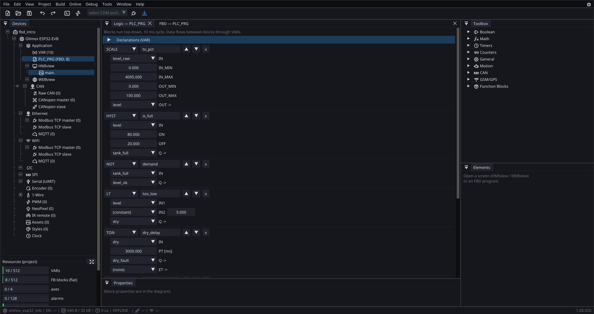

# Tutorial projects

Eleven small projects, each about **one idea**. Open one, read it whole
in a minute, and you know the thing it teaches.

They are deliberately not impressive. A project that demonstrates six
features at once teaches none of them, because you cannot tell which
part is doing what.

Find them in **ProgramData\ctrl32\tutorials**.

!!! success "They are tested on every build"
    Most of these are also regression fixtures: the build compiles them
    and compares the result, every time. So they cannot quietly rot into
    something that no longer works — if one of them does something the
    documentation does not describe, the project is right.

---

## Ladder

| Project | Teaches |
|:---|:---|
| **ladder_sealin** | the seal-in circuit — a start button that latches through the contact it energised. The oldest pattern in ladder, and still the one you write most |
| **ladder_box** | a block **in** a rung with EN/ENO: what happens when the rung stops conducting, and why the answer is "freezes", not "resets" |
| **bit_lamp** | one **bit** of a word under a coil — a lamp test that writes bit 3 without disturbing the rest of the word |

Start with `ladder_sealin`. If you have written ladder before, it will
look familiar in ten seconds and confirm that nothing here is exotic.

---

## Structured Text

| Project | Teaches |
|:---|:---|
| **st_pous** | several program units in one project, and how they are ordered |
| **st_ld_mix** | a ladder POU and an ST POU **in the same project** — the two are not alternatives, they are views you can mix per program unit |
| **st_string** | bounded strings in ST: parsing a command, the motif behind reading a barcode scanner |

`st_ld_mix` is the one worth opening if you are deciding which language
to use. The answer is usually "both" — a sequence in ST, the interlocks
in ladder, because that is where each is clearest.

---

## Function block diagram

| Project | Teaches |
|:---|:---|
| **fbd_intro** | a complete tank controller in seven blocks: 4–20 mA scaled to a percentage, hysteresis deciding "full", and a low-level detector delayed so a wave does not trip it |

---

## Timing and values

| Project | Teaches |
|:---|:---|
| **timer_et** | the `ET` output of a timer bound to a variable — so a delay can be *shown* filling on a screen instead of leaving somebody waiting at a blank panel |
| **time_setpoint** | a `TIME` variable set from the screen: the operator changes a delay without anybody rebuilding anything |
| **pou_order** | why execution order matters, and what happens when two program units' blocks are interleaved |

`time_setpoint` is the small idea with the largest payoff in practice.
Every delay somebody might want to adjust should be a variable, and it
costs one field.

---

## How to use them

**Read first, run second.** These are short enough to read whole, and
the reading is the point. Open the project, look at the variable list,
look at the program, then press **Simulate** and watch it do what you
just read.

**Then break something.** Change a threshold and see what happens.
Delete a rung. Swap two blocks in `pou_order` and watch the value go one
cycle stale. Nothing here can hurt anything, and the failures teach more
than the successes.

**Then copy the pattern.** A seal-in circuit, a timer with its elapsed
time on a screen, a setpoint the operator can change — those are the
pieces most projects are made of.

---

## Where next

| | |
|:---|:---|
| [Your first project](tutorial.md) | build one from an empty file |
| [Examples](examples.md) | the two complete board projects |
| [Function blocks](blocks.md) | everything the library offers |
| [Ladder](ladder.md) · [FBD](fbd-composites.md) · [ST](st-language.md) | the languages themselves |
