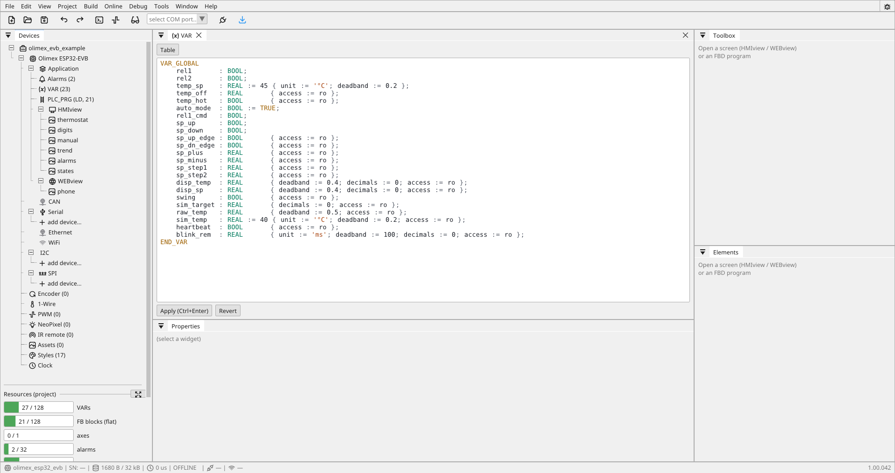

# Variables

**A variable is the only place in the whole system where a value lives.**
A widget holds no value, only a reference to a variable; the logic reads
and writes variables; Modbus, CANopen and the browser all reach the same
ones. That is why the screen, the program and the outside world cannot
drift apart — there is nothing to drift.

The variable table is at the same time the PLC's **process image**.



---

## VAR and RVAR

Variables live in **lists**, and a project has at least one.

| Object | What it is |
|:---|:---|
| **VAR** | a named list of global variables. A project starts with one called `VAR`; add more from *Add Object* to group things by area — `VAR_Heating`, `VAR_Conveyor`. |
| **RVAR** | the **retain** list — its variables survive a power-down. **At most one per project**, added the same way. |

The grouping in VAR lists is for you, not for the program: a variable in
`VAR_Heating` is reached by name exactly like any other. Split them when
a single list stops being something you can scan.

### Retain is membership, not a checkbox

This is the part worth reading twice. **A variable is retained because
it is in the RVAR list** — not because a flag is set on it somewhere.

That single rule prevents the classic mess: retention declared in two
places that disagree, and nobody able to say which values actually
survive a restart. Open RVAR and you are looking at the complete list of
what the board remembers.

Move a variable in, and it is retained. Move it out, and it is not.

### What belongs in RVAR

Things that must be known after power comes back:

- a piece counter, an hour meter
- a setpoint somebody typed
- which step a sequence had reached
- a latched fault that must not clear itself by a power cycle

**What does not:** measurements, calculated values, anything the program
recomputes on its own within a cycle or two.

!!! danger "Never write retained data on every change"
    Retain storage has a finite number of write cycles. A variable
    that changes every cycle and is stored on every change wears the
    memory out within months.

    RVAR is for what you need to remember, not for the instantaneous
    value of a measurement. If you are unsure whether something belongs
    there, ask what breaks if it comes back as zero — if the answer is
    "nothing", leave it in VAR.

!!! success "FRAM makes this painless"
    On hardware with FRAM, writes take microseconds and the endurance is
    practically unlimited, so the whole timing problem around power loss
    disappears. Where retention matters, it is worth choosing hardware
    that has it.

---

## What every variable has

| Property | What it is for |
|:---|:---|
| **name** | the only thing you refer to it by; in ST it is an identifier |
| **type** | `BOOL`, `I16`, `U16`, `I32`, `U32`, `REAL` (f32), `STRING`, `TIME` |
| **access** | `ro` / `rw` — for the browser and the operator, not for the logic |
| **source** | where the value comes from (below) |
| **gain / offset** | conversion to a physical quantity: `y = x · gain + offset` |
| **unit, decimals** | how it is displayed |
| **deadband** | from what change on it counts as a change |

!!! warning "A name must not be an ST keyword"
    Names like `NOT`, `AND`, `VAR`, `REAL`, `TIME` or `END_IF` become
    something else in the generated program. The editor refuses them at
    build time and says which one.

---

## Bits of a word

Every bit of an integer variable is addressable on its own, everywhere
the variable itself goes:

- **ST**: `IF status.5 THEN`, `mask.0 := ready;`
- **Ladder / FBD**: a contact, a coil or a block's bool pin binds
  variable + bit — the picker offers the bit field
- **Screens**: the switch and led widgets carry `bit:`

The index must fit the declared width: bits 0–15 on a 16-bit variable,
0–31 on a 32-bit one. A wrong index, a `REAL`, a `TIME` or a bool (a bool
*is* a bit) are refused at build time with the variable named. The index
is a constant.

!!! success "A bit write never loses a neighbour"
    Writing `mask.0` from the logic while a browser switch flips `mask.7`
    is safe — bits are written atomically, so neither writer can undo the
    other's work.

---

## Where the value comes from

| Source | Meaning |
|:---|:---|
| **internal** | board memory only |
| **modbus** | from a controller, a drive or a meter — unit, function code, address |
| **canopen** | an object from a node's dictionary (index/subindex), over PDO or SDO |
| **gpio** | a local board input or output, optionally inverted |
| **periph** | a chip pin on a local bus (expander, thermometer, LED) |

!!! danger "Word order for Modbus `REAL`"
    A `REAL` travels over Modbus in two 16-bit registers, and **the word
    order differs from vendor to vendor**. It is the most common source
    of nonsense values. There is a `word_order` switch for it — when
    23.5 °C reads as 3.4·10³⁸, start there.

!!! note "SDO never in the cycle"
    CANopen objects read over **SDO** are slow and do not belong in the
    cycle — they are for parameterisation at startup. What belongs in the
    cycle is **PDO**. See [CANopen](canopen.md).

---

## TIME — a duration the operator can set

Delays belong to the operator, not to a rebuild. That is what a `TIME`
variable is for:

```yaml
- { name: delay, datatype: time, unit: s, decimals: 1, init: 2500 }
```

- **the table always holds milliseconds** — the logic, the buses and
  Modbus see an ordinary integer
- **the board shows and edits it in the variable's unit** (`ms`, `s`,
  `min`, `h`). With `unit: s` the widget reads "2.5 s", the operator
  types `2.5` and 2500 is stored
- **`min`/`max` on the `input` widget are in the same unit**, so the
  operator is bounded by numbers they can see
- **in ST it is a `TIME`**, so `t1(PT := delay)` and
  `delay := T#1s500ms` need no conversion

That is how a "preheat time" reaches an operator's screen: an `input`
bound to a `TIME` variable, and the same variable as the timer's `PT`.

!!! note "Time comparisons are unsigned"
    A `TIME` runs past 2³¹ ms (24.8 days), which is ordinary for
    something never switched off. Comparisons are unsigned, so
    `IF t1.ET > T#500ms` still holds after a month.

---

## Deadband is not cosmetics

An analog input always has noise. Without a deadband the board repaints
the display on every flicker of the last bit, and sends that same flicker
over the WebSocket to every connected browser.

Set it **larger than the noise and smaller than what you care about**:
for a pressure resolved to 0.01 bar, 0.05 bar is sensible.

This one field does more for how a project feels to use than any other.

---

## Why reading a variable is the most expensive thing in the cycle

The variable table is **lock-free**: a value is one naturally aligned
32-bit word and a type never changes after registration, so a reader gets
either the old value or the new one, never half of each. The hardware
guarantees it and no lock is needed.

Before that, every access paid for a lock — about 1.5 µs per take/give
pair, which was 20–100× the memory access it guarded. The control
program went from 1.32 ms to **0.30 ms**. See [Performance and
limits](limits.md).

**The practical consequence: keep intermediate results in POU local
variables, not in global ones.** A global variable is an interface — to
the screen, to Modbus, to monitoring. Not scratch space.

!!! warning "A type wider than 32 bits does not fit"
    `LREAL`, `LINT` and a string stored inside the value are unsupported
    precisely because they would break the lock-free read. Strings are
    indices into a string table.

---

## A snapshot, not an instant

The renderer and online monitoring both read a **snapshot**: every value
in it is fresh in itself, but it is not a consistent instant across all
of them. It never was — a writer updates them one at a time.

For display that is right. When you need two values guaranteed to be from
the same cycle, compute them in the logic and write the result.

---

## Limit

**512 variables.** In practice this is the first thing to run out —
before blocks, before compilation. The editor refuses a project over the
limit at build time, at your desk.
