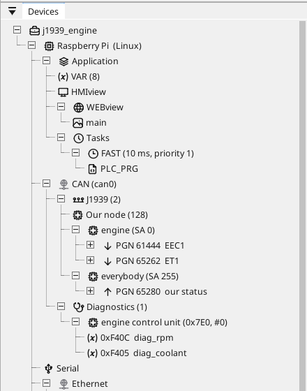
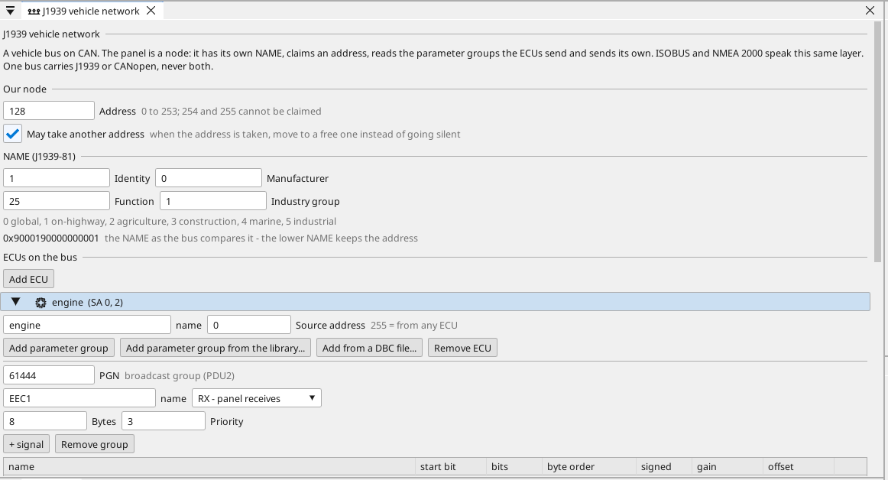
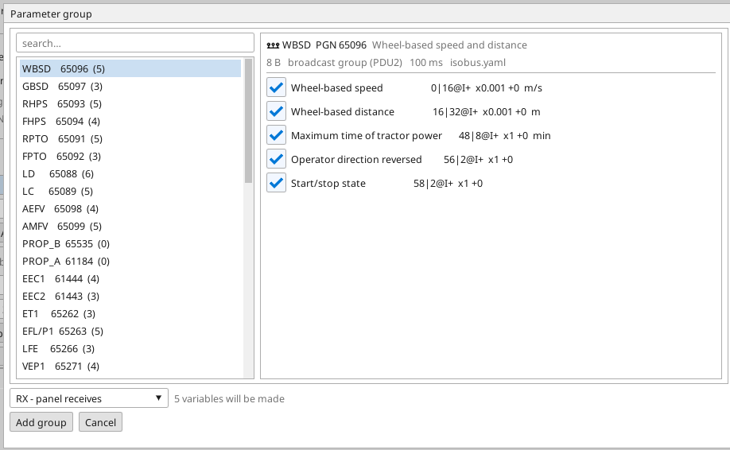

# Vehicle buses (J1939)

A vehicle bus is CAN with a different set of manners. Nothing is
addressed to anybody in particular: every control unit broadcasts what
it measures, over and over, and whoever needs a value simply listens.
The identifier of a frame is not a register number — it carries the
**parameter group** the data belongs to and the **address of the unit
that sent it**.

That layer is **J1939**, and three worlds speak it:

| World | What it is called | What changes |
|:---|:---|:---|
| Trucks, buses, off-road equipment | **J1939** | nothing — this is the base |
| Boats | **NMEA 2000 compatible** | its own transport for long messages, its own parameter groups |
| Tractors and implements | **ISOBUS** | industry group 2 in the name, the implement's own parameter groups |

ctrl32 speaks all three, because underneath they are one layer.

{: .sb-center}

---

## The panel is a node, not a listener

A device on a vehicle bus has a **NAME** — sixty-four bits that say what
it is: the function it performs, the industry it belongs to, the
manufacturer, a serial number. On power-up it asks for an **address**
and defends it: if another unit wants the same one, the **lower NAME
keeps it** and the loser either moves to a free address or goes quiet.

ctrl32 does the whole of that by itself. You choose the address it
should ask for and the fields of its NAME; it claims, defends, and (when
you allow it) moves out of the way.

{: .sb-center}

!!! note "Why the address matters"
    On a vehicle bus the address is how other units know who sent a
    value — and who a request is for. 128 to 247 is the range for
    equipment like ours; 254 and 255 are not addresses at all and
    cannot be asked for.

**One bus carries one higher layer.** J1939 and CANopen may not share a
pair of wires: the identifier ranges do not collide but the load and the
bit rates do, and nobody wants to find that out on a vehicle. A Linux
device has four CAN interfaces, so the drive and the vehicle can each
have their own.

---

## Parameter groups, and where they come from

A **parameter group** (PGN) is a numbered message — "electronic engine
controller 1", "engine temperature", "wheel-based speed and distance" —
with its signals at fixed bit positions inside it. You never have to
invent one: pick it from the library the editor ships.

{: .sb-center}

The library carries the common groups of all three worlds — the engine,
the fuel, the vehicle speed, the fault-code message, the boats' engine
and tank and navigation groups, the tractor's hitches, power take-offs
and valves. Ticking a group makes **one variable per ticked signal**,
already scaled, in a single step you can undo.

Where the library does not reach, the vendor's own **DBC file** does:
the editor reads it the same way and offers its messages in the same
window.

!!! tip "Two kinds of group number"
    Some groups are addressed to one unit and some are broadcast to
    everybody — the number itself decides which, and the editor says so
    beside it. A broadcast group cannot be sent to a single unit; give
    it the address 255 and it goes to all.

---

## Long messages

Eight bytes is one frame. A parameter group longer than that travels in
pieces and is put back together — announced to everybody, or negotiated
with one unit that acknowledges each block. Either way ctrl32 delivers
the message **whole or not at all**: a missing piece never reaches your
variables as half a value.

On the boats the same job is done by a different transport, **Fast
Packet**, and nothing in a frame says which of the two a message uses —
only its number does. The library knows; a group you type in by hand has
a tick box that says it.

| | J1939 transport | Fast Packet |
|:---|:---|:---|
| Used by | trucks, tractors | boats |
| Length | up to 1785 bytes | 9 to 223 bytes |
| Announced | yes | no |
| Acknowledged | when sent to one unit | never |

!!! note "How long a message a panel can hold"
    A Linux device takes the full 1785 bytes. A panel keeps 512, which
    is more than every group in the library needs.

---

## Boats

**NMEA 2000 compatible** means exactly what it says: the same parameter
group numbers, the same transport, the same units — engine speed and
hours, fuel and water tanks, battery, heading, rudder, depth, speed
through water, position, course and speed over ground, wind,
temperature, humidity, pressure. What it does not mean is a
certification: that is a paid conformance process with the association
that owns the name, and we do not claim it.

---

## Tractors and implements

**ISOBUS** is J1939 with the agricultural half on top: the same
addresses, the same claim, and the industry group in the NAME set to
agriculture, which is how a tractor tells an implement from a gearbox.
The groups are the ones an implement works with — wheel-based and
ground-based speed and distance, the front and rear hitch, both power
take-offs, the lighting, the auxiliary valves.

!!! warning "What ISOBUS does not include here"
    The **Virtual Terminal** — the implement uploading its own screens
    to the tractor's terminal and running them there — is not part of
    this. It is a second visualisation system inside ours, and a farmer
    who hears "ISOBUS" usually means that terminal. Our screens are our
    own: the panel shows them, and the tractor's terminal shows its own.

---

## Where it runs

| Device | Vehicle buses |
|:---|:---|
| Linux devices | yes, on any of the four CAN interfaces |
| Boards with CAN | yes, on the one bus they have |
| Boards without a CAN transceiver | no bus to speak on |

What a project may hold: **4 networks** (one per CAN interface),
**32 control units**, **64 parameter groups** and **256 signals**. The
editor refuses more at your desk rather than on the vehicle.

---

## Asking a unit a question

Listening is one half. The other — asking a control unit for its fault
codes or for a value it does not broadcast — is
[vehicle diagnostics](vehicle-diagnostics.md), a separate part with its
own page.

!!! warning "Safety"
    A vehicle bus is not a safety function. Nothing on it replaces a
    hard-wired stop, and reading a value does not make it true a second
    later. Treat what arrives as information for the operator and for
    your logic, not as protection.
