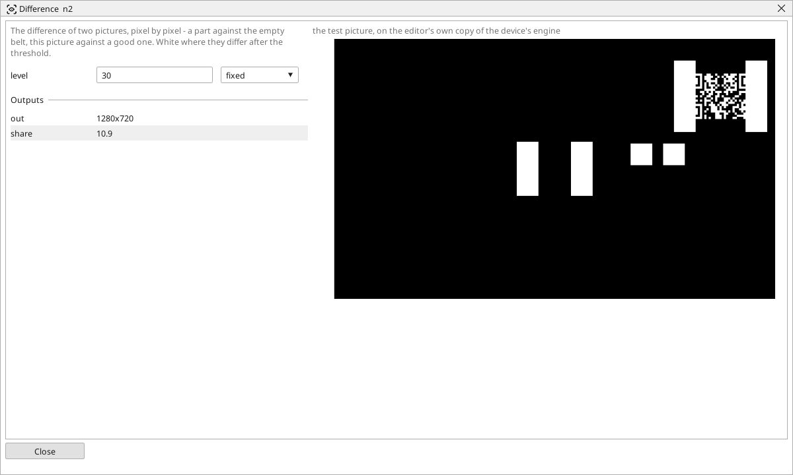

<!-- AUTOMATICALLY GENERATED from schema/visu-vision.yaml (tools/gen_vision.py) -->

# Difference

**Filters** · in the trade: *image subtraction, frame differencing* · in a project file: `absdiff`

The difference of two pictures, pixel by pixel - a part against the empty belt, this picture against a good one. White where they differ after the threshold.

{: .sb-center}

Subtracts two pictures point by point and keeps the size of the difference. Where the two are the same the result is black; where they differ it is bright. After the `level`, the output is black and white: white where the difference is larger than the level. *share* says how much of the picture that is, in percent.

The classic use is a picture of the empty belt against the current one - everything that is not belt is white, whatever its colour or shape - and a current picture against a picture of a good part, where the white shows what is missing or wrong. The two pictures must have the same size; take the reference with a [Camera](vision-camera.md) block whose picture you froze, or with a taught picture through [Compare with taught](vision-golden.md), which does this for one area with a taught reference built in.

## Typical uses

- a part against the empty belt, whatever its colour
- the current part against a good one
- what changed between two cameras' views

## Inputs

| Input | Type | Meaning |
|:---|:---:|:---|
| `a` | picture | the first picture |
| `b` | picture | the second picture, the same size |

## Outputs

| Output | Type | Meaning |
|:---|:---:|:---|
| `out` | picture | black and white: white where the two differ by more than the level |
| `share` | number | the share of the picture that differs, in percent |

A number or a yes/no output goes into a variable of the PLC program (right-click the block on the Vision page, *Result ... into*); a text output into a STRING variable; a picture or a list of objects into the next block.

## Settings

| Setting | Range | Default | Unit | Meaning |
|:---|:---:|:---:|:---:|:---|
| `level` | 1 .. 255 | 30 |  | a difference above this counts |

Every number and yes/no setting can be read from a **variable** before each run instead of being fixed - pick it in the list beside the setting (the variable column of [the block's window](vision.md#the-blocks-window)). A text setting takes a STRING variable the same way.

---

Every block: [Vision blocks](vision-blocks.md) · how a program is drawn and what its window shows: [Vision](vision.md) · the cameras: [Cameras](cameras.md)
