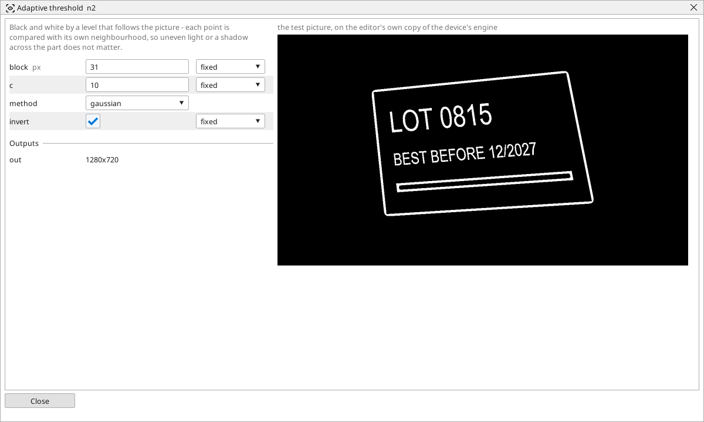

<!-- AUTOMATICALLY GENERATED from schema/visu-vision.yaml (tools/gen_vision.py) -->

# Adaptive threshold

**Colour** · in the trade: *adaptive (local) threshold* · in a project file: `adaptive`

Black and white by a level that follows the picture - each point is compared with its own neighbourhood, so uneven light or a shadow across the part does not matter.

{: .sb-center}

A threshold that follows the picture. Instead of one level for the whole picture, each point is compared with the average of its own neighbourhood (`block` pixels across) less a small constant `c`: brighter than its surroundings is white, darker is black. Uneven light, a shadow across the part, a lamp that is brighter on one side - none of it matters, because every point is judged against what is next to it.

It is the threshold for printed text, codes and marks on a surface that is not evenly lit. It is not the threshold for large flat areas: the middle of a big white part is no brighter than its surroundings and comes out black (the edges white) - for those use [Automatic threshold](vision-otsu.md).

Make `block` larger than the detail you want to keep (a stroke of text wants 11..31, a label 51 and more; it must be odd). A larger `c` keeps fewer, surer points.

## Typical uses

- text and codes under uneven light
- a mark on a surface with a shadow across it
- a print on a curved part

## Inputs

| Input | Type | Meaning |
|:---|:---:|:---|
| `src` | picture | a gray or colour picture |

## Outputs

| Output | Type | Meaning |
|:---|:---:|:---|
| `out` | picture | black and white: white where a point is brighter than its surroundings |

A number or a yes/no output goes into a variable of the PLC program (right-click the block on the Vision page, *Result ... into*); a text output into a STRING variable; a picture or a list of objects into the next block.

## Settings

| Setting | Range | Default | Unit | Meaning |
|:---|:---:|:---:|:---:|:---|
| `block` | 3 .. 255 | 11 | px | the neighbourhood (odd) |
| `c` | -50 .. 50 | 2 |  | taken off the neighbourhood's mean before comparing |
| `method` | gaussian / mean | gaussian |  | how the neighbourhood is averaged |
| `invert` | yes / no | no |  | white where it is darker instead |

Every number and yes/no setting can be read from a **variable** before each run instead of being fixed - pick it in the list beside the setting (the variable column of [the block's window](vision.md#the-blocks-window)). A text setting takes a STRING variable the same way.

---

Every block: [Vision blocks](vision-blocks.md) · how a program is drawn and what its window shows: [Vision](vision.md) · the cameras: [Cameras](cameras.md)
