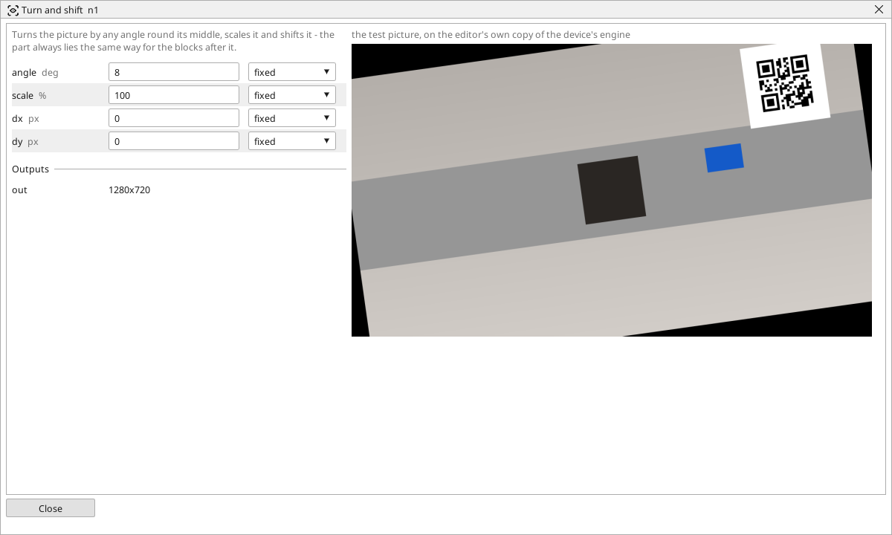

<!-- AUTOMATICALLY GENERATED from schema/visu-vision.yaml (tools/gen_vision.py) -->

# Turn and shift

**Geometry** · in the trade: *affine transform (rotation, scale, translation)* · in a project file: `affine`

Turns the picture by any angle round its middle, scales it and shifts it - the part always lies the same way for the blocks after it.

{: .sb-center}

Turns the picture by any angle round its middle, scales it and shifts it by a number of pixels. A camera mounted a few degrees off, a part that always lies at the same slant, a picture that should sit a little to the left for the areas drawn on it - one block puts it right, and every block after it works on a picture where the part lies the way the areas were drawn.

The angle is anticlockwise in degrees, the scale in percent, the shift in pixels to the right and down. Corners that turn out of the picture are lost and the corners that turn in are black.

For a part that lies differently on every picture use [Fixture](vision-fixture.md), which measures the shift and the turn each time; Turn and shift is for a correction that is always the same.

## Typical uses

- a camera mounted a few degrees off
- a part that always lies at the same slant
- a fixed shift so that the areas sit where they were drawn

## Inputs

| Input | Type | Meaning |
|:---|:---:|:---|
| `src` | picture | the picture to turn, scale and shift |

## Outputs

| Output | Type | Meaning |
|:---|:---:|:---|
| `out` | picture | the corrected picture, the same size as the input |

A number or a yes/no output goes into a variable of the PLC program (right-click the block on the Vision page, *Result ... into*); a text output into a STRING variable; a picture or a list of objects into the next block.

## Settings

| Setting | Range | Default | Unit | Meaning |
|:---|:---:|:---:|:---:|:---|
| `angle` | -360 .. 360 | 0 | deg | anticlockwise |
| `scale` | 5 .. 400 | 100 | % | size of the result |
| `dx` | -8192 .. 8192 | 0 | px | shift to the right |
| `dy` | -8192 .. 8192 | 0 | px | shift down |

Every number and yes/no setting can be read from a **variable** before each run instead of being fixed - pick it in the list beside the setting (the variable column of [the block's window](vision.md#the-blocks-window)). A text setting takes a STRING variable the same way.

---

Every block: [Vision blocks](vision-blocks.md) · how a program is drawn and what its window shows: [Vision](vision.md) · the cameras: [Cameras](cameras.md)
