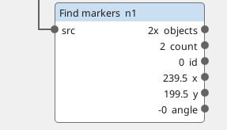
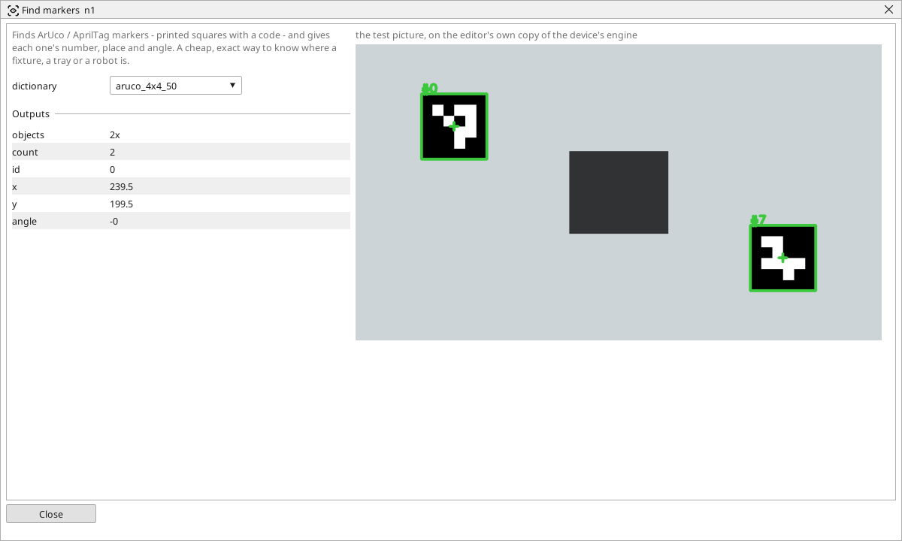

<!-- AUTOMATICALLY GENERATED from schema/visu-vision.yaml (tools/gen_vision.py) -->

# Find markers

**Finding objects** · in the trade: *fiducial markers (ArUco, AprilTag)* · in a project file: `aruco`

Finds ArUco / AprilTag markers - printed squares with a code - and gives each one's number, place and angle. A cheap, exact way to know where a fixture, a tray or a robot is.

{: .sb-center}

{: .sb-center}

## Where it runs

| Linux runtime, 64-bit | Linux runtime, 32-bit ARM | ESP32 boards | STM32 |
|:---:|:---:|:---:|:---:|
| yes | - | - | - |

**Needs:** a camera of the project (a USB camera or a stream address).

## Description

Finds printed markers - ArUco squares and AprilTags, the black-and-white squares with a code inside - and gives each one's number, place and angle. A marker is found exactly, from any angle, in poor light, and it carries a number: the cheapest way to know where a fixture, a tray, a pallet or a robot's hand is, and which one it is. Print the markers from the chosen `dictionary` (free generators exist for every family) and stick them on.

*id*, *x*, *y* and *angle* are the marker with the lowest number; the list carries every marker found with its number in the object's id. Four markers on the corners of a tray and a [Straighten](vision-warp.md) block make a top view of the tray; one marker on a part is the part's position and angle for a [Fixture](vision-fixture.md)-like correction without teaching.

## Typical uses

- which tray or pallet is in front of the camera, and where
- a robot's hand or a fixture located exactly
- four corners of a tray for a Straighten

## Inputs

| Input | Type | Meaning |
|:---|:---:|:---|
| `src` | picture | a gray or colour picture |

## Outputs

| Output | Type | Meaning |
|:---|:---:|:---|
| `objects` | list of objects | every marker found, its number as the object's id, its corners as the frame |
| `count` | number | how many markers were found |
| `id` | number | the number of the marker with the lowest number |
| `x` | number | that marker's centre, pixels from the left |
| `y` | number | that marker's centre, pixels from the top |
| `angle` | number | that marker's angle, in degrees |

A number or a yes/no output goes into a variable of the PLC program (right-click the block on the Vision page, *Result ... into*); a text output into a STRING variable; a picture or a list of objects into the next block.

## Settings

| Setting | Range | Default | Unit | Meaning |
|:---|:---:|:---:|:---:|:---|
| `dictionary` | aruco_4x4_50 / aruco_5x5_100 / aruco_6x6_250 / aruco_7x7_50 / apriltag_36h11 | aruco_4x4_50 |  | the family the markers were printed from |

Every number and yes/no setting can be read from a **variable** before each run instead of being fixed - pick it in the list beside the setting (the variable column of [the block's window](vision.md#the-blocks-window)). A text setting takes a STRING variable the same way.

---

Every block: [Vision blocks](vision-blocks.md) · how a program is drawn and what its window shows: [Vision](vision.md) · the cameras: [Cameras](cameras.md)
