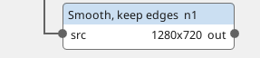
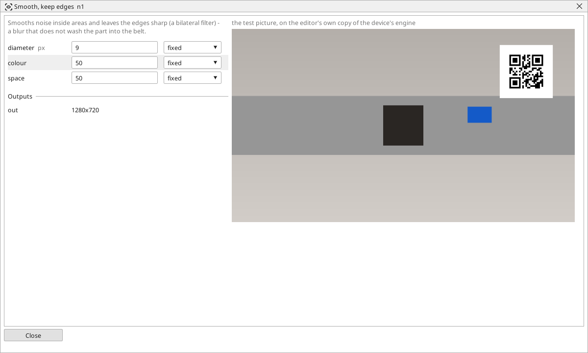

<!-- AUTOMATICALLY GENERATED from schema/visu-vision.yaml (tools/gen_vision.py) -->

# Smooth, keep edges

**Filters** · in the trade: *bilateral filter (edge-preserving smoothing)* · in a project file: `bilateral`

Smooths noise inside areas and leaves the edges sharp (a bilateral filter) - a blur that does not wash the part into the belt.

{: .sb-center}

{: .sb-center}

## Where it runs

| Linux runtime, 64-bit | Linux runtime, 32-bit ARM | ESP32 boards | STM32 |
|:---:|:---:|:---:|:---:|
| yes | - | - | - |

**Needs:** a camera of the project (a USB camera or a stream address).

## Description

Smooths the noise inside areas and leaves the edges sharp. A point is averaged only with neighbours of a similar shade (within `colour`) and within `space` of it, so the belt's texture and the camera's noise disappear while the part's edge stays exactly where it was - a blur that does not wash the part into the background. It is the filter to put before a threshold when the part and the belt are close in shade.

It is slower than the other filters: keep `diameter` small (5 to 9) and feed it a cropped or halved picture.

## Typical uses

- a textured belt smoothed with the part's edge kept
- noise removed before a measurement

## Inputs

| Input | Type | Meaning |
|:---|:---:|:---|
| `src` | picture | a noisy picture with edges that must stay |

## Outputs

| Output | Type | Meaning |
|:---|:---:|:---|
| `out` | picture | the picture smoothed inside the areas, the edges kept |

A number or a yes/no output goes into a variable of the PLC program (right-click the block on the Vision page, *Result ... into*); a text output into a STRING variable; a picture or a list of objects into the next block.

## Settings

| Setting | Range | Default | Unit | Meaning |
|:---|:---:|:---:|:---:|:---|
| `diameter` | 1 .. 15 | 7 | px | how far around each point is looked at |
| `colour` | 1 .. 255 | 50 |  | how different a shade may be and still be smoothed together |
| `space` | 1 .. 255 | 50 |  | how far a point still counts |

Every number and yes/no setting can be read from a **variable** before each run instead of being fixed - pick it in the list beside the setting (the variable column of [the block's window](vision.md#the-blocks-window)). A text setting takes a STRING variable the same way.

---

Every block: [Vision blocks](vision-blocks.md) · how a program is drawn and what its window shows: [Vision](vision.md) · the cameras: [Cameras](cameras.md)
