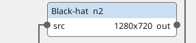
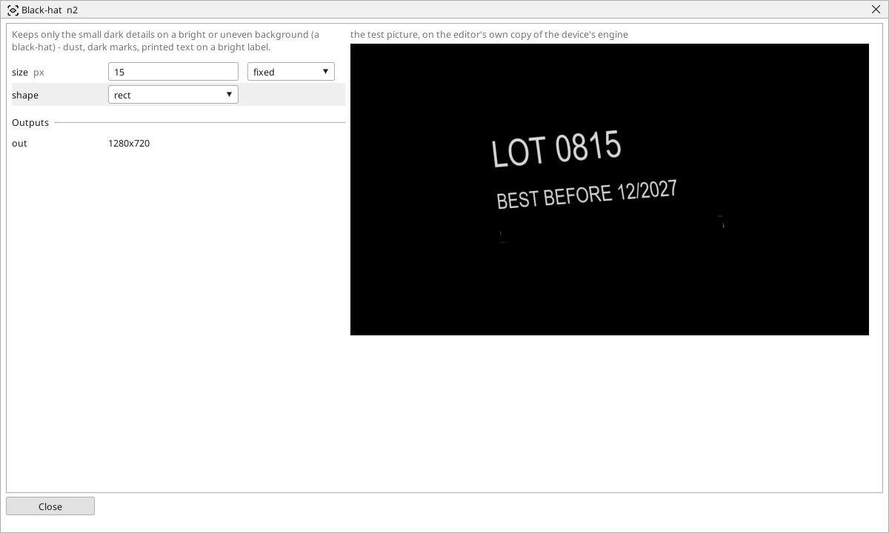

<!-- AUTOMATICALLY GENERATED from schema/visu-vision.yaml (tools/gen_vision.py) -->

# Black-hat

**Shapes** · in the trade: *black-hat transform* · in a project file: `blackhat`

Keeps only the small dark details on a bright or uneven background (a black-hat) - dust, dark marks, printed text on a bright label.

{: .sb-center}

{: .sb-center}

## Where it runs

| Linux runtime, 64-bit | Linux runtime, 32-bit ARM | ESP32 boards | STM32 |
|:---:|:---:|:---:|:---:|
| yes | - | - | - |

**Needs:** a camera of the project (a USB camera or a stream address).

## Description

Keeps only the small dark details on a bright or uneven background: the picture's own Close minus the picture. Dust, dark marks, printed text on a bright label, a crack in a light surface - everything dark and smaller than the brush of `size` pixels stays bright in the output, the rest goes black. A threshold after it turns the detail into shapes to count or to measure.

Set `size` a little larger than the detail to keep. [Top-hat](vision-tophat.md) is the same for small BRIGHT details.

## Typical uses

- dust and dark marks on a light surface
- printed text on a bright label
- a crack in a light part

## Inputs

| Input | Type | Meaning |
|:---|:---:|:---|
| `src` | picture | a gray picture |

## Outputs

| Output | Type | Meaning |
|:---|:---:|:---|
| `out` | picture | the small dark details, bright on a black background |

A number or a yes/no output goes into a variable of the PLC program (right-click the block on the Vision page, *Result ... into*); a text output into a STRING variable; a picture or a list of objects into the next block.

## Settings

| Setting | Range | Default | Unit | Meaning |
|:---|:---:|:---:|:---:|:---|
| `size` | 1 .. 99 | 9 | px | a detail larger than this is background |
| `shape` | rect / ellipse / cross | rect |  | the shape of the structuring element |

Every number and yes/no setting can be read from a **variable** before each run instead of being fixed - pick it in the list beside the setting (the variable column of [the block's window](vision.md#the-blocks-window)). A text setting takes a STRING variable the same way.

---

Every block: [Vision blocks](vision-blocks.md) · how a program is drawn and what its window shows: [Vision](vision.md) · the cameras: [Cameras](cameras.md)
