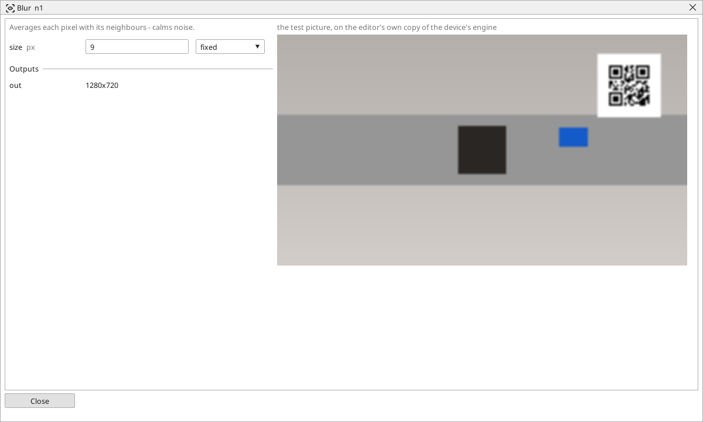

<!-- AUTOMATICALLY GENERATED from schema/visu-vision.yaml (tools/gen_vision.py) -->

# Blur

**Filters** · in the trade: *box filter (mean filter)* · in a project file: `blur`

Averages each pixel with its neighbours - calms noise.

{: .sb-center}

Averages every pixel with its neighbours in a square of `size` pixels. Noise calms down, fine texture disappears, and a threshold after it gives clean shapes instead of a snowstorm. The price is that edges soften - a code or a caliper measured after a blur loses precision.

Three to five pixels is the usual size for noise; a blur much larger than the detail you want to keep washes it away. [Gaussian blur](vision-gauss.md) does the same with less damage to edges, [Median](vision-median.md) removes specks without softening anything.

## Typical uses

- noise calmed before a threshold
- fine texture removed from a surface

## Inputs

| Input | Type | Meaning |
|:---|:---:|:---|
| `src` | picture | the picture to smooth |

## Outputs

| Output | Type | Meaning |
|:---|:---:|:---|
| `out` | picture | the smoothed picture |

A number or a yes/no output goes into a variable of the PLC program (right-click the block on the Vision page, *Result ... into*); a text output into a STRING variable; a picture or a list of objects into the next block.

## Settings

| Setting | Range | Default | Unit | Meaning |
|:---|:---:|:---:|:---:|:---|
| `size` | 1 .. 99 | 5 | px | size of the neighbourhood |

Every number and yes/no setting can be read from a **variable** before each run instead of being fixed - pick it in the list beside the setting (the variable column of [the block's window](vision.md#the-blocks-window)). A text setting takes a STRING variable the same way.

---

Every block: [Vision blocks](vision-blocks.md) · how a program is drawn and what its window shows: [Vision](vision.md) · the cameras: [Cameras](cameras.md)
