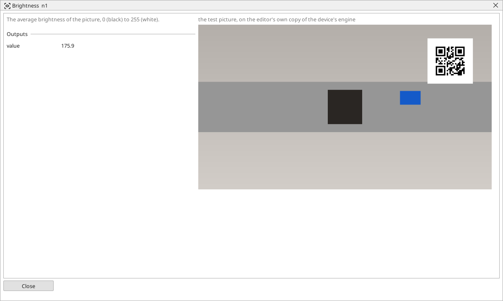

<!-- AUTOMATICALLY GENERATED from schema/visu-vision.yaml (tools/gen_vision.py) -->

# Brightness

**Measurements** · in the trade: *mean intensity* · in a project file: `brightness`

The average brightness of the picture, 0 (black) to 255 (white).

{: .sb-center}

The mean intensity of the picture it receives, 0 (black) to 255 (white). The simplest measurement there is, and often enough: with a [Crop](vision-crop.md) in front of it it says whether a lamp is on, whether the lens is covered, whether a part (darker than the belt) lies in the window. Put an [In range](vision-in_range.md) after it for a yes/no, or send the value into a variable the PLC program compares itself.

For a measurement of ONE area without a Crop, with a yes/no built in, use [Presence](vision-presence.md); for the darkest, the brightest and the spread as well, [Brightness statistics](vision-stats.md).

## Typical uses

- is the lamp on, is the lens covered
- is there something dark in the window
- a lighting trend on a screen

## Inputs

| Input | Type | Meaning |
|:---|:---:|:---|
| `src` | picture | the picture (a colour one is taken by its brightness) |

## Outputs

| Output | Type | Meaning |
|:---|:---:|:---|
| `value` | number | the mean brightness, 0..255 |

A number or a yes/no output goes into a variable of the PLC program (right-click the block on the Vision page, *Result ... into*); a text output into a STRING variable; a picture or a list of objects into the next block.

## Settings

The block has no settings.

## Used in

- The reTerminal with EtherCAT (the code reader) - a shipped example project

---

Every block: [Vision blocks](vision-blocks.md) · how a program is drawn and what its window shows: [Vision](vision.md) · the cameras: [Cameras](cameras.md)
