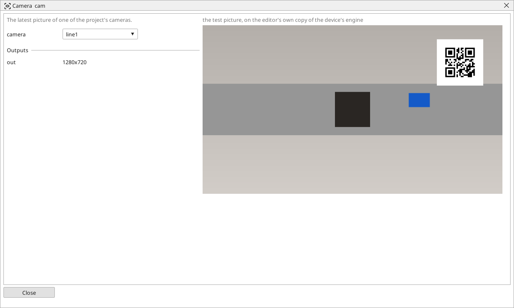

<!-- AUTOMATICALLY GENERATED from schema/visu-vision.yaml (tools/gen_vision.py) -->

# Camera

**Source** · in the trade: *image acquisition* · in a project file: `camera`

The latest picture of one of the project's cameras.

{: .sb-center}

The first block of nearly every program. It hands over the newest picture the named camera delivered - the device keeps the last picture of each camera in memory, so the block costs nothing and never waits for the camera. A program that runs faster than the camera delivers sees the same picture twice; a program that runs slower simply skips pictures.

The camera is one of the project's cameras (see [Cameras](cameras.md)): its name goes into the setting. A new program is created with this block already in it, set to the project's first camera; a program with two cameras has two of these blocks.

On the editor's test picture the block shows that picture. Online it shows what the device just took.

## Typical uses

- the newest picture of a USB camera
- an IP camera's MJPEG or RTSP stream
- two cameras in one program, one block each

## Inputs

The block has no input - it is a source.

## Outputs

| Output | Type | Meaning |
|:---|:---:|:---|
| `out` | picture | the camera's newest picture, in colour, at the size set on the camera's page |

A number or a yes/no output goes into a variable of the PLC program (right-click the block on the Vision page, *Result ... into*); a text output into a STRING variable; a picture or a list of objects into the next block.

## Settings

| Setting | Range | Default | Unit | Meaning |
|:---|:---:|:---:|:---:|:---|
| `camera` | text | (empty) |  | the camera's name in the project |

Every number and yes/no setting can be read from a **variable** before each run instead of being fixed - pick it in the list beside the setting (the variable column of [the block's window](vision.md#the-blocks-window)). A text setting takes a STRING variable the same way.

## Used in

- [Bottle check](example-bottle-check.md)
- [People counter](example-people-counter.md)
- [The reTerminal with EtherCAT (the code reader)](example-reterminal-ecat.md)

---

Every block: [Vision blocks](vision-blocks.md) · how a program is drawn and what its window shows: [Vision](vision.md) · the cameras: [Cameras](cameras.md)
