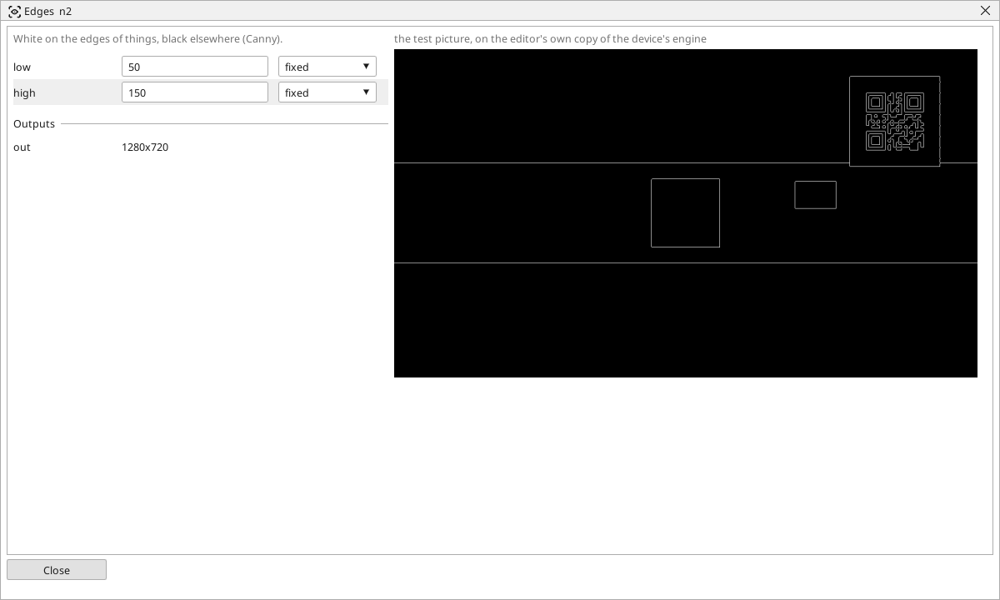

<!-- AUTOMATICALLY GENERATED from schema/visu-vision.yaml (tools/gen_vision.py) -->

# Edges

**Edges** · in the trade: *edge detection (Canny)* · in a project file: `canny`

White on the edges of things, black elsewhere (Canny).

{: .sb-center}

Marks the edges of things with thin white lines on black (the Canny detector): the outline of a part, the border of a label, the strokes of a print - and nothing in the flat areas between. It is the picture [Find lines](vision-lines.md), [Find circles](vision-circles.md) and [Find objects](vision-contours.md) work best on, and it is independent of how bright the picture is, because an edge is a change of brightness, not a level.

Two thresholds control it: an edge starts where the change is stronger than `high` and continues along weaker changes down to `low`, so a strong edge is followed into its faint stretches while faint noise alone is dropped. A ratio of two or three between them is the usual choice; raise both when the picture is noisy, lower them when faint edges are missed. A [Gaussian blur](vision-gauss.md) of 3 or 5 before it removes the noise that would otherwise become short false edges.

## Typical uses

- the edge picture for Find lines and Find circles
- an outline independent of the lamp's brightness
- the strokes of a print as thin lines

## Inputs

| Input | Type | Meaning |
|:---|:---:|:---|
| `src` | picture | a gray or colour picture |

## Outputs

| Output | Type | Meaning |
|:---|:---:|:---|
| `out` | picture | the edges, one pixel wide, white on black |

A number or a yes/no output goes into a variable of the PLC program (right-click the block on the Vision page, *Result ... into*); a text output into a STRING variable; a picture or a list of objects into the next block.

## Settings

| Setting | Range | Default | Unit | Meaning |
|:---|:---:|:---:|:---:|:---|
| `low` | 0 .. 1000 | 50 |  | weaker edges continue a strong one above this |
| `high` | 0 .. 1000 | 150 |  | an edge starts above this |

Every number and yes/no setting can be read from a **variable** before each run instead of being fixed - pick it in the list beside the setting (the variable column of [the block's window](vision.md#the-blocks-window)). A text setting takes a STRING variable the same way.

---

Every block: [Vision blocks](vision-blocks.md) · how a program is drawn and what its window shows: [Vision](vision.md) · the cameras: [Cameras](cameras.md)
