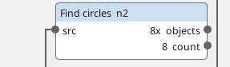
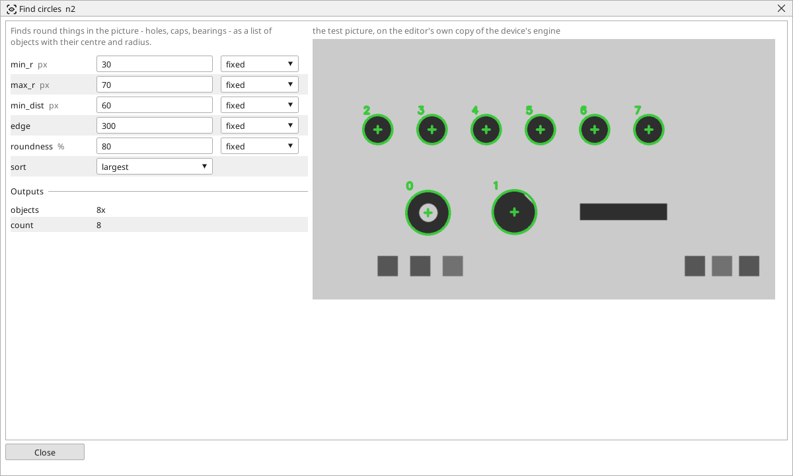

<!-- AUTOMATICALLY GENERATED from schema/visu-vision.yaml (tools/gen_vision.py) -->

# Find circles

**Finding objects** · in the trade: *Hough circle transform* · in a project file: `circles`

Finds round things in the picture - holes, caps, bearings - as a list of objects with their centre and radius.

{: .sb-center}

{: .sb-center}

## Where it runs

| Linux runtime, 64-bit | Linux runtime, 32-bit ARM | ESP32 boards | STM32 |
|:---:|:---:|:---:|:---:|
| yes | - | - | - |

**Needs:** a camera of the project (a USB camera or a stream address).

## Description

Finds round things - holes, caps, bearings, bottle mouths seen from above - as a list of objects with their centre and radius (the Hough circle transform). It works on the edges of a gray picture, so it needs no threshold, and it finds a circle even when its outline is broken.

Give it the radius range (`min_r`..`max_r`) tightly: a wide range finds more false circles and takes longer. `min_dist` stops one circle being reported twice; `edge` is the contrast of the circle's edge (lower finds fainter circles); `roundness` is how perfect a circle must be - lower it for circles seen slightly from the side, at the price of false ones. The window draws every circle it found with its number. For the exact diameter of ONE circle whose rough place is known, [Circle (fit)](vision-circle_fit.md) is more precise.

## Typical uses

- holes in a plate found with their centres
- caps and bottle mouths seen from above
- a rough centre for a Circle (fit) or an Unroll ring

## Inputs

| Input | Type | Meaning |
|:---|:---:|:---|
| `src` | picture | a gray or colour picture |

## Outputs

| Output | Type | Meaning |
|:---|:---:|:---|
| `objects` | list of objects | the circles, each with its centre and radius |
| `count` | number | how many circles were found |

A number or a yes/no output goes into a variable of the PLC program (right-click the block on the Vision page, *Result ... into*); a text output into a STRING variable; a picture or a list of objects into the next block.

## Settings

| Setting | Range | Default | Unit | Meaning |
|:---|:---:|:---:|:---:|:---|
| `min_r` | 1 .. 4096 | 10 | px | smallest radius |
| `max_r` | 1 .. 4096 | 200 | px | largest radius |
| `min_dist` | 1 .. 4096 | 20 | px | two centres closer than this are one circle |
| `edge` | 1 .. 1000 | 300 |  | the contrast of the circle's edge |
| `roundness` | 1 .. 100 | 80 | % | how perfect a circle must be (lower finds more |
| `sort` | largest / left_to_right / top_to_bottom | largest |  | which circle is number 0 |

Every number and yes/no setting can be read from a **variable** before each run instead of being fixed - pick it in the list beside the setting (the variable column of [the block's window](vision.md#the-blocks-window)). A text setting takes a STRING variable the same way.

---

Every block: [Vision blocks](vision-blocks.md) · how a program is drawn and what its window shows: [Vision](vision.md) · the cameras: [Cameras](cameras.md)
