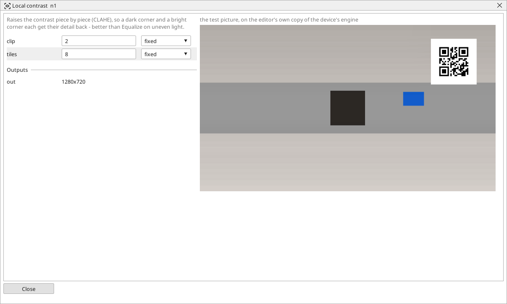

<!-- AUTOMATICALLY GENERATED from schema/visu-vision.yaml (tools/gen_vision.py) -->

# Local contrast

**Filters** · in the trade: *CLAHE (contrast limited adaptive histogram equalisation)* · in a project file: `clahe`

Raises the contrast piece by piece (CLAHE), so a dark corner and a bright corner each get their detail back - better than Equalize on uneven light.

{: .sb-center}

Raises the contrast piece by piece. The picture is split into `tiles` x `tiles` tiles and the shades of each tile are spread over the whole range on its own, with the tiles blended so that no seam shows; `clip` limits how far the contrast may be pushed so that noise in a flat tile is not amplified into texture. A dark corner and a bright corner each get their detail back - which [Equalize light](vision-equalize.md), working on the whole picture at once, cannot do.

Use it on unevenly lit scenes before a threshold or a reader. A larger `clip` gives more contrast and more noise; eight tiles each way suits a 1280 x 720 picture.

## Typical uses

- a dark corner and a bright corner each with their detail
- unevenly lit scenes before a threshold or a reader

## Inputs

| Input | Type | Meaning |
|:---|:---:|:---|
| `src` | picture | an unevenly lit picture |

## Outputs

| Output | Type | Meaning |
|:---|:---:|:---|
| `out` | picture | the picture with the contrast raised in every part |

A number or a yes/no output goes into a variable of the PLC program (right-click the block on the Vision page, *Result ... into*); a text output into a STRING variable; a picture or a list of objects into the next block.

## Settings

| Setting | Range | Default | Unit | Meaning |
|:---|:---:|:---:|:---:|:---|
| `clip` | 0.5 .. 40 | 2 |  | how far the contrast may be pushed (more = stronger |
| `tiles` | 1 .. 32 | 8 |  | the picture is split into this many tiles each way |

Every number and yes/no setting can be read from a **variable** before each run instead of being fixed - pick it in the list beside the setting (the variable column of [the block's window](vision.md#the-blocks-window)). A text setting takes a STRING variable the same way.

---

Every block: [Vision blocks](vision-blocks.md) · how a program is drawn and what its window shows: [Vision](vision.md) · the cameras: [Cameras](cameras.md)
