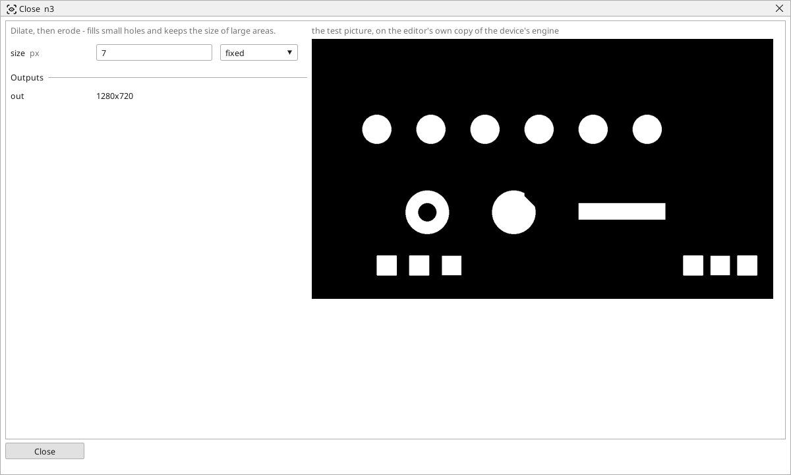

<!-- AUTOMATICALLY GENERATED from schema/visu-vision.yaml (tools/gen_vision.py) -->

# Close

**Shapes** · in the trade: *morphological closing* · in a project file: `close`

Dilate, then erode - fills small holes and keeps the size of large areas.

{: .sb-center}

A dilate followed by an erode with the same brush. Holes, cracks and gaps narrower than the brush are filled in the dilate and stay filled after the erode, while the shapes keep their size and place. A part whose threshold came out with pinholes, a printed outline with breaks, a code's bars broken by a scratch - Close makes them whole before the next block counts or measures them.

Choose `size` just above the widest gap to fill. Holes larger than the brush stay; [Fill holes](vision-fill_holes.md) fills any hole, whatever its size.

## Typical uses

- pinholes in a part filled
- a broken outline made whole
- the bars of a scratched code joined

## Inputs

| Input | Type | Meaning |
|:---|:---:|:---|
| `src` | picture | a black-and-white picture |

## Outputs

| Output | Type | Meaning |
|:---|:---:|:---|
| `out` | picture | the picture with the small holes and gaps filled |

A number or a yes/no output goes into a variable of the PLC program (right-click the block on the Vision page, *Result ... into*); a text output into a STRING variable; a picture or a list of objects into the next block.

## Settings

| Setting | Range | Default | Unit | Meaning |
|:---|:---:|:---:|:---:|:---|
| `size` | 1 .. 51 | 3 | px | size of the brush |

Every number and yes/no setting can be read from a **variable** before each run instead of being fixed - pick it in the list beside the setting (the variable column of [the block's window](vision.md#the-blocks-window)). A text setting takes a STRING variable the same way.

---

Every block: [Vision blocks](vision-blocks.md) · how a program is drawn and what its window shows: [Vision](vision.md) · the cameras: [Cameras](cameras.md)
