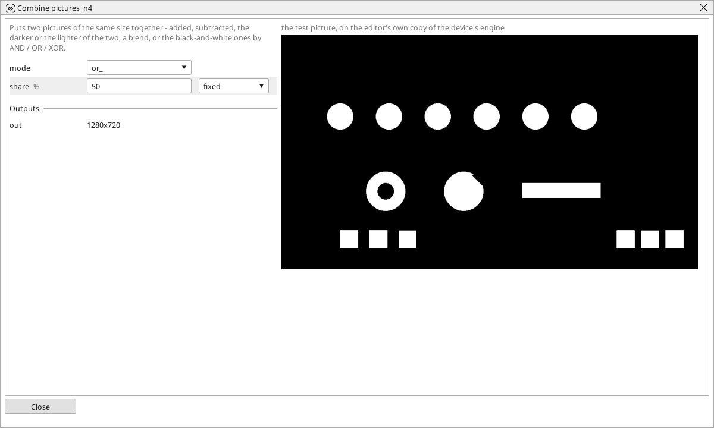

<!-- AUTOMATICALLY GENERATED from schema/visu-vision.yaml (tools/gen_vision.py) -->

# Combine pictures

**Filters** · in the trade: *image arithmetic, boolean image operations* · in a project file: `combine`

Puts two pictures of the same size together - added, subtracted, the darker or the lighter of the two, a blend, or the black-and-white ones by AND / OR / XOR.

{: .sb-center}

Puts two pictures of the same size together point by point. `add` and `subtract` do what they say; `min` keeps the darker of the two and `max` the lighter; `blend` mixes them with `share` percent of the first; `and_`, `or_` and `xor_` are for black-and-white pictures - white where both are white, where either is, where exactly one is.

AND of two colour ranges finds what is red AND bright; OR of two thresholds finds the parts of two shades at once; a picture AND a mask keeps only what lies inside the mask ([Mask](vision-mask.md) does that in one block, with a colour picture too). The two pictures must have the same size - crop or resize them alike.

## Typical uses

- red AND bright with two colour ranges
- two shades of parts with OR
- a picture blended with a reference for the operator

## Inputs

| Input | Type | Meaning |
|:---|:---:|:---|
| `a` | picture | the first picture |
| `b` | picture | the second picture, the same size |

## Outputs

| Output | Type | Meaning |
|:---|:---:|:---|
| `out` | picture | the two put together as `mode` says |

A number or a yes/no output goes into a variable of the PLC program (right-click the block on the Vision page, *Result ... into*); a text output into a STRING variable; a picture or a list of objects into the next block.

## Settings

| Setting | Range | Default | Unit | Meaning |
|:---|:---:|:---:|:---:|:---|
| `mode` | add / subtract / and_ / or_ / xor_ / min / max / blend | add |  | how the two are put together (and_ / or_ / xor_ for black-and-white pictures) |
| `share` | 0 .. 100 | 50 | % | the first picture's share in a blend |

Every number and yes/no setting can be read from a **variable** before each run instead of being fixed - pick it in the list beside the setting (the variable column of [the block's window](vision.md#the-blocks-window)). A text setting takes a STRING variable the same way.

---

Every block: [Vision blocks](vision-blocks.md) · how a program is drawn and what its window shows: [Vision](vision.md) · the cameras: [Cameras](cameras.md)
