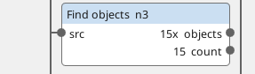
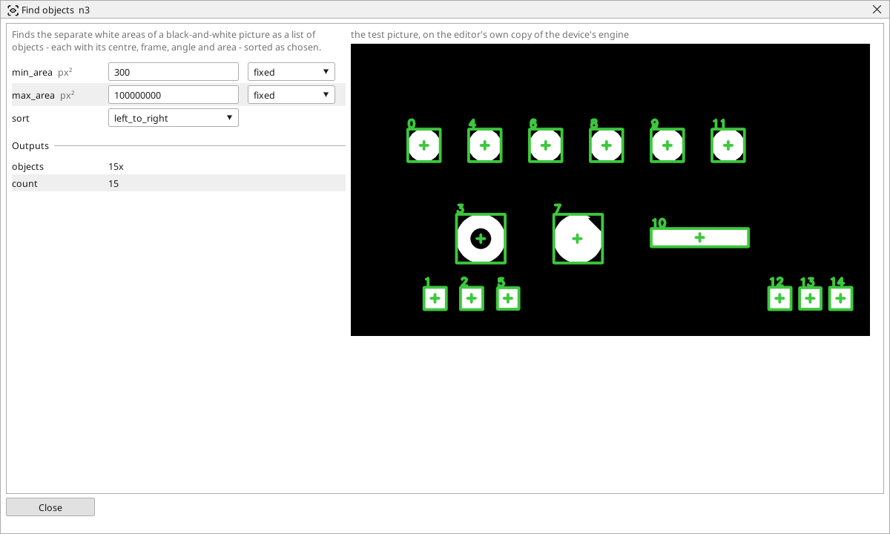

<!-- AUTOMATICALLY GENERATED from schema/visu-vision.yaml (tools/gen_vision.py) -->

# Find objects

**Finding objects** · in the trade: *blob analysis, connected components, contour extraction* · in a project file: `contours`

Finds the separate white areas of a black-and-white picture as a list of objects - each with its centre, frame, angle and area - sorted as chosen.

{: .sb-center}

{: .sb-center}

## Where it runs

| Linux runtime, 64-bit | Linux runtime, 32-bit ARM | ESP32 boards | STM32 |
|:---:|:---:|:---:|:---:|
| yes | - | - | - |

**Needs:** a camera of the project (a USB camera or a stream address).

## Description

Finds the separate white areas of a black-and-white picture and hands them on as a **list of objects**, each with its centre, its frame, its angle and its area. It is the block that turns a threshold into things: the parts on a tray, the holes in a plate, the pills in a blister, the drops on a nozzle - and the blocks after it ([Pick object](vision-pick.md), [Check objects](vision-objcheck.md), [Filter objects](vision-filter_objects.md), [Crop to object](vision-crop_object.md)) take the list.

`min_area` and `max_area` throw away what is too small (noise) or too large (the belt). `sort` decides which object is number 0: the largest, the leftmost or the topmost - so that a Pick object always means the same one. The window shows every object framed and numbered in the order of the list.

The picture must be black and white with the objects WHITE: a threshold, a colour range or an Invert before it. Objects that touch are one object - an [Open](vision-open.md) or a [Distance map](vision-distance.md) separates them.

## Typical uses

- the parts on a tray as a list, largest first
- the holes in a plate counted and measured
- the pills in a blister handed on to Check objects

## Inputs

| Input | Type | Meaning |
|:---|:---:|:---|
| `src` | picture | a black-and-white picture, the objects white |

## Outputs

| Output | Type | Meaning |
|:---|:---:|:---|
| `objects` | list of objects | the list of objects, sorted as `sort` says |
| `count` | number | how many objects were found |

A number or a yes/no output goes into a variable of the PLC program (right-click the block on the Vision page, *Result ... into*); a text output into a STRING variable; a picture or a list of objects into the next block.

## Settings

| Setting | Range | Default | Unit | Meaning |
|:---|:---:|:---:|:---:|:---|
| `min_area` | 1 .. 10000000 | 50 | px² | smaller areas are not objects |
| `max_area` | 1 .. 100000000 | 100000000 | px² | larger areas are not objects |
| `sort` | largest / left_to_right / top_to_bottom | largest |  | which object is number 0 |

Every number and yes/no setting can be read from a **variable** before each run instead of being fixed - pick it in the list beside the setting (the variable column of [the block's window](vision.md#the-blocks-window)). A text setting takes a STRING variable the same way.

---

Every block: [Vision blocks](vision-blocks.md) · how a program is drawn and what its window shows: [Vision](vision.md) · the cameras: [Cameras](cameras.md)
