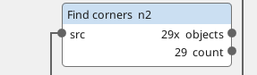
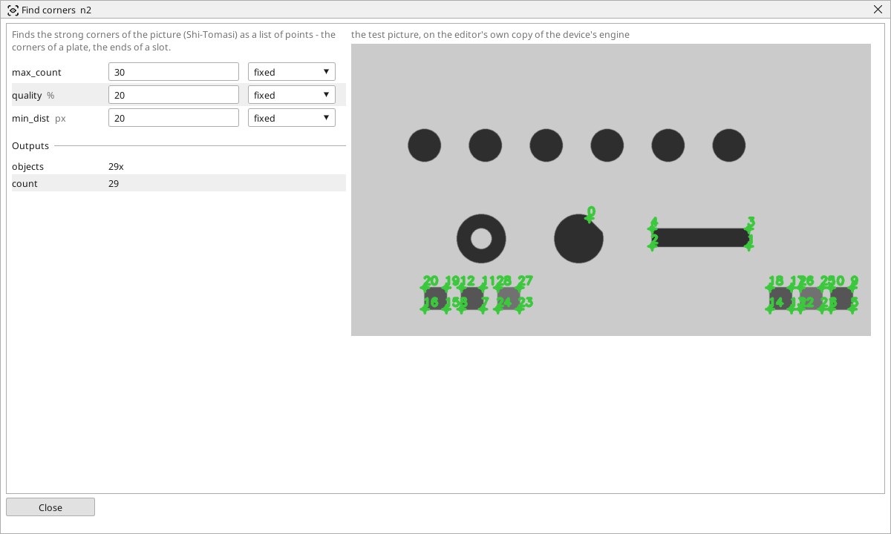

<!-- AUTOMATICALLY GENERATED from schema/visu-vision.yaml (tools/gen_vision.py) -->

# Find corners

**Finding objects** · in the trade: *corner detection (Shi-Tomasi)* · in a project file: `corners`

Finds the strong corners of the picture (Shi-Tomasi) as a list of points - the corners of a plate, the ends of a slot.

{: .sb-center}

{: .sb-center}

## Where it runs

| Linux runtime, 64-bit | Linux runtime, 32-bit ARM | ESP32 boards | STM32 |
|:---:|:---:|:---:|:---:|
| yes | - | - | - |

**Needs:** a camera of the project (a USB camera or a stream address).

## Description

Finds the strong corners of the picture - the corners of a plate, the ends of a slot, the points of a star wheel - as a list of points (the Shi-Tomasi detector). Each corner is an object with its position; `max_count` limits how many, the strongest first, `quality` drops corners weaker than that share of the strongest, and `min_dist` keeps two corners that are closer than that apart from being one.

It works on a gray picture without a threshold. A [Nearest object](vision-nearest.md) after it picks the corner near a known place, a [Distance of points](vision-points_dist.md) measures between two of them.

## Typical uses

- the corners of a plate for a Distance of points
- the ends of a slot
- the points of a star wheel

## Inputs

| Input | Type | Meaning |
|:---|:---:|:---|
| `src` | picture | a gray or colour picture |

## Outputs

| Output | Type | Meaning |
|:---|:---:|:---|
| `objects` | list of objects | the corners, strongest first, each a point |
| `count` | number | how many corners were found |

A number or a yes/no output goes into a variable of the PLC program (right-click the block on the Vision page, *Result ... into*); a text output into a STRING variable; a picture or a list of objects into the next block.

## Settings

| Setting | Range | Default | Unit | Meaning |
|:---|:---:|:---:|:---:|:---|
| `max_count` | 1 .. 500 | 50 |  | at most this many corners |
| `quality` | 1 .. 100 | 10 | % | a corner weaker than this share of the strongest is dropped |
| `min_dist` | 1 .. 500 | 10 | px | two corners closer than this are one |

Every number and yes/no setting can be read from a **variable** before each run instead of being fixed - pick it in the list beside the setting (the variable column of [the block's window](vision.md#the-blocks-window)). A text setting takes a STRING variable the same way.

---

Every block: [Vision blocks](vision-blocks.md) · how a program is drawn and what its window shows: [Vision](vision.md) · the cameras: [Cameras](cameras.md)
