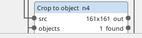
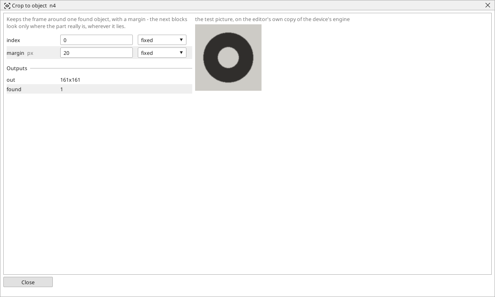

<!-- AUTOMATICALLY GENERATED from schema/visu-vision.yaml (tools/gen_vision.py) -->

# Crop to object

**Finding objects** · in the trade: *dynamic region of interest* · in a project file: `crop_object`

Keeps the frame around one found object, with a margin - the next blocks look only where the part really is, wherever it lies.

{: .sb-center}

{: .sb-center}

## Where it runs

| Linux runtime, 64-bit | Linux runtime, 32-bit ARM | ESP32 boards | STM32 |
|:---:|:---:|:---:|:---:|
| yes | - | - | - |

**Needs:** a camera of the project (a USB camera or a stream address).

## Description

Cuts the frame around one found object out of a picture, with `margin` pixels added on every side, and hands that cut-out on. The blocks after it look only where the part really is, wherever it lies: a code reader on the label that was found by its colour, a Colour check on the cap found by Find circles, a Compare with taught on the part found by Find pattern.

It takes two inputs: the picture to cut from and the list of objects (the two must be in the same coordinates - the list found on a cropped picture does not fit the whole one). *found* is off when the list is shorter than `index`, and the output is then the whole picture.

## Typical uses

- a code read on the label that was found by its colour
- a Colour check on the cap found by Find circles
- a Compare with taught on the part wherever it lies

## Inputs

| Input | Type | Meaning |
|:---|:---:|:---|
| `src` | picture | the picture to cut from |
| `objects` | list of objects | the list of objects found in that picture |

## Outputs

| Output | Type | Meaning |
|:---|:---:|:---|
| `out` | picture | the frame of the chosen object plus the margin, as a picture |
| `found` | yes/no | the list has an object at that index |

A number or a yes/no output goes into a variable of the PLC program (right-click the block on the Vision page, *Result ... into*); a text output into a STRING variable; a picture or a list of objects into the next block.

## Settings

| Setting | Range | Default | Unit | Meaning |
|:---|:---:|:---:|:---:|:---|
| `index` | 0 .. 10000 | 0 |  | which object (0 = the first) |
| `margin` | 0 .. 4096 | 10 | px | added around the object's frame |

Every number and yes/no setting can be read from a **variable** before each run instead of being fixed - pick it in the list beside the setting (the variable column of [the block's window](vision.md#the-blocks-window)). A text setting takes a STRING variable the same way.

---

Every block: [Vision blocks](vision-blocks.md) · how a program is drawn and what its window shows: [Vision](vision.md) · the cameras: [Cameras](cameras.md)
