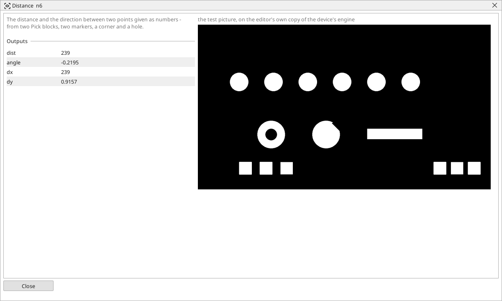

<!-- AUTOMATICALLY GENERATED from schema/visu-vision.yaml (tools/gen_vision.py) -->

# Distance

**Measurements** · in the trade: *point-to-point distance and direction* · in a project file: `dist`

The distance and the direction between two points given as numbers - from two Pick blocks, two markers, a corner and a hole.

{: .sb-center}

The distance and the direction between two points given as numbers - from two [Pick object](vision-pick.md) blocks, two markers, a corner and a hole, a found centre and a typed one. Beside the distance it gives the angle of the line between them (0 = to the right, 90 = up) and the two components *dx*, *dy*, which a positioning program uses directly.

The newer [Distance of points](vision-points_dist.md) does the same with a scale input and a tolerance built in; Distance stays for programs that want the angle and the components.

## Typical uses

- the offset of a part from its nominal place, as dx/dy for a correction
- the angle between two found points
- the distance of a feature from a marker

## Inputs

| Input | Type | Meaning |
|:---|:---:|:---|
| `x1` | number (optional) | the first point's x |
| `y1` | number (optional) | the first point's y |
| `x2` | number (optional) | the second point's x |
| `y2` | number (optional) | the second point's y |

## Outputs

| Output | Type | Meaning |
|:---|:---:|:---|
| `dist` | number | the distance between the points, in pixels |
| `angle` | number | the direction from the first to the second point, in degrees (0 right, 90 up, -90 down) |
| `dx` | number | x2 - x1 |
| `dy` | number | y2 - y1 |

A number or a yes/no output goes into a variable of the PLC program (right-click the block on the Vision page, *Result ... into*); a text output into a STRING variable; a picture or a list of objects into the next block.

## Settings

The block has no settings.

---

Every block: [Vision blocks](vision-blocks.md) · how a program is drawn and what its window shows: [Vision](vision.md) · the cameras: [Cameras](cameras.md)
