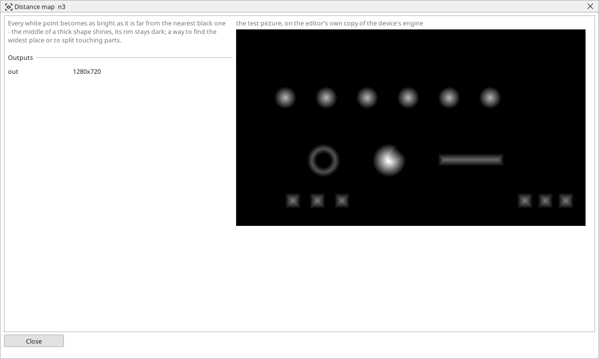

<!-- AUTOMATICALLY GENERATED from schema/visu-vision.yaml (tools/gen_vision.py) -->

# Distance map

**Shapes** · in the trade: *distance transform* · in a project file: `distance`

Every white point becomes as bright as it is far from the nearest black one - the middle of a thick shape shines, its rim stays dark; a way to find the widest place or to split touching parts.

{: .sb-center}

Turns a black-and-white picture into a map of distances: every white point becomes as bright as it is far from the nearest black one, so the middle of a thick shape shines and its rim stays dark. Two things follow from it. A threshold on the map at half the parts' width splits touching parts - two pills that touch share a thin neck, which is dark on the map, and come out as two shapes. And the brightest point of the map is the widest place of a shape: where a round part can be gripped, how wide a bead of glue is at its widest.

The map's brightness is clipped at 255 pixels of distance.

## Typical uses

- touching parts split by a threshold on the map
- the widest place of a shape
- the centre line of a thick stroke

## Inputs

| Input | Type | Meaning |
|:---|:---:|:---|
| `src` | picture | a black-and-white picture |

## Outputs

| Output | Type | Meaning |
|:---|:---:|:---|
| `out` | picture | the distance map: brighter the farther from the nearest black point |

A number or a yes/no output goes into a variable of the PLC program (right-click the block on the Vision page, *Result ... into*); a text output into a STRING variable; a picture or a list of objects into the next block.

## Settings

The block has no settings.

---

Every block: [Vision blocks](vision-blocks.md) · how a program is drawn and what its window shows: [Vision](vision.md) · the cameras: [Cameras](cameras.md)
