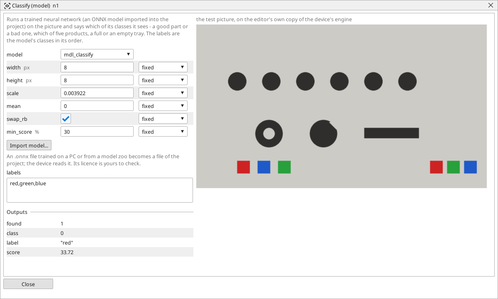

<!-- AUTOMATICALLY GENERATED from schema/visu-vision.yaml (tools/gen_vision.py) -->

# Classify (model)

**Learned models** · in the trade: *deep learning inference, image classification, ONNX* · in a project file: `dnn_classify`

Runs a trained neural network (an ONNX model imported into the project) on the picture and says which of its classes it sees - a good part or a bad one, which of five products, a full or an empty tray. The labels are the model's classes in its order.

{: .sb-center}

Runs a trained neural network - an ONNX model imported into the project - on the picture and says which of its classes the picture is: a good part or a bad one, which of five products, a full or an empty tray, a scratch or no scratch. *class* is the class number, *label* its name from `labels`, *score* how sure the model is, *found* whether the best class reaches `min_score`. It is for the things no rule describes - a defect of any shape, a part that is "wrong" in a hundred ways.

The model is not trained on the device: it is trained on a PC from pictures you collected (a few hundred good ones and bad ones are a start, collected with **Take a picture from the device**), or taken from a model zoo, and exported as ONNX. Press **Import model...** in the block's window; the file becomes a file of the project. The settings say what the model expects - its input `width` and `height`, whether the picture goes in as 0..1 (`scale` 1/255) or 0..255, with a `mean` taken off, as RGB (`swap_rb`) or BGR - and `labels` lists the classes in the model's order. On a Raspberry Pi 4 a small classifier takes tens of milliseconds; run it on a [Crop](vision-crop.md) of the part, on a trigger. The model file carries its own licence - check it before you build a product on a downloaded one.

## Typical uses

- good / bad on a part no rule describes
- which of several products is on the belt
- a surface defect of any shape

## Inputs

| Input | Type | Meaning |
|:---|:---:|:---|
| `src` | picture | the picture (resized to the model's input by the block) |

## Outputs

| Output | Type | Meaning |
|:---|:---:|:---|
| `found` | yes/no | the best class reached min_score |
| `class` | number | the number of the best class |
| `label` | text | its name from the labels setting (the number as text when labels is empty) |
| `score` | number | how sure the model is, in percent |

A number or a yes/no output goes into a variable of the PLC program (right-click the block on the Vision page, *Result ... into*); a text output into a STRING variable; a picture or a list of objects into the next block.

## Settings

| Setting | Range | Default | Unit | Meaning |
|:---|:---:|:---:|:---:|:---|
| `model` | text | (empty) |  | the model (an .onnx file imported into the project) |
| `labels` | text | (empty) |  | the class names in the model's order, separated by commas (empty = the class number) |
| `width` | 8 .. 2048 | 224 | px | the model's input width |
| `height` | 8 .. 2048 | 224 | px | the model's input height |
| `scale` | 0 .. 1 | 0.003922 |  | the input is multiplied by this (0.003922 = 1/255 for a model trained on 0..1) |
| `mean` | 0 .. 255 | 0 |  | taken off every channel before scaling |
| `swap_rb` | yes / no | yes |  | the model wants RGB (most do) rather than BGR |
| `min_score` | 0 .. 100 | 50 | % | a class below this is not found |

Every number and yes/no setting can be read from a **variable** before each run instead of being fixed - pick it in the list beside the setting (the variable column of [the block's window](vision.md#the-blocks-window)). A text setting takes a STRING variable the same way.

## On the block's window

- **Import model...** - a button in the window: an `.onnx` file (at most 64 MB) becomes a file of the project and the setting `model` names it.

---

Every block: [Vision blocks](vision-blocks.md) · how a program is drawn and what its window shows: [Vision](vision.md) · the cameras: [Cameras](cameras.md)
