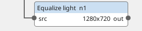
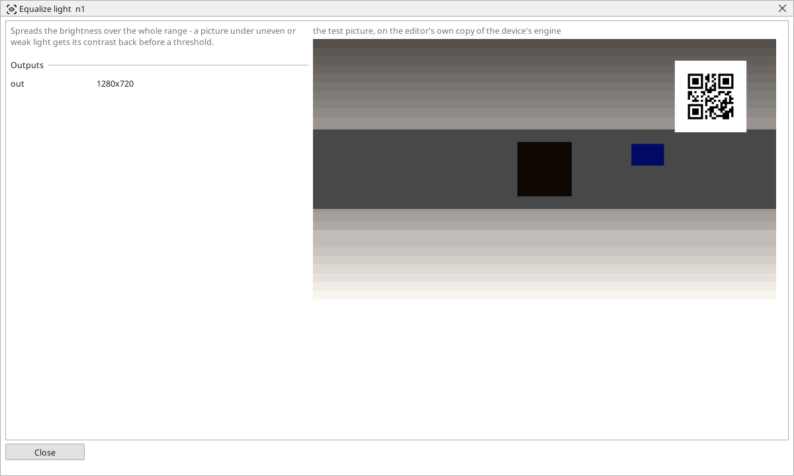

<!-- AUTOMATICALLY GENERATED from schema/visu-vision.yaml (tools/gen_vision.py) -->

# Equalize light

**Filters** · in the trade: *histogram equalisation* · in a project file: `equalize`

Spreads the brightness over the whole range - a picture under uneven or weak light gets its contrast back before a threshold.

{: .sb-center}

{: .sb-center}

## Where it runs

| Linux runtime, 64-bit | Linux runtime, 32-bit ARM | ESP32 boards | STM32 |
|:---:|:---:|:---:|:---:|
| yes | - | - | - |

**Needs:** a camera of the project (a USB camera or a stream address).

## Description

Spreads the brightness of the picture over the whole range from black to white (histogram equalisation). A picture that is dull because the lamp is weak, or that uses only the dark half of the shades, gets its contrast back - a threshold after it has something to cut.

It works on the whole picture at once: a picture with a bright corner and a dark corner is stretched as one and the dark corner stays dark. For that case [Local contrast](vision-clahe.md) stretches each part of the picture on its own. For a picture that only needs the darkest point made black and the brightest white, [Stretch contrast](vision-normalize.md) is the gentler choice.

## Typical uses

- a dull picture under a weak lamp
- contrast for a threshold on a low-contrast part

## Inputs

| Input | Type | Meaning |
|:---|:---:|:---|
| `src` | picture | a dull picture |

## Outputs

| Output | Type | Meaning |
|:---|:---:|:---|
| `out` | picture | the picture with its shades spread over the whole range |

A number or a yes/no output goes into a variable of the PLC program (right-click the block on the Vision page, *Result ... into*); a text output into a STRING variable; a picture or a list of objects into the next block.

## Settings

The block has no settings.

---

Every block: [Vision blocks](vision-blocks.md) · how a program is drawn and what its window shows: [Vision](vision.md) · the cameras: [Cameras](cameras.md)
