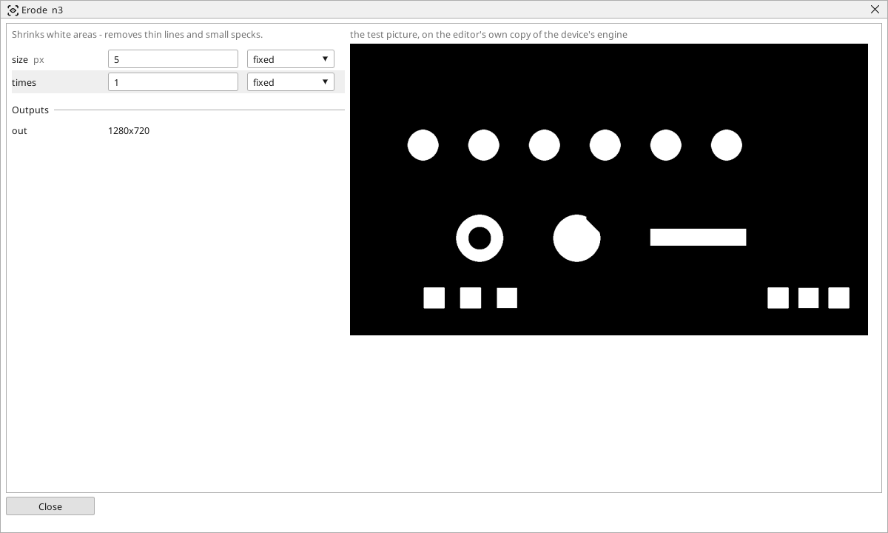

<!-- AUTOMATICALLY GENERATED from schema/visu-vision.yaml (tools/gen_vision.py) -->

# Erode

**Shapes** · in the trade: *morphological erosion* · in a project file: `erode`

Shrinks white areas - removes thin lines and small specks.

{: .sb-center}

Shrinks every white area of a black-and-white picture by a brush of `size` pixels, `times` over. Thin lines and specks smaller than the brush disappear, two parts joined by a thin bridge come apart, and every shape loses a rim of that width - which [Dilate](vision-dilate.md) afterwards gives back.

It is the cleaner to put after a threshold that left noise in the background; three pixels once is the usual dose. A shape that must keep its exact size is better served by [Open](vision-open.md), which erodes and dilates in one step.

## Typical uses

- specks removed after a threshold
- two parts joined by a thin bridge separated

## Inputs

| Input | Type | Meaning |
|:---|:---:|:---|
| `src` | picture | a black-and-white picture (white shapes on black) |

## Outputs

| Output | Type | Meaning |
|:---|:---:|:---|
| `out` | picture | the picture with the white areas shrunk |

A number or a yes/no output goes into a variable of the PLC program (right-click the block on the Vision page, *Result ... into*); a text output into a STRING variable; a picture or a list of objects into the next block.

## Settings

| Setting | Range | Default | Unit | Meaning |
|:---|:---:|:---:|:---:|:---|
| `size` | 1 .. 51 | 3 | px | size of the brush |
| `times` | 1 .. 20 | 1 |  | how many times |

Every number and yes/no setting can be read from a **variable** before each run instead of being fixed - pick it in the list beside the setting (the variable column of [the block's window](vision.md#the-blocks-window)). A text setting takes a STRING variable the same way.

---

Every block: [Vision blocks](vision-blocks.md) · how a program is drawn and what its window shows: [Vision](vision.md) · the cameras: [Cameras](cameras.md)
