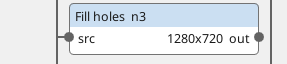
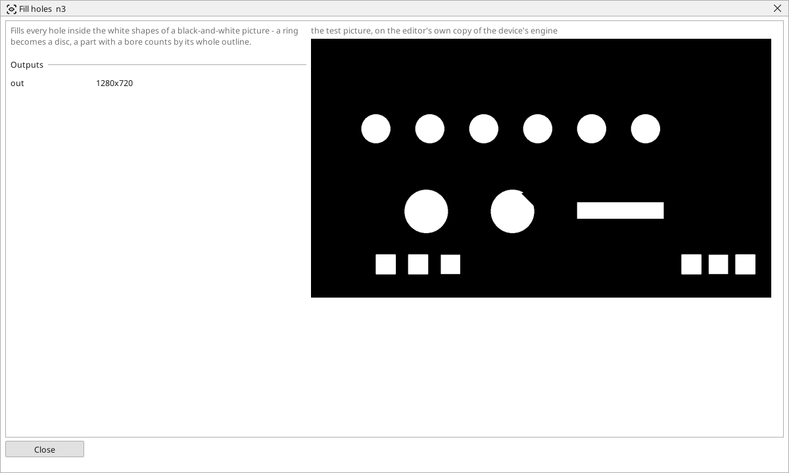

<!-- AUTOMATICALLY GENERATED from schema/visu-vision.yaml (tools/gen_vision.py) -->

# Fill holes

**Shapes** · in the trade: *hole filling* · in a project file: `fill_holes`

Fills every hole inside the white shapes of a black-and-white picture - a ring becomes a disc, a part with a bore counts by its whole outline.

{: .sb-center}

{: .sb-center}

## Where it runs

| Linux runtime, 64-bit | Linux runtime, 32-bit ARM | ESP32 boards | STM32 |
|:---:|:---:|:---:|:---:|
| yes | - | - | - |

**Needs:** a camera of the project (a USB camera or a stream address).

## Description

Fills every hole inside the white shapes of a black-and-white picture, whatever its size: a ring becomes a disc, a washer counts by its whole outline, a part with a bore or a window is measured as a solid shape. Only holes that are closed all round are filled; a bay open to the background stays.

Put it before [Find objects](vision-contours.md) when the holes would otherwise be counted as separate objects or spoil an area measurement, and before [Mask](vision-mask.md) when the whole part should be kept including its holes.

## Typical uses

- a ring or a washer counted by its whole outline
- a part with a bore as one solid shape
- a mask that covers the part including its holes

## Inputs

| Input | Type | Meaning |
|:---|:---:|:---|
| `src` | picture | a black-and-white picture |

## Outputs

| Output | Type | Meaning |
|:---|:---:|:---|
| `out` | picture | the picture with every enclosed hole made white |

A number or a yes/no output goes into a variable of the PLC program (right-click the block on the Vision page, *Result ... into*); a text output into a STRING variable; a picture or a list of objects into the next block.

## Settings

The block has no settings.

---

Every block: [Vision blocks](vision-blocks.md) · how a program is drawn and what its window shows: [Vision](vision.md) · the cameras: [Cameras](cameras.md)
