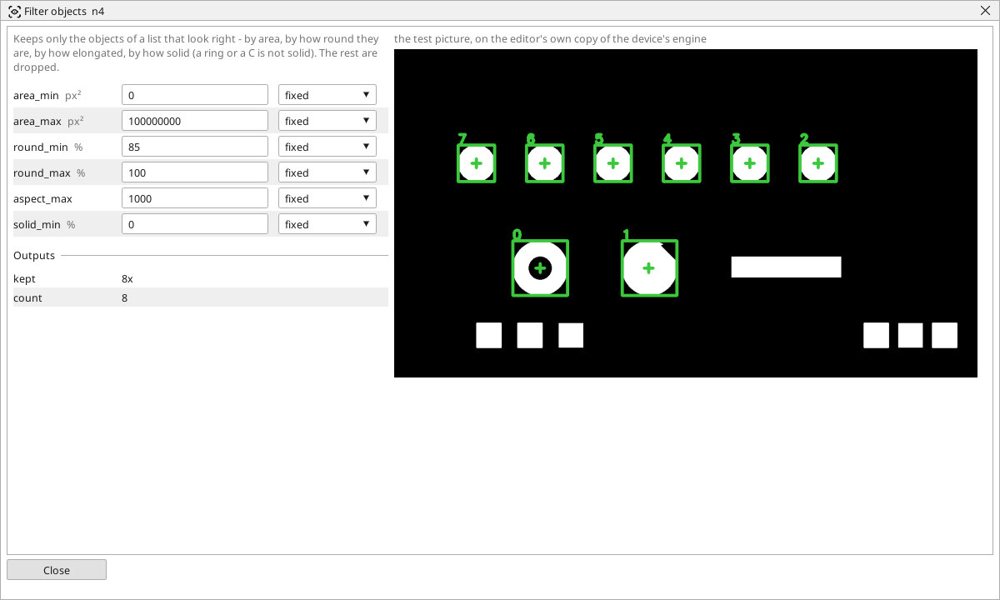

<!-- AUTOMATICALLY GENERATED from schema/visu-vision.yaml (tools/gen_vision.py) -->

# Filter objects

**Finding objects** · in the trade: *blob filtering by shape features* · in a project file: `filter_objects`

Keeps only the objects of a list that look right - by area, by how round they are, by how elongated, by how solid (a ring or a C is not solid). The rest are dropped.

{: .sb-center}

Keeps only the objects of a list that look right and drops the rest. Four measures, each with its limits: the area (`area_min`..`area_max`), the roundness (100 for a disc, 0 for a line), the aspect (the longest side over the shortest - a square is 1, a bar 5) and the solidity (a filled shape is 100, a ring or a C much less). An object has to pass every limit to be kept.

It is how a list from [Find objects](vision-contours.md) becomes "the round ones", "the long ones", "the ones with a hole" - and then [Check objects](vision-objcheck.md) counts what passed, or [Pick object](vision-pick.md) takes the first. The kept list keeps the sorting of the input.

## Typical uses

- only the round parts of a tray
- only the long parts (a bar, not a chip)
- only the solid ones (a disc, not a ring)

## Inputs

| Input | Type | Meaning |
|:---|:---:|:---|
| `objects` | list of objects | the list to filter |

## Outputs

| Output | Type | Meaning |
|:---|:---:|:---|
| `kept` | list of objects | the objects that passed every limit, in their old order |
| `count` | number | how many were kept |

A number or a yes/no output goes into a variable of the PLC program (right-click the block on the Vision page, *Result ... into*); a text output into a STRING variable; a picture or a list of objects into the next block.

## Settings

| Setting | Range | Default | Unit | Meaning |
|:---|:---:|:---:|:---:|:---|
| `area_min` | 0 .. 100000000 | 0 | px² | smallest area kept |
| `area_max` | 0 .. 100000000 | 100000000 | px² | largest area kept |
| `round_min` | 0 .. 100 | 0 | % | least roundness kept (a disc is 100 |
| `round_max` | 0 .. 100 | 100 | % | most roundness kept |
| `aspect_max` | 1 .. 1000 | 1000 |  | longest side over shortest side |
| `solid_min` | 0 .. 100 | 0 | % | least solidity kept (a filled shape is 100 |

Every number and yes/no setting can be read from a **variable** before each run instead of being fixed - pick it in the list beside the setting (the variable column of [the block's window](vision.md#the-blocks-window)). A text setting takes a STRING variable the same way.

---

Every block: [Vision blocks](vision-blocks.md) · how a program is drawn and what its window shows: [Vision](vision.md) · the cameras: [Cameras](cameras.md)
