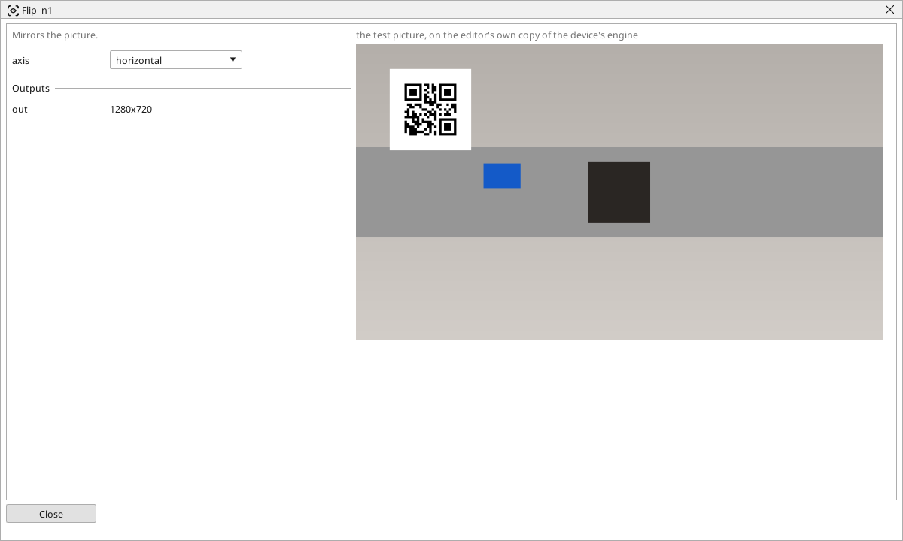

<!-- AUTOMATICALLY GENERATED from schema/visu-vision.yaml (tools/gen_vision.py) -->

# Flip

**Geometry** · in the trade: *mirroring* · in a project file: `flip`

Mirrors the picture.

{: .sb-center}

Mirrors the picture left-right, top-bottom or both. A camera that looks into a mirror, or one mounted so that the belt runs the wrong way on the screen, gives a picture people read more easily after this block. A taught pattern is found as taught: teach it after the Flip, not before.

## Typical uses

- a camera that looks into a mirror
- a belt that runs the wrong way on the screen

## Inputs

| Input | Type | Meaning |
|:---|:---:|:---|
| `src` | picture | the picture to mirror |

## Outputs

| Output | Type | Meaning |
|:---|:---:|:---|
| `out` | picture | the mirrored picture |

A number or a yes/no output goes into a variable of the PLC program (right-click the block on the Vision page, *Result ... into*); a text output into a STRING variable; a picture or a list of objects into the next block.

## Settings

| Setting | Range | Default | Unit | Meaning |
|:---|:---:|:---:|:---:|:---|
| `axis` | horizontal / vertical / both | horizontal |  | which way |

Every number and yes/no setting can be read from a **variable** before each run instead of being fixed - pick it in the list beside the setting (the variable column of [the block's window](vision.md#the-blocks-window)). A text setting takes a STRING variable the same way.

---

Every block: [Vision blocks](vision-blocks.md) · how a program is drawn and what its window shows: [Vision](vision.md) · the cameras: [Cameras](cameras.md)
