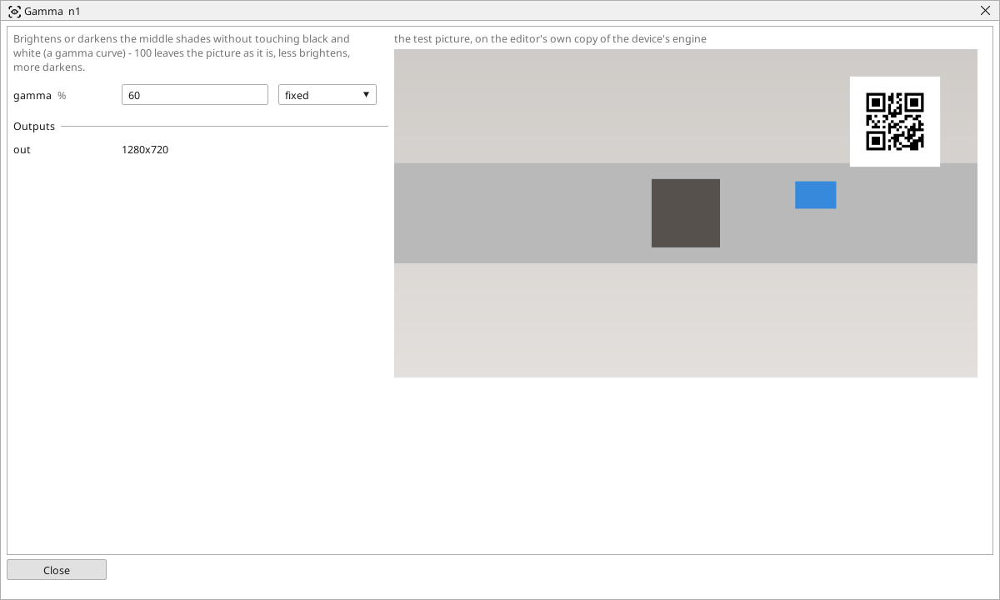

<!-- AUTOMATICALLY GENERATED from schema/visu-vision.yaml (tools/gen_vision.py) -->

# Gamma

**Filters** · in the trade: *gamma correction* · in a project file: `gamma`

Brightens or darkens the middle shades without touching black and white (a gamma curve) - 100 leaves the picture as it is, less brightens, more darkens.

{: .sb-center}

Brightens or darkens the middle shades while black stays black and white stays white (a gamma curve). Below 100 % the middle shades come up - the detail in a dark part or a shadow becomes visible; above 100 % they go down - a washed-out, overexposed label gets its contrast back. 100 leaves the picture as it is.

It is the first setting to turn when a reader or a finder fails on a picture that is simply too dark or too bright, and the shipped code-reading example puts it on the screen for the operator for that reason.

## Typical uses

- detail brought up in a dark part
- a washed-out label given its contrast back

## Inputs

| Input | Type | Meaning |
|:---|:---:|:---|
| `src` | picture | the picture to correct |

## Outputs

| Output | Type | Meaning |
|:---|:---:|:---|
| `out` | picture | the picture with its middle shades moved |

A number or a yes/no output goes into a variable of the PLC program (right-click the block on the Vision page, *Result ... into*); a text output into a STRING variable; a picture or a list of objects into the next block.

## Settings

| Setting | Range | Default | Unit | Meaning |
|:---|:---:|:---:|:---:|:---|
| `gamma` | 10 .. 500 | 100 | % | 100 = unchanged; 50 = brighter middle; 200 = darker middle |

Every number and yes/no setting can be read from a **variable** before each run instead of being fixed - pick it in the list beside the setting (the variable column of [the block's window](vision.md#the-blocks-window)). A text setting takes a STRING variable the same way.

## Used in

- The reTerminal with EtherCAT (the code reader) - a shipped example project

---

Every block: [Vision blocks](vision-blocks.md) · how a program is drawn and what its window shows: [Vision](vision.md) · the cameras: [Cameras](cameras.md)
