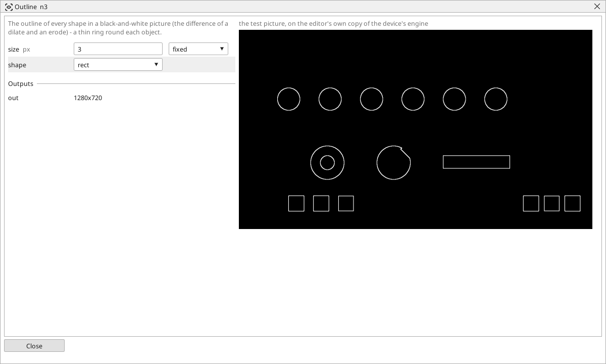

<!-- AUTOMATICALLY GENERATED from schema/visu-vision.yaml (tools/gen_vision.py) -->

# Outline

**Shapes** · in the trade: *morphological gradient* · in a project file: `gradient`

The outline of every shape in a black-and-white picture (the difference of a dilate and an erode) - a thin ring round each object.

{: .sb-center}

Draws the outline of every white shape of a black-and-white picture: the difference of a dilate and an erode leaves a ring of `size` pixels round each shape and nothing inside it. On a gray picture it marks the edges in every direction at once, thicker and stronger than [Edges](vision-canny.md), without the thresholds.

Use it to measure a part's perimeter with [White share](vision-white_ratio.md), to feed [Find lines](vision-lines.md) with the sides of a plate, or simply to show an operator where the shapes were found.

## Typical uses

- the outline of every found shape
- the perimeter of a part as a white share
- the sides of a plate for Find lines

## Inputs

| Input | Type | Meaning |
|:---|:---:|:---|
| `src` | picture | a black-and-white picture (a gray one works too) |

## Outputs

| Output | Type | Meaning |
|:---|:---:|:---|
| `out` | picture | the outlines, white on black |

A number or a yes/no output goes into a variable of the PLC program (right-click the block on the Vision page, *Result ... into*); a text output into a STRING variable; a picture or a list of objects into the next block.

## Settings

| Setting | Range | Default | Unit | Meaning |
|:---|:---:|:---:|:---:|:---|
| `size` | 1 .. 99 | 3 | px | the thickness of the outline |
| `shape` | rect / ellipse / cross | rect |  | the shape of the structuring element |

Every number and yes/no setting can be read from a **variable** before each run instead of being fixed - pick it in the list beside the setting (the variable column of [the block's window](vision.md#the-blocks-window)). A text setting takes a STRING variable the same way.

---

Every block: [Vision blocks](vision-blocks.md) · how a program is drawn and what its window shows: [Vision](vision.md) · the cameras: [Cameras](cameras.md)
